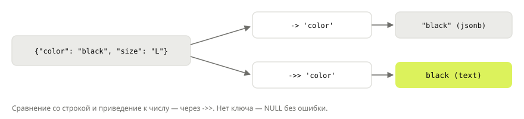

## Теория
У разных товаров разные характеристики: у ноутбука — объём памяти, у футболки — размер, у книги — ничего. Заводить столбец под каждую характеристику — десятки пустых столбцов. В учебной базе они лежат в одном столбце `products.attributes` типа **`jsonb`**: `{"color": "black", "size": "M"}`.

`jsonb` хранит JSON в разобранном двоичном виде: ключи упорядочены, повторы убраны, по нему быстро искать. Тип `json` хранит исходный текст как есть (с порядком ключей и пробелами) и разбирает его при каждом обращении — он нужен редко, например чтобы сохранить JSON ровно как пришёл.

**Достать значение:**
- `attributes -> 'color'` — значение как **`jsonb`**: строка в кавычках, `"black"`;
- `attributes ->> 'color'` — значение как **`text`**: `black`. Для сравнения со строкой и вывода нужен `->>`;
- `attributes #>> '{dims,width}'` — по пути во вложенном объекте;
- нет такого ключа — NULL, без ошибки.

`->>` всегда даёт текст, а текст сравнивается по алфавиту: `'8' >= '16'` — TRUE, потому что `'8'` > `'1'`. Числа приводят: `(attributes ->> 'ram_gb')::int >= 16`.

**Проверить:**
- `attributes @> '{"color": "black"}'` — содержит ли документ эти пары (можно несколько сразу);
- `attributes ? 'size'` — есть ли ключ.

**Изменить:** `attributes || '{"warranty_months": 24}'` — добавить или заменить ключи; `jsonb_set(attributes, '{color}', '"graphite"')` — заменить по пути (новое значение — тоже JSON, поэтому строка в двойных кавычках внутри одинарных); `attributes - 'size'` — удалить ключ.

**Индекс.** `CREATE INDEX ON products USING gin (attributes)` ускоряет `@>` и `?` по всему документу. Для частого фильтра по одному ключу строят обычный индекс по выражению: `CREATE INDEX ON products ((attributes ->> 'color'))`. Подробно об индексах — в разделе «Производительность».

Когда **не** использовать JSONB: для полей, по которым постоянно фильтруют, сортируют и соединяют, и для обязательных данных с ограничениями — цена, остаток, ссылка на категорию. У них должен быть свой столбец с типом, `NOT NULL` и `CHECK`.

## Наглядно
**Рисунок 1.** `->` возвращает JSON, `->>` — текст.



**Таблица 1.** Операторы JSONB.

| Запись | Результат для `{"color": "black", "size": "L"}` |
|---|---|
| `-> 'color'` | `"black"` (`jsonb`) |
| `->> 'color'` | `black` (`text`) |
| `->> 'weight'` | NULL — ключа нет |
| `@> '{"size": "L"}'` | TRUE |
| `? 'size'` | TRUE |
| `\|\| '{"size": "M"}'` | `{"color": "black", "size": "M"}` |
| `- 'size'` | `{"color": "black"}` |

## На практике
Задача: найти товары по характеристикам и обновить характеристики.

### Шаг 1. -> и ->>
Цвет трёх товаров — как JSON и как текст:
```sql
SELECT id, name,
       attributes -> 'color' AS json_color,
       attributes ->> 'color' AS text_color
FROM products
WHERE id IN (1, 4, 8);
```
Результат:
```
 id |        name        | json_color | text_color
----+--------------------+------------+------------
  1 | Ноутбук Aster 14   | "silver"   | silver
  4 | Беспроводная мышь  | "black"    | black
  8 | USB-хаб на 4 порта |            |
(3 rows)
```
У USB-хаба `attributes` пустой (`{}`), ключа нет — NULL.

### Шаг 2. Фильтр по ключу
Чёрные товары:
```sql
SELECT id, name
FROM products
WHERE attributes ->> 'color' = 'black'
ORDER BY id;
```
Результат:
```
 id |          name
----+-------------------------
  4 | Беспроводная мышь
  5 | Проводная мышь
  7 | Коврик для мыши
  9 | Веб-камера
 10 | Смартфон Pixelon 8
 13 | Чехол для смартфона
 16 | Футболка базовая чёрная
 17 | Футболка с принтом
(8 rows)
```
С `->` запрос упал бы: `'black'` сравнивалось бы с `jsonb`, и PostgreSQL попытался бы прочитать `black` как JSON — `invalid input syntax for type json`.

### Шаг 3. Несколько условий сразу
Чёрные товары размера L — оператор `@>`:
```sql
SELECT id, name
FROM products
WHERE attributes @> '{"color": "black", "size": "L"}'
ORDER BY id;
```
Результат:
```
 id |          name
----+-------------------------
  7 | Коврик для мыши
 16 | Футболка базовая чёрная
(2 rows)
```

### Шаг 4. Число из JSON
Ноутбуки с памятью от 16 ГБ — значение приводим к числу:
```sql
SELECT id, name, (attributes ->> 'ram_gb')::int AS ram_gb
FROM products
WHERE (attributes ->> 'ram_gb')::int >= 16
ORDER BY id;
```
Результат:
```
 id |         name         | ram_gb
----+----------------------+--------
  1 | Ноутбук Aster 14     |     16
  2 | Ноутбук Aster 16 Pro |     32
(2 rows)
```
Без приведения `'8' >= '16'` — TRUE, и в ответ попал бы Nimbus Air с 8 ГБ.

### Шаг 5. Изменить документ
Добавить гарантию ноутбуку 1:
```sql
UPDATE products
SET attributes = attributes || '{"warranty_months": 24}'
WHERE id = 1
RETURNING id, attributes;
```
Результат:
```
 id |                        attributes
----+----------------------------------------------------------
  1 | {"color": "silver", "ram_gb": 16, "warranty_months": 24}
(1 row)

UPDATE 1
```

## Частые ошибки
- **`->` вместо `->>` при сравнении со строкой.** `jsonb = 'black'` — ошибка разбора JSON.
- **Сравнение чисел текстом.** `->>` даёт текст; `'8' >= '16'` — TRUE. Приводите `::int`, `::numeric`.
- **Опечатка в ключе.** `->> 'colour'` молча даёт NULL — ошибки нет, просто пустой результат.
- **Строка в `jsonb_set` без JSON-кавычек.** Значение — JSON: `'"graphite"'`, а не `'graphite'`.
- **Важные поля в JSONB.** Цена, остаток, ссылки — в обычных столбцах с ограничениями.

## Итог
**Чтение**
- `->` — `jsonb`, `->>` — `text`; нет ключа — NULL.
- Числа из JSON — с приведением типа.

**Поиск и изменение**
- `@>` — содержит пары, `?` — есть ключ; ускоряет индекс GIN.
- `||` — добавить/заменить ключи, `jsonb_set` — по пути, `-` — удалить ключ.

**Когда**
- Разные необязательные характеристики — JSONB; основные поля — столбцы.

## Вопросы на собеседовании
<details><summary>Чем `json` отличается от `jsonb`?</summary>

`json` хранит исходный текст (с пробелами, порядком и повторами ключей) и разбирает его при каждой операции. `jsonb` хранит разобранную двоичную форму: быстрее в запросах, поддерживает операторы `@>`, `?` и индекс GIN, но не сохраняет порядок ключей и пробелы. Почти всегда берут `jsonb`.
</details>

<details><summary>Чем `->` отличается от `->>`?</summary>

`->` возвращает значение как `jsonb` (строка остаётся в JSON-кавычках, объект — объектом, можно продолжать `->`), `->>` — как `text`. Для сравнения со строкой, вывода и приведения к числу нужен `->>`.
</details>

<details><summary>Когда хранить данные в JSONB, а когда — в столбцах?</summary>

JSONB — для данных с переменной структурой, которые читаются целиком или по редким ключам: характеристики товаров, настройки, ответы внешних API. Столбцы — для полей, по которым фильтруют, сортируют, соединяют и на которые нужны ограничения (`NOT NULL`, `CHECK`, внешние ключи): у JSONB их нет, а статистика планировщика по нему грубее.
</details>
