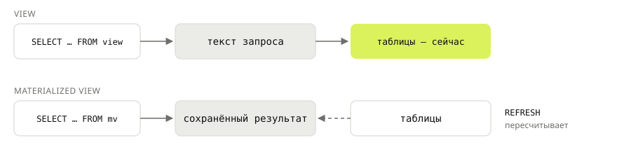

## Теория
CTE живёт один запрос. Если отчёт «выручка по категориям» нужен аналитику каждый день, запрос сохраняют в базе как **представление** (view):
```sql
CREATE VIEW category_revenue AS
SELECT c.name AS category, sum(oi.quantity * oi.price) AS revenue
FROM …;
```
Дальше к нему обращаются как к таблице: `SELECT * FROM category_revenue`. Представление **не хранит данные** — только текст запроса. При каждом обращении запрос выполняется заново, поэтому результат всегда актуален. Зачем это нужно:
- **один источник правды** — формула выручки записана в одном месте, а не скопирована в десять отчётов;
- **простой интерфейс** — аналитик пишет `SELECT … FROM category_revenue`, не зная о четырёх соединениях;
- **доступ** — можно дать право читать представление без права читать сами таблицы (например, без email покупателей).

Изменить представление — `CREATE OR REPLACE VIEW`, но только **добавляя** столбцы в конец: существующие столбцы нельзя переименовать, удалить или поменять местами — ошибка `cannot change name of view column`. Для этого представление удаляют (`DROP VIEW`) и создают заново. Простое представление над одной таблицей можно даже изменять (`UPDATE`); представление с `GROUP BY` или `JOIN` — только читать.

**Материализованное представление** (`CREATE MATERIALIZED VIEW`) **хранит результат**, как таблица. Читается быстро — тяжёлый запрос не выполняется заново, — но данные «застывают» на момент создания. Обновляет их команда `REFRESH MATERIALIZED VIEW имя`: запрос выполняется заново и результат заменяется. Пока идёт обновление, читать нельзя; вариант `REFRESH … CONCURRENTLY` не блокирует чтение, но требует уникального индекса на представлении. Обновление запускают по расписанию (раз в час, раз в ночь) — для отчётов, где минутная свежесть не нужна.

## Наглядно
**Рисунок 1.** Обычное представление хранит запрос, материализованное — результат.



**Таблица 1.** Представление и материализованное представление.

| | `VIEW` | `MATERIALIZED VIEW` |
|---|---|---|
| хранит | текст запроса | результат запроса |
| данные | всегда актуальны | на момент последнего `REFRESH` |
| скорость чтения | как у самого запроса | как у таблицы |
| индексы | нет (используются индексы таблиц) | можно создать |
| обновление | не нужно | `REFRESH MATERIALIZED VIEW` |

## На практике
Задача: отчёт «выручка по категориям» для аналитика — сначала как представление, потом как снимок.

### Шаг 1. Создать представление
Запрос выручки сохраняем под именем и сразу читаем из него:
```sql
CREATE VIEW category_revenue AS
SELECT c.name AS category, sum(oi.quantity * oi.price) AS revenue
FROM orders o
JOIN order_items oi ON oi.order_id = o.id
JOIN products p ON p.id = oi.product_id
JOIN categories c ON c.id = p.category_id
WHERE o.status <> 'cancelled'
GROUP BY c.id, c.name;

SELECT category, revenue
FROM category_revenue
ORDER BY revenue DESC
LIMIT 3;
```
Результат:
```
CREATE VIEW
  category  |  revenue
------------+-----------
 Смартфоны  | 271870.00
 Ноутбуки   | 254960.00
 Аксессуары |  48715.00
(3 rows)
```

### Шаг 2. Данные меняются — представление тоже
В заказе 22 вместо одного ноутбука стало два:
```sql
UPDATE order_items SET quantity = 2 WHERE id = 39;

SELECT category, revenue
FROM category_revenue
ORDER BY revenue DESC
LIMIT 3;
```
Результат:
```
UPDATE 1
  category  |  revenue
------------+-----------
 Ноутбуки   | 319950.00
 Смартфоны  | 271870.00
 Аксессуары |  48715.00
(3 rows)
```
Ноутбуки вышли на первое место: запрос представления выполнился заново.

### Шаг 3. Снимок
Материализованное представление сохраняет текущий результат; потом позицию возвращаем как было:
```sql
CREATE MATERIALIZED VIEW category_revenue_snapshot AS
SELECT * FROM category_revenue;

UPDATE order_items SET quantity = 1 WHERE id = 39;

SELECT category, revenue
FROM category_revenue_snapshot
WHERE category = 'Ноутбуки';
```
Результат:
```
SELECT 6
UPDATE 1
 category |  revenue
----------+-----------
 Ноутбуки | 319950.00
(1 row)
```
Снимок показывает старую выручку — данные застыли на момент создания. Обновляем:
```sql
REFRESH MATERIALIZED VIEW category_revenue_snapshot;

SELECT category, revenue
FROM category_revenue_snapshot
WHERE category = 'Ноутбуки';
```
Результат:
```
REFRESH MATERIALIZED VIEW
 category |  revenue
----------+-----------
 Ноутбуки | 254960.00
(1 row)
```

### Шаг 4. Изменить представление
Добавить число позиций — новым столбцом **между** существующими:
```sql
CREATE OR REPLACE VIEW category_revenue AS
SELECT c.name AS category, count(*) AS items, sum(oi.quantity * oi.price) AS revenue
FROM orders o
JOIN order_items oi ON oi.order_id = o.id
JOIN products p ON p.id = oi.product_id
JOIN categories c ON c.id = p.category_id
WHERE o.status <> 'cancelled'
GROUP BY c.id, c.name;
```
Результат:
```
ERROR:  cannot change name of view column "revenue" to "items"
HINT:  Use ALTER VIEW ... RENAME COLUMN ... to change name of view column instead.
```
`OR REPLACE` разрешает только дописывать столбцы в конец. `items` после `revenue` — пройдёт.

## Частые ошибки
- **Ожидание, что `VIEW` ускоряет запрос.** Обычное представление выполняет свой запрос при каждом чтении — быстрее он не становится.
- **Забытый `REFRESH`.** Материализованное представление показывает данные на момент последнего обновления.
- **Новый столбец в середине `CREATE OR REPLACE VIEW`.** Ошибка; новые столбцы — в конец, иначе `DROP VIEW` и создать заново.
- **`UPDATE` представления с `GROUP BY`.** Такое представление только для чтения: `cannot update view`.
- **`SELECT *` в определении.** Список столбцов фиксируется при создании; новые столбцы таблицы в представлении сами не появятся.

## Итог
**VIEW**
- Сохранённый запрос с именем; данных не хранит, всегда актуален.
- Один источник формул, простой интерфейс, разграничение доступа.
- `CREATE OR REPLACE` — только добавить столбцы в конец.

**MATERIALIZED VIEW**
- Хранит результат; читать быстро, данные — на момент `REFRESH`.
- `REFRESH MATERIALIZED VIEW` (`CONCURRENTLY` — без блокировки чтения, нужен уникальный индекс).

## Вопросы на собеседовании
<details><summary>Чем представление отличается от таблицы?</summary>

Таблица хранит данные, представление — только запрос. При чтении из представления PostgreSQL подставляет его запрос и выполняет его над таблицами, поэтому данные всегда актуальны, а скорость — как у самого запроса.
</details>

<details><summary>Когда нужно материализованное представление?</summary>

Когда запрос тяжёлый (агрегаты по миллионам строк), читается часто, а небольшое отставание данных допустимо: дашборды, отчёты, витрины. Результат хранится как таблица, по нему можно построить индексы; обновляют `REFRESH MATERIALIZED VIEW` по расписанию или после загрузки данных.
</details>

<details><summary>Как обновить материализованное представление, не блокируя чтение?</summary>

`REFRESH MATERIALIZED VIEW CONCURRENTLY имя` — PostgreSQL строит новый результат рядом и применяет разницу, читатели в это время видят старые данные. Для этого на представлении нужен уникальный индекс. Обычный `REFRESH` быстрее, но блокирует чтение на время обновления.
</details>
