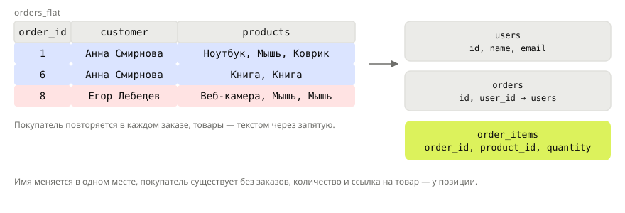

## Теория
Самый простой способ хранить заказы — одна таблица: номер заказа, почта и имя покупателя, список товаров строкой, сумма. Для отчёта в Excel это удобно, для базы магазина — нет. Каждый факт здесь записан много раз или склеен с другими, и из-за этого появляются **аномалии** — ситуации, когда данные портятся при обычной работе:
- **аномалия обновления** — покупательница сменила фамилию, а имя записано в каждом её заказе. Обновили одну строку — в базе стало две «версии» Анны;
- **аномалия вставки** — нельзя записать покупателя, пока он ничего не заказал: строка — это заказ;
- **аномалия удаления** — удалили единственный заказ Егора — пропали и его почта, и имя.

**Нормализация** — раскладывание данных по таблицам так, чтобы каждый факт хранился **один раз**, а связи держались на ключах. Нормальные формы — последовательные правила для этого. На практике достаточно трёх первых.

**Первая нормальная форма (1НФ):**
1. каждая ячейка хранит **одно значение** — не список через запятую, не JSON со списком того, по чему ищут и что связывают;
2. нет **повторяющихся групп столбцов** — `phone1`, `phone2`, `phone3`: сколько ни заведи, однажды не хватит, а пустые столбцы мешают искать;
3. у строки есть **первичный ключ**.

Список выносят в отдельную таблицу: телефоны — в `customer_phones (customer_id, phone)`, товары заказа — в `order_items`. Строка на значение, ключ — пара «владелец + значение» или свой `id`.

Почему список в ячейке плох, видно на поиске: «заказы с мышью» через `LIKE '%мышь%'` находит и «Беспроводную мышь», и «Проводную мышь», но не находит «Коврик для мыши» (другая форма слова) и не отличит товар от упоминания в названии. Количество придётся записывать повтором названия, а проверить внешним ключом, что товар существует, — нельзя.

## Наглядно
**Рисунок 1.** Таблица «всё в одном» и её раскладка по таблицам.



**Таблица 1.** Нарушения 1НФ.

| Нарушение | Пример | Как исправить |
|---|---|---|
| список в ячейке | `products = 'Ноутбук, Мышь'` | таблица-связка `order_items` |
| повторяющиеся столбцы | `phone1`, `phone2`, `phone3` | таблица `customer_phones` |
| составное значение, по частям которого ищут | `address = 'Казань, ул. Баумана, 12'` | столбцы `city`, `street`, … |
| нет ключа | две одинаковые строки | первичный ключ |

## На практике
Задача: посмотреть на аномалии плоской таблицы и разложить телефоны по 1НФ.

### Шаг 1. Плоская таблица
Три заказа «как в Excel»:
```sql
CREATE TABLE orders_flat (
    order_id       integer PRIMARY KEY,
    customer_email text NOT NULL,
    customer_name  text NOT NULL,
    products       text NOT NULL,
    total          numeric(10,2) NOT NULL
);
INSERT INTO orders_flat VALUES
    (1, 'anna.smirnova@example.com', 'Анна Смирнова', 'Ноутбук Aster 14, Беспроводная мышь, Коврик для мыши', 61770.00),
    (6, 'anna.smirnova@example.com', 'Анна Смирнова', 'Книга «Python с нуля», Книга «SQL на практике»', 3280.00),
    (8, 'egor.lebedev@example.com', 'Егор Лебедев', 'Веб-камера, Проводная мышь, Проводная мышь', 5170.00);
```
Результат:
```
CREATE TABLE
INSERT 0 3
```
У Егора две проводные мыши — количество приходится выражать повтором названия.

### Шаг 2. Поиск по списку
Заказы с мышью:
```sql
SELECT order_id, products
FROM orders_flat
WHERE products LIKE '%мышь%'
ORDER BY order_id;
```
Результат:
```
 order_id |                       products
----------+------------------------------------------------------
        1 | Ноутбук Aster 14, Беспроводная мышь, Коврик для мыши
        8 | Веб-камера, Проводная мышь, Проводная мышь
(2 rows)
```
Найдено по тексту, а не по товару: «Коврик для мыши» совпал случайно — в строке рядом есть «мышь». Чтобы найти заказы с ковриком отдельно от мышей, текст пришлось бы разбирать.

### Шаг 3. Аномалия обновления
Анна сменила фамилию, обновили один заказ:
```sql
UPDATE orders_flat SET customer_name = 'Анна Петрова' WHERE order_id = 6;

SELECT DISTINCT customer_email, customer_name
FROM orders_flat
ORDER BY customer_email, customer_name;
```
Результат:
```
UPDATE 1
      customer_email       | customer_name
---------------------------+---------------
 anna.smirnova@example.com | Анна Петрова
 anna.smirnova@example.com | Анна Смирнова
 egor.lebedev@example.com  | Егор Лебедев
(3 rows)
```
У одной почты — два имени. В учебной базе имя хранится один раз в `users`, и такого не случится.

### Шаг 4. Телефоны по 1НФ
Покупатели с телефонами в трёх столбцах и таблица, где телефон — строка:
```sql
CREATE TABLE customers (
    id     integer PRIMARY KEY,
    name   text NOT NULL,
    phone1 text,
    phone2 text,
    phone3 text
);
INSERT INTO customers VALUES
    (1, 'Анна', '+79001112233', '+79005550001', NULL),
    (2, 'Борис', '+79002223344', NULL, NULL),
    (3, 'Вера', NULL, NULL, NULL);

CREATE TABLE customer_phones (
    customer_id integer NOT NULL REFERENCES customers (id) ON DELETE CASCADE,
    phone       text    NOT NULL,
    PRIMARY KEY (customer_id, phone)
);
INSERT INTO customer_phones (customer_id, phone)
SELECT id, phone1 FROM customers WHERE phone1 IS NOT NULL
UNION ALL
SELECT id, phone2 FROM customers WHERE phone2 IS NOT NULL
UNION ALL
SELECT id, phone3 FROM customers WHERE phone3 IS NOT NULL;

SELECT customer_id, phone FROM customer_phones ORDER BY customer_id, phone;
```
Результат:
```
CREATE TABLE
INSERT 0 3
CREATE TABLE
INSERT 0 3
 customer_id |    phone
-------------+--------------
           1 | +79001112233
           1 | +79005550001
           2 | +79002223344
(3 rows)
```
Теперь телефонов сколько угодно, пустых ячеек нет, «у кого номер +7900…» — простой `WHERE phone = …`. Столбцы `phone1–3` после переноса удаляют.

## Частые ошибки
- **Список через запятую «пока так».** Поиск, количество, проверка ссылок — всё ломается; связка нужна с первого дня.
- **`phone1`, `phone2`, `phone3`.** Повторяющаяся группа; при четвёртом телефоне — `ALTER TABLE`.
- **Перенос со строками NULL.** При раскладке столбцов в строки пустые значения отфильтровывают — иначе строки с NULL или ошибка `NOT NULL`.
- **Атомарность до абсурда.** Имя не обязательно делить на буквы, а email — на части: делят то, по частям чего ищут и что связывают.
- **Массивы и JSON вместо связей.** `integer[]` с номерами товаров — то же «через запятую»: без внешних ключей.

## Итог
**Аномалии**
- Обновления — факт в нескольких местах; вставки — нельзя записать без лишнего; удаления — теряется соседний факт.

**1НФ**
- Одно значение в ячейке; без повторяющихся групп столбцов; есть первичный ключ.
- Список → отдельная таблица: строка на значение.

## Вопросы на собеседовании
<details><summary>Что такое нормализация и зачем она нужна?</summary>

Раскладывание данных по таблицам так, чтобы каждый факт хранился один раз, а связи держались на ключах. Убирает избыточность и аномалии обновления, вставки и удаления: имя покупателя меняется в одном месте, покупатель существует без заказов, удаление заказа не стирает покупателя.
</details>

<details><summary>Какие аномалии бывают в ненормализованной таблице?</summary>

Обновления — один факт записан в нескольких строках, и при изменении одной копии данные расходятся. Вставки — нельзя записать факт, не имея другого (покупателя без заказа). Удаления — удаление строки уносит факт, который в ней хранился попутно (последний заказ — и покупатель).
</details>

<details><summary>Нарушает ли столбец `jsonb` первую нормальную форму?</summary>

Формально — значение составное. Практически — зависит от использования: характеристики товара, которые читаются целиком и не связываются с другими таблицами, в `jsonb` хранить нормально. Список номеров товаров заказа или тегов — нарушение по смыслу: по ним ищут и их связывают, им нужны внешние ключи — значит, нужна таблица.
</details>
