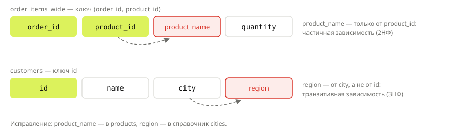

## Теория
Вторая и третья нормальные формы говорят об одном: **каждый неключевой столбец должен зависеть от ключа, от всего ключа и ни от чего, кроме ключа**.

**Функциональная зависимость** `A → B`: по значению `A` значение `B` определяется однозначно. Номер товара определяет его название (`product_id → name`), город — регион (`Казань → Татарстан`). Если в таблице `B` повторяется для каждого повтора `A`, это кандидат на отдельную таблицу.

**2НФ** — таблица в 1НФ, и неключевые столбцы зависят от **всего** первичного ключа, а не от его части. Актуально для составных ключей. В позиции заказа с ключом `(order_id, product_id)`:
- `quantity` зависит от пары — сколько **этого** товара в **этом** заказе — нормально;
- `product_name` зависит только от `product_id` — **частичная зависимость**: название повторяется в каждой позиции с этим товаром, переименование товара надо делать во всех заказах. Выносим в `products`.

А `order_items.price`? В некоторых конспектах её тоже называют частичной зависимостью от `product_id`. Это неверно для магазина: в позиции хранится цена **на момент покупки**, она зависит от пары «заказ — товар» — та же мышь стоила 1290 в ноябре и 1499 в апреле. Текущая цена — другой факт, он живёт в `products.price`. Подробнее — в теме «Денормализация».

**3НФ** — таблица во 2НФ, и неключевые столбцы не зависят **друг от друга** (нет **транзитивной** зависимости `ключ → A → B`). Если в `customers` есть `city` и `region`, то `id → city → region`: регион определяется городом, а не покупателем. У двух покупателей из Казани регион записан дважды — и однажды разойдётся («Татарстан» и «Республика Татарстан»). Выносим города в `cities (id, name, region)`, у покупателя — `city_id`.

Короткое правило для обеих форм: в строке таблицы — только факты **о том, что задаёт её ключ**. Факты о товаре — в `products`, о городе — в `cities`.

## Наглядно
**Рисунок 1.** Частичная и транзитивная зависимости.



**Таблица 1.** Нормальные формы.

| Форма | Правило | Нарушение | Исправление |
|---|---|---|---|
| 1НФ | одно значение в ячейке, есть ключ | `products = 'Ноутбук, Мышь'` | таблица-связка |
| 2НФ | зависимость от всего ключа | `order_items.product_name` при ключе `(order_id, product_id)` | название — в `products` |
| 3НФ | нет зависимостей между неключевыми | `customers.region` при наличии `city` | таблица `cities` |

## На практике
Задача: найти транзитивную зависимость в покупателях и увидеть, к чему она приводит.

### Шаг 1. Город и регион у покупателя
Покупатели с городом и регионом в одной таблице:
```sql
CREATE TABLE customers (
    id     integer PRIMARY KEY,
    name   text NOT NULL,
    city   text NOT NULL,
    region text NOT NULL
);
INSERT INTO customers VALUES
    (1, 'Анна', 'Москва', 'Москва'),
    (2, 'Глеб', 'Казань', 'Татарстан'),
    (3, 'Лидия', 'Казань', 'Республика Татарстан'),
    (4, 'Захар', 'Екатеринбург', 'Свердловская область');
```
Результат:
```
CREATE TABLE
INSERT 0 4
```

### Шаг 2. Сколько у Казани регионов
Пары «город — регион»:
```sql
SELECT DISTINCT city, region
FROM customers
ORDER BY city, region;
```
Результат:
```
     city     |        region
--------------+----------------------
 Екатеринбург | Свердловская область
 Казань       | Республика Татарстан
 Казань       | Татарстан
 Москва       | Москва
(4 rows)
```
Один город — два варианта региона: менеджер записал его по-разному. Отчёт «продажи по регионам» разделит Татарстан на два. Это аномалия обновления, и её причина — 3НФ нарушена: регион зависит от города, а хранится у покупателя.

### Шаг 3. Таблица городов
Факт «Казань — в Татарстане» должен храниться один раз:
```sql
CREATE TABLE cities (
    id     integer GENERATED ALWAYS AS IDENTITY PRIMARY KEY,
    name   text NOT NULL UNIQUE,
    region text NOT NULL
);
INSERT INTO cities (name, region)
SELECT DISTINCT city, region FROM customers;
```
Результат:
```
CREATE TABLE
ERROR:  duplicate key value violates unique constraint "cities_name_key"
DETAIL:  Key (name)=(Казань) already exists.
```
`UNIQUE` на названии города не пустил вторую Казань — противоречие пришлось бы разрешить до переноса: решить, какой регион верный, и исправить данные. После этого у `customers` появляется `city_id REFERENCES cities`, а `city` и `region` удаляются.

## Частые ошибки
- **Название товара в позиции заказа.** Частичная зависимость (2НФ): название — свойство товара.
- **Регион рядом с городом, категория-родитель рядом с категорией.** Транзитивная зависимость (3НФ).
- **Цена покупки за «нарушение 2НФ».** Цена в позиции — факт о покупке, а не о товаре; переносить её в `products` нельзя.
- **Перенос в справочник без проверки.** `SELECT DISTINCT` тащит в новую таблицу и все расхождения; сначала их находят и исправляют.
- **Нормализация ради нормализации.** Почтовый индекс → город формально транзитивен, но выносить индексы в справочник ради этого обычно незачем; решают по тому, меняется ли и используется ли факт отдельно.

## Итог
**Зависимости**
- `A → B` — по `A` однозначно определяется `B`.
- Частичная — от части составного ключа; транзитивная — через другой неключевой столбец.

**2НФ и 3НФ**
- 2НФ: неключевые столбцы зависят от всего ключа.
- 3НФ: неключевые столбцы не зависят друг от друга.
- Вместе: в строке — только факты о том, что задаёт её ключ.

## Вопросы на собеседовании
<details><summary>Чем 2НФ отличается от 3НФ?</summary>

2НФ запрещает зависимость неключевого столбца от части составного ключа (`product_name` в `order_items` с ключом `(order_id, product_id)`). 3НФ запрещает зависимость неключевого столбца от другого неключевого (`region` от `city` в `customers`). Обе лечатся выносом зависимого факта в отдельную таблицу.
</details>

<details><summary>Что такое транзитивная зависимость?</summary>

Зависимость через посредника: `id → city` и `city → region`, значит, `id → region` — но не напрямую, а через город. Из-за неё регион повторяется у всех покупателей одного города и может разойтись. Решение — справочник городов.
</details>

<details><summary>Является ли `order_items.price` нарушением нормальных форм?</summary>

Нет, если это цена на момент покупки: она зависит от пары «заказ — товар» (в разных заказах один товар стоил по-разному) и не вычисляется из текущей цены. Нарушением было бы хранить там текущую цену товара — тогда это копия `products.price`.
</details>
