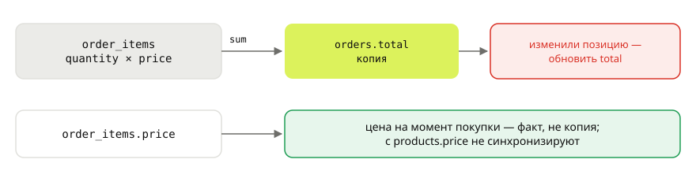

## Теория
Нормализованная схема хорошо хранит и меняет данные, но некоторые чтения в ней дорогие. Сумма заказа — это `sum(quantity * price)` по позициям; в списке «мои заказы» её считают для каждого заказа при каждом открытии страницы. Средняя оценка товара в каталоге — `avg(rating)` по всем отзывам для каждой карточки. **Денормализация** — осознанное хранение **вычислимого** значения рядом с данными: `orders.total`, `products.rating_avg`, `products.reviews_count`.

Это не ошибка, если сделано осознанно, но у неё есть цена: значение хранится **дважды** — в исходных данных и в копии, — и копия может разойтись с оригиналом. Изменили позицию заказа и забыли обновить `total` — в списке заказов одна сумма, в чеке другая. Поэтому денормализацию вводят, только когда:
- чтений намного больше, чем изменений;
- вычисление действительно дорогое (замеряли, а не предполагают);
- есть понятный способ держать копию в согласии: обновлять в той же транзакции, что и исходные данные, триггером или пересчётом по расписанию (материализованное представление — тоже денормализация).

И нужна **проверка** — запрос, который находит расхождения копии с оригиналом.

**Что денормализацией не является.** `order_items.price` — цена на момент покупки. Это не копия `products.price`: это отдельный исторический факт, который со временем не должен меняться вслед за прайсом. Так же адрес доставки в заказе — не копия адреса в профиле: покупатель мог переехать, а заказ ушёл по старому адресу. Такие «снимки» — правильная нормализованная модель, а не оптимизация.

И наоборот: если «сумму заказа» пересчитывать по **текущим** ценам товаров (`sum(oi.quantity * p.price)`), старые заказы будут «дорожать» вместе с прайсом — классическая ошибка в примерах из интернета.

## Наглядно
**Рисунок 1.** Копия значения ускоряет чтение, но требует синхронизации.



**Таблица 1.** Копия или факт.

| Столбец | Что это | Должен меняться вместе с источником? |
|---|---|---|
| `orders.total` | копия суммы позиций (денормализация) | да — иначе расхождение |
| `products.reviews_count` | копия `count(*)` отзывов (денормализация) | да |
| `order_items.price` | цена на момент покупки (факт) | нет |
| адрес доставки в заказе | адрес на момент заказа (факт) | нет |

## На практике
Задача: добавить заказам денормализованную сумму, заполнить её и научиться находить расхождения.

### Шаг 1. Столбец и заполнение
Сумма считается коррелированным подзапросом для каждого заказа — кроме последнего, 34-го, «забытого» при заполнении:
```sql
ALTER TABLE orders ADD COLUMN total numeric(10,2);

UPDATE orders o
SET total = (
    SELECT sum(oi.quantity * oi.price)
    FROM order_items oi
    WHERE oi.order_id = o.id
)
WHERE o.id <> 34;
```
Результат:
```
ALTER TABLE
UPDATE 33
```

### Шаг 2. Позиция изменилась, копия — нет
Покупатель добавил второй ноутбук в заказ 1, а код, меняющий позицию, о `total` не знает:
```sql
UPDATE order_items SET quantity = 2 WHERE id = 1;
```
Результат:
```
UPDATE 1
```

### Шаг 3. Найти расхождения
Сравниваем сохранённую сумму с вычисленной. `<>` не годится: у заказа 34 `total` — NULL, и `NULL <> 39990` — «неизвестно». Нужен `IS DISTINCT FROM`, для которого NULL — обычное значение:
```sql
SELECT o.id, o.total, s.actual
FROM orders o
JOIN (
    SELECT order_id, sum(quantity * price) AS actual
    FROM order_items
    GROUP BY order_id
) s ON s.order_id = o.id
WHERE o.total IS DISTINCT FROM s.actual
ORDER BY o.id;
```
Результат:
```
 id |  total   |  actual
----+----------+-----------
  1 | 61770.00 | 121760.00
 34 |          |  39990.00
(2 rows)
```
Обе проблемы найдены: устаревшая копия и незаполненная. Такую проверку запускают регулярно — или убирают причину: меняют `total` в той же транзакции, что и позиции.

## Частые ошибки
- **Денормализация «на будущее».** Без замеров и без плана синхронизации — только риск расхождений.
- **Обновление копии в другом месте кода.** Позиции поменяли, `total` — забыли. Меняйте в той же транзакции или триггером.
- **`<>` при поиске расхождений.** NULL-копии не находятся; нужен `IS DISTINCT FROM`.
- **Пересчёт истории по текущим ценам.** `sum(quantity * products.price)` меняет суммы старых заказов вслед за прайсом.
- **Снимок принят за копию.** Цену покупки и адрес доставки не «синхронизируют» с текущими.

## Итог
**Денормализация**
- Хранение вычислимого значения ради быстрого чтения: `total`, счётчики, средние.
- Цена — риск расхождения; нужна синхронизация и проверка.
- Вводят, когда чтений много, вычисление дорогое и есть способ держать копию верной.

**Снимки — не копии**
- Цена покупки, адрес доставки — факты момента, не меняются с источником.

## Вопросы на собеседовании
<details><summary>Что такое денормализация и когда она оправдана?</summary>

Осознанное дублирование данных — обычно вычислимых — ради скорости чтения: сумма заказа, число отзывов, рейтинг. Оправдана, когда чтений намного больше, чем записей, вычисление дорогое и есть надёжный способ поддерживать копию (та же транзакция, триггер, пересчёт по расписанию). Цена — риск расхождения и усложнение записи.
</details>

<details><summary>Почему цену товара в позиции заказа хранят отдельно от цены товара?</summary>

Это цена на момент покупки — исторический факт. Текущая цена меняется, а заказ, чек и отчёт о выручке должны оставаться прежними. Это не дублирование, а отдельные данные: если хранить только `products.price`, старые заказы «подорожают» вместе с прайсом.
</details>

<details><summary>Чем `IS DISTINCT FROM` отличается от `<>`?</summary>

`<>` с NULL даёт NULL («неизвестно»), и строка не проходит `WHERE`. `IS DISTINCT FROM` считает NULL обычным значением: `NULL IS DISTINCT FROM 5` — TRUE, `NULL IS DISTINCT FROM NULL` — FALSE. Нужен при сравнении столбцов, которые могут быть пустыми, — например, при сверке копии с источником.
</details>
