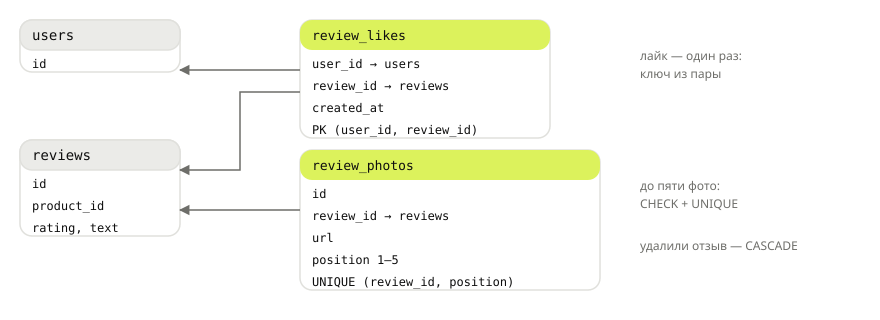

## Теория
Новая функция магазина начинается с описания словами: «к отзыву можно приложить до пяти фото; другие покупатели ставят отзыву лайк — один раз; на странице товара отзывы сортируются по числу лайков». Превратить такое описание в таблицы помогает порядок шагов.

**1. Сущности.** Выписать существительные и решить, какие из них — отдельные таблицы: фото отзыва, лайк. Признак таблицы — у сущности есть свои данные или их может быть **много** у одного владельца. «Лайк» — не поле `likes` у отзыва: тогда не узнать, **кто** лайкнул, и не запретить лайкнуть дважды. Это связь «покупатель — отзыв», и ей нужна своя таблица.

**2. Связи и их вид.** Для каждой пары — сколько с каждой стороны:
- отзыв — фото: 1:N, внешний ключ у фото;
- покупатель — отзыв через лайк: N:M, таблица-связка `review_likes (user_id, review_id)`.
Если у связи есть свои данные (время лайка, порядок фото), они живут в таблице связи.

**3. Столбцы и типы.** По смыслу значения: ссылки — `integer` с внешним ключом, время — `timestamptz`, адрес картинки — `text`, порядок — `smallint`.

**4. Ключи.** Свой `id` или составной ключ из пары. Для лайка естественный ключ — `(user_id, review_id)`: он сам запрещает второй лайк того же покупателя. Для фото — `id` (на фото могут ссылаться другие таблицы, а пара «отзыв + порядок» может меняться при перестановке).

**5. Ограничения — правила из описания.** «До пяти фото» и «порядок» → `CHECK (position BETWEEN 1 AND 5)` и `UNIQUE (review_id, position)`. «Один лайк» → первичный ключ пары. «Удалили отзыв — удалить его фото и лайки» → `ON DELETE CASCADE`. Всё, что можно проверить в базе, проверяют в базе.

**6. Запросы.** Проверить схему на вопросах, которые к ней будут задавать: «отзывы товара по числу лайков» — `LEFT JOIN review_likes … GROUP BY … ORDER BY count(…)`. Если запрос получается сложным или медленным — пересмотреть схему, добавить индекс или, осознанно, счётчик.

Типичные ошибки проектирования повторяют прошлые темы: флаг вместо связи («избранное» полем у товара), список в ячейке, копии без синхронизации, связь без уникальности пары.

## Наглядно
**Рисунок 1.** Схема новой функции: фото и лайки отзывов.



**Таблица 1.** От правила в описании — к ограничению.

| Из описания | В схеме |
|---|---|
| «лайк — один раз» | `PRIMARY KEY (user_id, review_id)` |
| «до пяти фото» | `CHECK (position BETWEEN 1 AND 5)` + `UNIQUE (review_id, position)` |
| «удалили отзыв — удалить фото и лайки» | `ON DELETE CASCADE` |
| «фото обязательно с адресом» | `url text NOT NULL` |
| «знать, когда лайкнули» | `created_at timestamptz NOT NULL DEFAULT now()` |

## На практике
Задача: создать таблицы фото и лайков отзывов и проверить, что правила работают.

### Шаг 1. Фото отзыва
Свой `id`, ссылка на отзыв и правила про порядок:
```sql
CREATE TABLE review_photos (
    id        integer  GENERATED ALWAYS AS IDENTITY PRIMARY KEY,
    review_id integer  NOT NULL REFERENCES reviews (id) ON DELETE CASCADE,
    url       text     NOT NULL,
    position  smallint NOT NULL CHECK (position BETWEEN 1 AND 5),
    UNIQUE (review_id, position)
);
```
Результат:
```
CREATE TABLE
```

### Шаг 2. Лайки
Связка с ключом из пары и временем лайка:
```sql
CREATE TABLE review_likes (
    user_id    integer     NOT NULL REFERENCES users (id) ON DELETE CASCADE,
    review_id  integer     NOT NULL REFERENCES reviews (id) ON DELETE CASCADE,
    created_at timestamptz NOT NULL DEFAULT now(),
    PRIMARY KEY (user_id, review_id)
);
```
Результат:
```
CREATE TABLE
```

### Шаг 3. Правила в деле
Три лайка отзыву 1, потом повторный лайк Бориса и шестое фото:
```sql
INSERT INTO review_likes (user_id, review_id) VALUES (2, 1), (3, 1), (4, 1);
INSERT INTO review_likes (user_id, review_id) VALUES (2, 1);
INSERT INTO review_photos (review_id, url, position) VALUES (1, 'https://cdn.example/r1-6.jpg', 6);
```
Результат:
```
INSERT 0 3
ERROR:  duplicate key value violates unique constraint "review_likes_pkey"
DETAIL:  Key (user_id, review_id)=(2, 1) already exists.
ERROR:  new row for relation "review_photos" violates check constraint "review_photos_position_check"
DETAIL:  Failing row contains (1, 1, https://cdn.example/r1-6.jpg, 6).
```
Оба правила из описания соблюдает база, а не код, который их «не забудет».

### Шаг 4. Запрос, ради которого всё делалось
Отзывы на ноутбук 1 по числу лайков:
```sql
SELECT r.id, r.rating, count(l.user_id) AS likes
FROM reviews r
LEFT JOIN review_likes l ON l.review_id = r.id
WHERE r.product_id = 1
GROUP BY r.id
ORDER BY likes DESC, r.id;
```
Результат:
```
 id | rating | likes
----+--------+-------
  1 |      5 |     3
 10 |      5 |     0
(2 rows)
```
`LEFT JOIN` и `count(l.user_id)` — чтобы отзыв без лайков остался с нулём.

## Частые ошибки
- **Флаг вместо связи.** `is_liked` или `likes integer` у отзыва — не видно, кто лайкнул, нельзя запретить повтор.
- **Связка без уникальности пары.** Свой `id` и никакого `UNIQUE (user_id, review_id)` — один покупатель лайкает сколько угодно раз.
- **Правило только в коде.** «До пяти фото» в форме, но не в базе — импорт или API обойдут.
- **Забытое `ON DELETE`.** Удаление отзыва упирается в его фото и лайки.
- **Схема без запросов.** Таблицы созданы, а главный запрос страницы не пишется — проверяйте схему на реальных вопросах сразу.

## Итог
**Шаги**
- Сущности → связи и их вид → столбцы и типы → ключи → ограничения → проверка запросами.

**Правила**
- Связь «многие ко многим» и связь с собственными данными — отдельная таблица.
- Уникальность пары — составным ключом или `UNIQUE`.
- Каждое правило из описания, которое можно проверить в базе, — ограничение.

## Вопросы на собеседовании
<details><summary>С чего начинают проектирование схемы базы?</summary>

С сущностей и связей: выписывают существительные из описания, решают, какие из них — таблицы, и для каждой пары определяют вид связи (1:1, 1:N, N:M). Потом — столбцы и типы, ключи, ограничения из бизнес-правил, и проверка схемы на основных запросах приложения.
</details>

<details><summary>Как хранить «избранное» или «лайки»?</summary>

Отдельной таблицей-связкой `(user_id, object_id)` с составным первичным ключом или `UNIQUE` на паре, внешними ключами с `ON DELETE CASCADE` и временем добавления. Поле-флаг у объекта не годится: у одного объекта много пользователей, и нужно знать, кто именно.
</details>

<details><summary>Как сделать подписку пользователя на пользователя?</summary>

Таблица `subscriptions (follower_id, following_id)`, обе колонки ссылаются на `users`, первичный ключ — пара (подписка одна), `CHECK (follower_id <> following_id)` — нельзя подписаться на себя. Это самосвязь «многие ко многим» через таблицу-связку.
</details>
