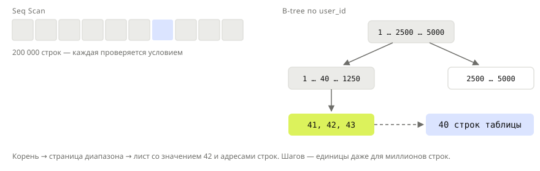

## Теория
Строки таблицы лежат в файле без порядка. Чтобы найти просмотры покупателя 42 среди 200 тысяч строк, базе без подсказки остаётся одно — прочитать **все** строки и проверить условие у каждой (Seq Scan, последовательное чтение). На учебных таблицах это незаметно, на миллионах строк — секунды на каждый запрос.

**Индекс** — отдельная структура, где значения столбца хранятся **упорядоченно** вместе со ссылками на строки таблицы. Основной вид в PostgreSQL — **B-tree** (сбалансированное дерево): чтобы найти значение, база спускается от корня к листу за несколько шагов — как по оглавлению книги, — и сразу получает адреса нужных строк. Порядок значений позволяет так же быстро искать диапазоны (`>`, `<`, `BETWEEN`), начало строки (`LIKE 'Ноут%'` — с оговорками про правила сортировки) и отдавать строки уже отсортированными для `ORDER BY`. Создаётся он так:
```sql
CREATE INDEX page_views_user_id_idx ON page_views (user_id);
```

**Что индекс стоит.** Каждый индекс — копия данных столбца на диске, и при каждом `INSERT`, `UPDATE` ключевого столбца и `DELETE` база обновляет все индексы таблицы. Десять индексов на таблице, куда постоянно пишут, — десять дополнительных записей на каждую вставку. Поэтому индексы создают **под конкретные запросы**, а не «на все столбцы».

**Какие индексы уже есть.** `PRIMARY KEY` и `UNIQUE` создают уникальный индекс сами — иначе база не могла бы быстро проверить уникальность. **Внешний ключ индекс не создаёт**: `orders.user_id` ссылается на `users`, но поиск заказов покупателя без отдельного индекса читает всю таблицу заказов. Индексы на столбцы внешних ключей обычно добавляют вручную (Django делает это сам).

**Когда индекс не нужен.** Маленькая таблица (как все таблицы учебной базы) читается целиком быстрее, чем через индекс, — и планировщик выберет Seq Scan, даже если индекс есть. Условие, которому соответствует большая часть строк (`status = 'shipped'` у 65 % заказов), тоже выгоднее проверить чтением подряд. Решение принимает **планировщик** по статистике таблицы; посмотреть его выбор — `EXPLAIN` (тема 3).

**Про «кластеризованный индекс».** В конспектах и статьях про MySQL и SQL Server встречается «кластеризованный индекс, который физически упорядочивает строки». В PostgreSQL такого нет: таблица хранится отдельно от индексов, первичный ключ — обычный B-tree. Команда `CLUSTER` переупорядочивает строки по индексу один раз, но новые строки порядок не поддерживают.

## Наглядно
**Рисунок 1.** Поиск без индекса и с индексом.



**Таблица 1.** Индексы, которые есть, и которые нужны.

| Что | Индекс |
|---|---|
| `PRIMARY KEY`, `UNIQUE` | создаётся автоматически |
| внешний ключ (`orders.user_id`) | **не** создаётся — добавить, если по нему ищут |
| столбец из частого `WHERE` / `ORDER BY` | добавить под запрос |
| таблица на десятки строк | не нужен |
| столбец, который почти у всех строк одинаковый | обычно не поможет |

## На практике
Задача: таблица просмотров товаров на 200 тысяч строк, поиск просмотров покупателя — без индекса и с индексом.

### Шаг 1. Таблица с данными
`generate_series` создаёт 200 000 строк: покупатели 1–5000, товары 1–22, просмотр раз в минуту с 1 января. `ANALYZE` собирает статистику для планировщика:
```sql
CREATE TABLE page_views (
    id         bigint      GENERATED ALWAYS AS IDENTITY PRIMARY KEY,
    user_id    integer     NOT NULL,
    product_id integer     NOT NULL,
    viewed_at  timestamptz NOT NULL
);
INSERT INTO page_views (user_id, product_id, viewed_at)
SELECT g % 5000 + 1, g % 22 + 1, '2026-01-01'::timestamptz + g * interval '1 minute'
FROM generate_series(1, 200000) AS g;
ANALYZE page_views;
```
Результат:
```
CREATE TABLE
INSERT 0 200000
ANALYZE
```

### Шаг 2. Без индекса
`EXPLAIN ANALYZE` выполняет запрос и показывает, как он выполнялся:
```sql
EXPLAIN ANALYZE SELECT * FROM page_views WHERE user_id = 42;
```
Результат:
```
                                                QUERY PLAN
-----------------------------------------------------------------------------------------------------------
 Seq Scan on page_views  (cost=0.00..3774.00 rows=40 width=24) (actual time=0.027..13.317 rows=40 loops=1)
   Filter: (user_id = 42)
   Rows Removed by Filter: 199960
 Planning Time: 0.032 ms
 Execution Time: 13.420 ms
(5 rows)
```
Чтобы найти 40 строк, база прочитала все 200 000 и отбросила 199 960. Время у вас будет другим — оно зависит от компьютера.

### Шаг 3. С индексом
Создаём индекс и повторяем тот же запрос:
```sql
CREATE INDEX page_views_user_id_idx ON page_views (user_id);
EXPLAIN ANALYZE SELECT * FROM page_views WHERE user_id = 42;
```
Результат:
```
CREATE INDEX
                                                           QUERY PLAN
---------------------------------------------------------------------------------------------------------------------------------
 Bitmap Heap Scan on page_views  (cost=4.60..143.84 rows=40 width=24) (actual time=0.036..0.120 rows=40 loops=1)
   Recheck Cond: (user_id = 42)
   Heap Blocks: exact=40
   ->  Bitmap Index Scan on page_views_user_id_idx  (cost=0.00..4.59 rows=40 width=0) (actual time=0.023..0.023 rows=40 loops=1)
         Index Cond: (user_id = 42)
 Planning Time: 0.065 ms
 Execution Time: 0.161 ms
(7 rows)
```
Индекс дал адреса 40 строк, и база прочитала только их: 0.16 мс вместо 13 — почти в сто раз быстрее, и разрыв растёт вместе с таблицей.

### Шаг 4. Маленькая таблица
В учебной базе на `products` нет индекса по `category_id`, но и с ним результат был бы тем же:
```sql
EXPLAIN SELECT * FROM products WHERE category_id = 4;
```
Результат:
```
                        QUERY PLAN
-----------------------------------------------------------
 Seq Scan on products  (cost=0.00..17.88 rows=3 width=100)
   Filter: (category_id = 4)
(2 rows)
```
22 строки помещаются в одну страницу диска — прочитать её целиком дешевле любого индекса.

## Частые ошибки
- **Индекс «на каждый столбец».** Замедляет запись и занимает место; индекс — под конкретный частый запрос.
- **Ожидание индекса от внешнего ключа.** PostgreSQL его не создаёт; поиск по `orders.user_id` без индекса — Seq Scan.
- **Вывод по маленькой таблице.** На 20 строках Seq Scan — правильный выбор; проверять индексы нужно на объёме, близком к настоящему.
- **Индекс по столбцу с двумя-тремя значениями.** `is_active` у 95 % строк `true` — индекс почти не поможет (кроме частичного — следующая тема).
- **«Кластеризованный индекс» в PostgreSQL.** Такого понятия нет; порядок строк таблицы индекс не задаёт.

## Итог
**Индекс**
- Упорядоченная копия значений столбца со ссылками на строки; основной вид — B-tree.
- Ускоряет `=`, диапазоны, `ORDER BY`; замедляет запись и занимает место.

**Где**
- `PRIMARY KEY` и `UNIQUE` — индекс автоматически; внешний ключ — нет.
- Под частые запросы на больших таблицах; на маленьких не нужен.
- Использовать ли индекс, решает планировщик по статистике.

## Вопросы на собеседовании
<details><summary>Что такое индекс и почему он ускоряет поиск?</summary>

Отдельная структура (обычно B-tree), где значения столбца хранятся упорядоченно со ссылками на строки. Поиск по ней — спуск по дереву за логарифмическое число шагов вместо чтения всей таблицы. Платой служат место на диске и замедление записи: каждый `INSERT`/`UPDATE`/`DELETE` обновляет все индексы таблицы.
</details>

<details><summary>Создаёт ли PostgreSQL индекс на внешний ключ?</summary>

Нет. Индексы создаются для `PRIMARY KEY` и `UNIQUE`, а ссылающийся столбец внешнего ключа индексируют вручную. Без индекса медленны и выборки «все заказы покупателя», и удаление покупателя: базе нужно найти ссылающиеся строки.
</details>

<details><summary>Почему планировщик не использует индекс, хотя он есть?</summary>

Он считает, что так дороже: таблица маленькая, условию соответствует большая доля строк, статистика устарела (нужен `ANALYZE`), или условие записано так, что индекс к нему не подходит — функция над столбцом, `LIKE '%…'`, несовпадение с индексом по выражению.
</details>
