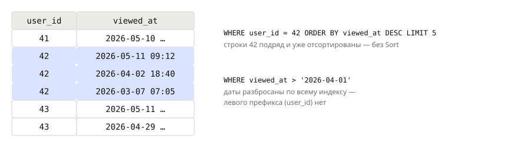

## Теория
Индекс по одному столбцу — только начало. Под разные запросы строят разные индексы.

**Составной** — по нескольким столбцам: `(user_id, viewed_at DESC)`. Значения отсортированы сначала по первому столбцу, внутри него — по второму, как телефонный справочник: по фамилии, внутри фамилии — по имени. Отсюда **правило левого префикса**: индекс эффективно работает для условий на первый столбец, первый и второй и т. д. Для условия только на второй столбец (`WHERE viewed_at > …`) упорядоченности нет — в лучшем случае база прочитает индекс целиком, как таблицу. Порядок столбцов выбирают так: сначала столбцы с `=`, потом столбец с диапазоном или сортировкой. Запрос «просмотры покупателя, новые сверху» — `WHERE user_id = 42 ORDER BY viewed_at DESC LIMIT 5` — идеально обслуживает индекс `(user_id, viewed_at DESC)`: база находит покупателя и берёт первые пять записей уже в нужном порядке, без сортировки.

**Уникальный** — `CREATE UNIQUE INDEX`: запрещает повтор, как ограничение `UNIQUE` (которое и создаёт такой индекс). Сам по себе нужен, когда уникальность — не по столбцу, а по выражению или по части строк.

**Частичный** — индекс только по строкам, подходящим под условие: `CREATE INDEX … ON orders (user_id) WHERE status <> 'cancelled'`. Меньше и быстрее обычного, но используется, только если условие запроса включает условие индекса. Частичный уникальный индекс решает задачи вроде «email уникален среди неудалённых пользователей».

**По выражению** — индексируется результат функции: `CREATE INDEX … ON users (lower(email))`. Обычный индекс по `email` не поможет `WHERE lower(email) = …`: в индексе лежат исходные значения, а не результат функции. Запрос должен содержать **то же самое** выражение.

**Покрывающий** (`INCLUDE`) — в индекс добавляют столбцы «пассажиры», по которым не ищут, но которые запрос выводит: `CREATE INDEX … ON orders (user_id, created_at DESC) INCLUDE (status)`. Тогда запрос может взять всё из индекса, не заходя в таблицу (Index Only Scan).

Кроме B-tree, в PostgreSQL есть GIN (для `jsonb`, массивов, полнотекстового поиска), GiST (геоданные, диапазоны), BRIN (огромные таблицы, где значения растут вместе с порядком записи, — время событий), Hash.

## Наглядно
**Рисунок 1.** Составной индекс упорядочен по первому столбцу, внутри — по второму.



**Таблица 1.** Виды индексов и запросы, которым они помогают.

| Индекс | Запрос |
|---|---|
| `(user_id, viewed_at DESC)` | `WHERE user_id = 42 ORDER BY viewed_at DESC LIMIT 5` |
| `UNIQUE (lower(email))` | запрет `Anna@…` при наличии `anna@…`; `WHERE lower(email) = …` |
| `(user_id) WHERE status <> 'cancelled'` | `WHERE user_id = 1 AND status <> 'cancelled'` |
| `(user_id, created_at DESC) INCLUDE (status)` | `SELECT created_at, status … WHERE user_id = 1` без чтения таблицы |
| GIN `(attributes)` | `WHERE attributes @> '{"color": "black"}'` |

## На практике
Задача: составной индекс для ленты просмотров покупателя, уникальный email без учёта регистра и частичный индекс по активным заказам. Таблица `page_views` — из прошлой темы.

### Шаг 1. Составной индекс под сортировку
Индекс под ленту «последние просмотры покупателя» и план запроса:
```sql
CREATE INDEX page_views_user_viewed_idx ON page_views (user_id, viewed_at DESC);
EXPLAIN SELECT * FROM page_views WHERE user_id = 42 ORDER BY viewed_at DESC LIMIT 5;
```
Результат:
```
CREATE INDEX
                                              QUERY PLAN
-------------------------------------------------------------------------------------------------------
 Limit  (cost=0.42..21.00 rows=5 width=24)
   ->  Index Scan using page_views_user_viewed_idx on page_views  (cost=0.42..165.09 rows=40 width=24)
         Index Cond: (user_id = 42)
(3 rows)
```
В плане нет узла `Sort`: строки идут из индекса уже по убыванию даты, и `Limit` останавливается на пятой.

### Шаг 2. Уникальность без учёта регистра
`UNIQUE` на `email` пропустит `Anna.Smirnova@example.com` рядом с `anna.smirnova@example.com`. Уникальный индекс по выражению — нет:
```sql
CREATE UNIQUE INDEX users_email_lower_key ON users (lower(email));
INSERT INTO users (email, name) VALUES ('Anna.Smirnova@example.com', 'Анна');
```
Результат:
```
CREATE INDEX
ERROR:  duplicate key value violates unique constraint "users_email_lower_key"
DETAIL:  Key (lower(email))=(anna.smirnova@example.com) already exists.
```

### Шаг 3. Частичный индекс
Отменённые заказы на «Моих заказах» не показываются — индексировать их незачем:
```sql
CREATE INDEX orders_active_idx ON orders (user_id) WHERE status <> 'cancelled';
SELECT indexdef FROM pg_indexes WHERE indexname = 'orders_active_idx';
```
Результат:
```
CREATE INDEX
                                                 indexdef
-----------------------------------------------------------------------------------------------------------
 CREATE INDEX orders_active_idx ON public.orders USING btree (user_id) WHERE (status <> 'cancelled'::text)
(1 row)
```
`pg_indexes` показывает определение индекса в том виде, как его хранит PostgreSQL.

## Частые ошибки
- **Не тот порядок столбцов.** `(viewed_at, user_id)` не поможет `WHERE user_id = 42`: первым должен идти столбец с `=`.
- **Функция над столбцом без индекса по выражению.** `WHERE lower(email) = …` не использует обычный индекс по `email`.
- **Условие запроса не совпадает с частичным индексом.** Индекс `WHERE status <> 'cancelled'` бесполезен для запроса без этого условия.
- **Дубли.** Индекс `(user_id)` рядом с `(user_id, created_at)` почти всегда лишний: составной работает и для `user_id` один.
- **`UNIQUE` вместо уникальности «по смыслу».** Email в разном регистре — разные строки для `UNIQUE (email)`.

## Итог
**Составной**
- Порядок важен: левый префикс; сначала `=`, потом диапазон или сортировка.
- Может заменить сортировку в `ORDER BY … LIMIT`.

**Особые виды**
- Уникальный — запрет повторов; по выражению — для `lower(…)`, `date_trunc(…)`; частичный — по части строк.
- `INCLUDE` — столбцы для Index Only Scan.
- GIN — `jsonb` и массивы; BRIN — огромные таблицы по времени.

## Вопросы на собеседовании
<details><summary>Что такое правило левого префикса?</summary>

Составной индекс `(a, b, c)` отсортирован по `a`, внутри — по `b`, внутри — по `c`. Он эффективно ищет по `a`, по `a` и `b`, по `a`, `b` и `c`, но не по `b` или `c` без `a`: значения `b` разбросаны по всему индексу. Поэтому первым ставят столбец, который есть во всех нужных запросах, обычно с условием `=`.
</details>

<details><summary>Что такое частичный индекс и когда он полезен?</summary>

Индекс по части строк: `CREATE INDEX … WHERE условие`. Полезен, когда запросы почти всегда ищут среди небольшой части таблицы (активные заказы, неудалённые пользователи): индекс меньше и быстрее. Частичный уникальный индекс задаёт уникальность среди части строк — например, email среди неудалённых аккаунтов.
</details>

<details><summary>Что такое покрывающий индекс?</summary>

Индекс, в котором есть все столбцы, нужные запросу, — либо как ключи, либо как `INCLUDE`. Тогда возможен Index Only Scan: данные берутся из индекса без обращения к таблице (если страницы таблицы отмечены видимыми в visibility map после `VACUUM`).
</details>
