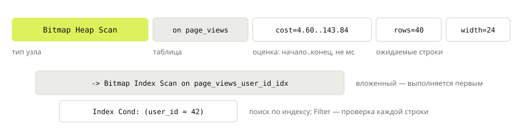

## Теория
SQL говорит **что** получить, а **как** — решает планировщик PostgreSQL: каким индексом пройти, в каком порядке соединять таблицы, сортировать или брать готовый порядок. **`EXPLAIN`** перед запросом показывает выбранный **план** — без выполнения. **`EXPLAIN ANALYZE`** выполняет запрос и добавляет к плану фактические числа: время и сколько строк реально прошло через каждый шаг.

План — дерево **узлов**, читается изнутри наружу: вложенные (со стрелкой `->` и отступом) выполняются первыми и отдают строки родителю. Основные узлы чтения:
- **Seq Scan** — чтение таблицы целиком, строка за строкой; `Filter:` — условие, которое проверяется у каждой строки;
- **Index Scan** — поиск по индексу (`Index Cond:`) и чтение найденных строк таблицы;
- **Index Only Scan** — всё нужное есть в индексе, таблица не читается;
- **Bitmap Index Scan + Bitmap Heap Scan** — индекс собирает «карту» нужных страниц, потом страницы читаются по порядку; так база делает, когда строк много для Index Scan, но мало для Seq Scan.

Выше по дереву — `Sort`, `Limit`, `Aggregate`, соединения (`Nested Loop`, `Hash Join`, `Merge Join`).

В скобках у каждого узла: `cost=начало..конец` — **оценка** стоимости в условных единицах (не миллисекунды), `rows` — сколько строк планировщик **ожидает**, `width` — средний размер строки. В `EXPLAIN ANALYZE` рядом — `actual time` (мс) и фактические `rows`. Большое расхождение ожидаемых и фактических строк — признак устаревшей статистики (`ANALYZE таблица`).

`Seq Scan` — не всегда плохо: на маленькой таблице или когда условию подходит большая часть строк, он самый быстрый. Плохо, когда на большой таблице `Seq Scan` с `Filter` отбрасывает почти все строки (`Rows Removed by Filter: 199960`) — значит, не хватает индекса или условие записано так, что индекс к нему не подходит.

**Условия, которые не используют индекс по столбцу:**
- функция или приведение над столбцом: `WHERE viewed_at::date = '2026-02-01'`, `WHERE lower(email) = …` — индекс хранит исходные значения; переписать как диапазон или построить индекс по выражению;
- `LIKE '%мышь'` — шаблон с `%` в начале: упорядоченность строк не помогает (нужен триграммный индекс `pg_trgm`);
- сравнение с другим столбцом той же строки, `OR` по разным столбцам (иногда спасает `BitmapOr`).

А вот `WHERE user_id = '42'` индекс использует: `'42'` в PostgreSQL — литерал без типа, и он сразу становится числом. Проблема «несовпадения типов» из статей про MySQL здесь не возникает.

**Осторожно: `EXPLAIN ANALYZE` выполняет запрос.** `EXPLAIN ANALYZE DELETE …` действительно удалит строки. Изменяющие запросы анализируют внутри транзакции с `ROLLBACK`.

## Наглядно
**Рисунок 1.** Как читать строку плана.



**Таблица 1.** Узлы чтения.

| Узел | Когда | Признак проблемы |
|---|---|---|
| `Seq Scan` + `Filter` | маленькая таблица; условию подходит много строк | большая таблица и `Rows Removed by Filter` почти все |
| `Index Scan` | мало строк по индексу | — |
| `Index Only Scan` | все столбцы есть в индексе | — |
| `Bitmap Heap Scan` | строк больше, чем для Index Scan | — |
| `Sort` над большим набором | нет индекса под `ORDER BY` | `Sort Method: external merge` (на диске) |

## На практике
Задача: на таблице `page_views` (200 тысяч просмотров из темы «Индексы», с индексами по `user_id` и `viewed_at`) понять, почему один запрос за день быстрый, а другой — нет.

### Шаг 1. Приведение типа над столбцом
Просмотры за 1 февраля — через приведение к дате:
```sql
EXPLAIN SELECT count(*) FROM page_views
WHERE viewed_at::date = '2026-02-01';
```
Результат:
```
                              QUERY PLAN
----------------------------------------------------------------------
 Aggregate  (cost=4276.50..4276.51 rows=1 width=8)
   ->  Seq Scan on page_views  (cost=0.00..4274.00 rows=1000 width=0)
         Filter: ((viewed_at)::date = '2026-02-01'::date)
(3 rows)
```
Индекс по `viewed_at` есть, но в нём лежат моменты времени, а не даты: чтобы сравнить `viewed_at::date`, базе приходится вычислить его для каждой строки.

### Шаг 2. Тот же день диапазоном
Условие на сам столбец — полуоткрытым интервалом:
```sql
EXPLAIN SELECT count(*) FROM page_views
WHERE viewed_at >= '2026-02-01' AND viewed_at < '2026-02-02';
```
Результат:
```
                                                                          QUERY PLAN
--------------------------------------------------------------------------------------------------------------------------------------------------------------
 Aggregate  (cost=62.05..62.05 rows=1 width=8)
   ->  Index Only Scan using page_views_viewed_at_idx on page_views  (cost=0.42..58.42 rows=1450 width=0)
         Index Cond: ((viewed_at >= '2026-02-01 00:00:00+03'::timestamp with time zone) AND (viewed_at < '2026-02-02 00:00:00+03'::timestamp with time zone))
(3 rows)
```
Условие на сам столбец — `Index Cond`, и стоимость упала с 4276 до 62. Для `count(*)` даже таблица не нужна — Index Only Scan.

### Шаг 3. Ожидание и факт
Поиск по покупателю с фактическими числами:
```sql
EXPLAIN ANALYZE SELECT * FROM page_views WHERE user_id = 42;
```
Результат:
```
                                                           QUERY PLAN
---------------------------------------------------------------------------------------------------------------------------------
 Bitmap Heap Scan on page_views  (cost=4.60..143.84 rows=40 width=24) (actual time=0.036..0.120 rows=40 loops=1)
   Recheck Cond: (user_id = 42)
   Heap Blocks: exact=40
   ->  Bitmap Index Scan on page_views_user_id_idx  (cost=0.00..4.59 rows=40 width=0) (actual time=0.023..0.023 rows=40 loops=1)
         Index Cond: (user_id = 42)
 Planning Time: 0.065 ms
 Execution Time: 0.161 ms
(7 rows)
```
Ожидали 40 строк (`rows=40` в оценке), получили 40 (`actual … rows=40`): статистика точная. Сначала выполнился вложенный `Bitmap Index Scan` — нашёл строки по индексу, затем `Bitmap Heap Scan` прочитал 40 страниц таблицы.

## Частые ошибки
- **`cost` — это миллисекунды.** Нет, условные единицы для сравнения планов; время — только в `EXPLAIN ANALYZE`.
- **«Seq Scan — всегда плохо».** На маленьких таблицах и неизбирательных условиях — лучший выбор.
- **Функция над индексированным столбцом.** `viewed_at::date = …`, `lower(email) = …` — индекс не используется; диапазон или индекс по выражению.
- **`EXPLAIN ANALYZE` для `DELETE`/`UPDATE` «просто посмотреть».** Запрос выполнится; оберните в `BEGIN … ROLLBACK`.
- **Проверка на пустой базе.** План на 20 строках ничего не говорит о плане на миллионе.

## Итог
**EXPLAIN**
- `EXPLAIN` — план без выполнения; `EXPLAIN ANALYZE` — выполнить и показать факт.
- Дерево узлов, читается изнутри; `cost` — оценка, `rows` — ожидание.

**Что искать**
- `Seq Scan` на большой таблице с почти всеми строками в `Rows Removed by Filter`.
- Расхождение `rows` и `actual rows` — обновить статистику.
- Функции и приведения над столбцом в `WHERE` — переписать условие.

## Вопросы на собеседовании
<details><summary>Чем `EXPLAIN` отличается от `EXPLAIN ANALYZE`?</summary>

`EXPLAIN` показывает план и оценки планировщика, не выполняя запрос. `EXPLAIN ANALYZE` выполняет запрос и добавляет фактическое время и число строк на каждом узле. Для изменяющих запросов `EXPLAIN ANALYZE` действительно меняет данные — его запускают в транзакции с `ROLLBACK`. Полезны опции `BUFFERS` (сколько страниц прочитано) и `COSTS OFF`.
</details>

<details><summary>Почему условие `WHERE date(created_at) = …` медленное?</summary>

Индекс по `created_at` хранит исходные значения, а не результат функции, поэтому условие нельзя проверить по индексу — функция вычисляется для каждой строки (Seq Scan). Решения: переписать как диапазон `created_at >= день AND created_at < следующий день` или создать индекс по выражению.
</details>

<details><summary>Как понять, что статистика устарела?</summary>

В `EXPLAIN ANALYZE` оценка `rows` сильно расходится с фактическим числом строк — например, ожидается 10, а приходит 100 000. Из-за этого планировщик выбирает неподходящий план. Статистику обновляет `ANALYZE` (его запускает и autovacuum), после массовой загрузки данных — вручную.
</details>
