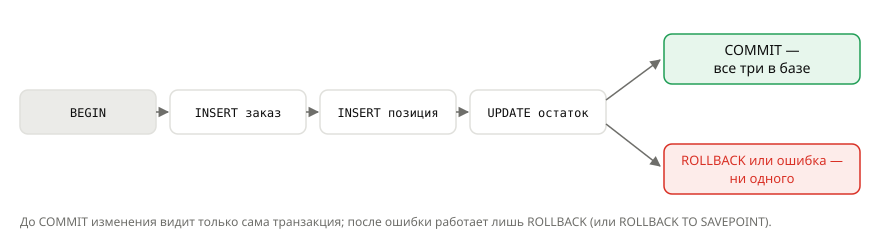

## Теория
Оформление заказа — это несколько запросов: создать заказ, добавить позиции, списать остатки. Если сервер упадёт после второго, в базе останется заказ без списанных товаров. **Транзакция** объединяет запросы в одно целое: либо выполняются все, либо ни один. Запись такая:
```sql
BEGIN;
-- запросы
COMMIT;    -- зафиксировать всё
-- или
ROLLBACK;  -- отменить всё
```
Без `BEGIN` каждый запрос — отдельная транзакция, которая фиксируется сразу (**autocommit**). Внутри транзакции её изменения видны ей самой, но другие подключения увидят их только после `COMMIT`.

Гарантии транзакции называют **ACID**:
- **Atomicity** (атомарность) — всё или ничего: `ROLLBACK` или сбой отменяют все изменения транзакции;
- **Consistency** (согласованность) — после транзакции соблюдены все ограничения базы (`NOT NULL`, `CHECK`, внешние ключи). Правила приложения — «сумма заказа равна сумме позиций» — база сама не знает: их обеспечивают ограничения и код;
- **Isolation** (изоляция) — параллельные транзакции не видят незафиксированных изменений друг друга; насколько ещё они друг от друга защищены, зависит от уровня изоляции (следующая тема);
- **Durability** (долговечность) — после `COMMIT` данные записаны в журнал (WAL) и переживут сбой.

**Ошибка внутри транзакции.** Если запрос упал (нарушено ограничение), транзакция переходит в состояние ошибки: все следующие запросы отвечают `current transaction is aborted, commands ignored until end of transaction block`, и единственный выход — `ROLLBACK`. Даже `COMMIT` после ошибки фактически откатывает транзакцию. Это защищает от «полузаказа».

**`SAVEPOINT`** — точка внутри транзакции, к которой можно откатиться, не теряя всё: `SAVEPOINT имя` … `ROLLBACK TO SAVEPOINT имя`. Так обрабатывают ожидаемую ошибку в середине — например, пропустить позицию с несуществующим товаром и продолжить.

В Django каждый запрос по умолчанию — отдельная транзакция, а `transaction.atomic()` оборачивает блок кода в `BEGIN … COMMIT` (вложенный `atomic` — это `SAVEPOINT`).

## Наглядно
**Рисунок 1.** COMMIT фиксирует все изменения транзакции, ROLLBACK отменяет все.



**Таблица 1.** Команды транзакций.

| Команда | Что делает |
|---|---|
| `BEGIN` | начать транзакцию |
| `COMMIT` | зафиксировать изменения |
| `ROLLBACK` | отменить все изменения транзакции |
| `SAVEPOINT s` | поставить точку внутри транзакции |
| `ROLLBACK TO SAVEPOINT s` | отменить изменения после точки, продолжить транзакцию |

## На практике
Задача: посмотреть на откат, ошибку внутри транзакции и точку сохранения на оформлении заказа.

### Шаг 1. ROLLBACK
Списываем ноутбук внутри транзакции и передумываем:
```sql
BEGIN;
UPDATE products SET stock = stock - 1 WHERE id = 1 RETURNING id, stock;
ROLLBACK;
SELECT id, stock FROM products WHERE id = 1;
```
Результат:
```
BEGIN
 id | stock
----+-------
  1 |     4
(1 row)

UPDATE 1
ROLLBACK
 id | stock
----+-------
  1 |     5
(1 row)
```
Внутри транзакции остаток был 4, после `ROLLBACK` — снова 5.

### Шаг 2. Ошибка посередине
Заказ создан, но в позиции — несуществующий товар 99:
```sql
BEGIN;
INSERT INTO orders (user_id) VALUES (13) RETURNING id;
INSERT INTO order_items (order_id, product_id, quantity, price) VALUES (35, 99, 1, 100);
SELECT count(*) AS n FROM orders;
ROLLBACK;
```
Результат:
```
BEGIN
 id
----
 35
(1 row)

INSERT 0 1
ERROR:  insert or update on table "order_items" violates foreign key constraint "order_items_product_id_fkey"
DETAIL:  Key (product_id)=(99) is not present in table "products".
ERROR:  current transaction is aborted, commands ignored until end of transaction block
ROLLBACK
```
После ошибки база не выполняет ничего, кроме `ROLLBACK`. Заказ 35 тоже отменён — «пустого» заказа без позиций в базе не осталось.

### Шаг 3. SAVEPOINT
Тот же случай, но позицию с ошибкой пропускаем, а заказ сохраняем:
```sql
BEGIN;
INSERT INTO orders (user_id) VALUES (13) RETURNING id;
SAVEPOINT before_items;
INSERT INTO order_items (order_id, product_id, quantity, price) VALUES (36, 99, 1, 100);
ROLLBACK TO SAVEPOINT before_items;
INSERT INTO order_items (order_id, product_id, quantity, price)
VALUES (36, 20, 1, 1590.00)
RETURNING id, order_id, product_id;
COMMIT;
```
Результат:
```
BEGIN
 id
----
 36
(1 row)

INSERT 0 1
SAVEPOINT
ERROR:  insert or update on table "order_items" violates foreign key constraint "order_items_product_id_fkey"
DETAIL:  Key (product_id)=(99) is not present in table "products".
ROLLBACK
 id | order_id | product_id
----+----------+------------
 61 |       36 |         20
(1 row)

INSERT 0 1
COMMIT
```
`ROLLBACK TO SAVEPOINT` отменил только неудачную позицию и вывел транзакцию из состояния ошибки. Номер заказа — 36: номер 35 был выдан в шаге 2 и пропал вместе с откатом.

## Частые ошибки
- **Связанные изменения без транзакции.** Заказ создан, остаток не списан — после сбоя данные противоречат друг другу.
- **Продолжать после ошибки.** Все запросы отвечают `current transaction is aborted`; нужен `ROLLBACK` (или `SAVEPOINT` заранее).
- **Забытый `COMMIT`.** Изменения не видны никому, кроме своей транзакции, и пропадут при отключении.
- **Долгая транзакция.** Открытая транзакция держит блокировки и мешает очистке старых версий строк; транзакции делают короткими, без ожидания пользователя внутри.
- **Consistency как «база проверит всё».** База проверяет только свои ограничения; правила приложения — на коде и ограничениях, которые вы задали.

## Итог
**Транзакция**
- `BEGIN … COMMIT` — всё или ничего; `ROLLBACK` — отменить.
- Без `BEGIN` каждый запрос — своя транзакция (autocommit).
- Ошибка — транзакция прервана до `ROLLBACK`; `SAVEPOINT` — частичный откат.

**ACID**
- Атомарность, согласованность (ограничения), изоляция, долговечность (WAL).

## Вопросы на собеседовании
<details><summary>Что такое ACID?</summary>

Atomicity — транзакция выполняется целиком или не выполняется. Consistency — транзакция переводит базу из согласованного состояния в согласованное (соблюдены ограничения). Isolation — параллельные транзакции не мешают друг другу в пределах уровня изоляции. Durability — зафиксированные изменения не теряются при сбое (журнал WAL).
</details>

<details><summary>Что будет, если в транзакции один из запросов упал?</summary>

В PostgreSQL транзакция переходит в состояние ошибки: все последующие команды отклоняются, `COMMIT` превращается в откат. Нужно выполнить `ROLLBACK`. Если ошибка ожидаема, перед рискованным запросом ставят `SAVEPOINT` и откатываются к нему — остальная транзакция сохраняется.
</details>

<details><summary>Как в Django выполнить несколько запросов в одной транзакции?</summary>

Обернуть код в `with transaction.atomic():` — Django выполнит `BEGIN` в начале блока, `COMMIT` при нормальном выходе и `ROLLBACK` при исключении. Вложенный `atomic()` создаёт `SAVEPOINT`. Можно включить `ATOMIC_REQUESTS`, чтобы каждый HTTP-запрос был одной транзакцией.
</details>
