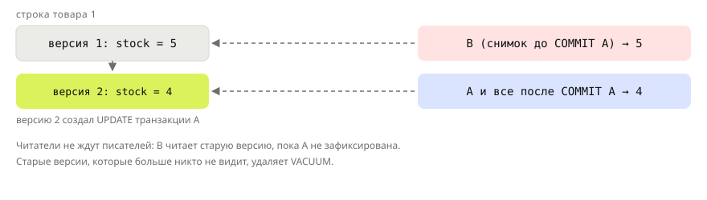

## Теория
На сайте одновременно работают десятки подключений к базе: один покупатель оформляет заказ, другой смотрит каталог, админка меняет цены. **Изоляция** определяет, что транзакция видит из чужих изменений, пока сама работает.

**MVCC** (multiversion concurrency control) — способ, которым PostgreSQL этого добивается. `UPDATE` не перезаписывает строку на месте, а создаёт её **новую версию**; старая остаётся, пока её может видеть хоть одна транзакция. Каждая транзакция читает **снимок** — те версии строк, которые были зафиксированы к моменту снимка. Поэтому в PostgreSQL **чтение не блокирует запись, а запись — чтение**: пока одна транзакция меняет остаток, другие спокойно читают прежнюю версию. Старые версии потом убирает **VACUUM** (автоматически, процессом autovacuum).

**Аномалии** — что может пойти не так при параллельной работе:
- **грязное чтение** — видны незафиксированные изменения чужой транзакции, которые потом могут откатиться;
- **неповторяющееся чтение** — в одной транзакции повторное чтение той же строки даёт другое значение: между чтениями кто-то зафиксировал изменение;
- **фантом** — повторный запрос с тем же условием возвращает другой **набор** строк: кто-то добавил подходящую строку;
- **аномалия сериализации** — результат параллельных транзакций невозможно получить, выполняя их по очереди в каком-либо порядке.

**Уровни изоляции в PostgreSQL:**

- **Read Committed** — по умолчанию. Снимок берётся **для каждого запроса**: каждый `SELECT` видит всё, что зафиксировано к его началу. Грязного чтения нет; неповторяющееся чтение и фантомы возможны. Уровень `Read Uncommitted` в PostgreSQL работает так же, как Read Committed, — грязного чтения в PostgreSQL не бывает вообще.
- **Repeatable Read** — снимок берётся **один раз**, при первом запросе транзакции, и все запросы видят одно и то же. Неповторяющегося чтения и фантомов нет (в PostgreSQL — в отличие от стандарта SQL и MySQL). Если транзакция пытается изменить строку, которую после её снимка изменила другая, — ошибка `could not serialize access due to concurrent update`, и транзакцию нужно повторить.
- **Serializable** — результат гарантированно такой, как при выполнении транзакций по очереди. PostgreSQL отслеживает опасные зависимости и при угрозе аномалии прерывает одну из транзакций ошибкой сериализации. Приложение обязано уметь **повторять** транзакцию.

Уровень задают при старте: `BEGIN ISOLATION LEVEL REPEATABLE READ;`. Текущий — `SHOW transaction_isolation`.

**Потерянное обновление** — самая практичная проблема. Двое покупают последний ноутбук: оба читают `stock = 1`, оба в коде вычисляют `1 - 1 = 0` и записывают `UPDATE … SET stock = 0`. Оба заказа оформлены, ноутбук продан дважды, остаток — 0. Read Committed от этого **не защищает**: каждый видел честно зафиксированные данные. Защита — не «прочитать и записать», а **изменить атомарно одной командой с условием** (`SET stock = stock - 1 WHERE stock >= 1`) или заблокировать строку при чтении (`SELECT … FOR UPDATE`) — следующая тема. Либо Repeatable Read/Serializable с повтором транзакции.

## Наглядно
**Рисунок 1.** MVCC: UPDATE создаёт новую версию строки, читающие видят свою.



**Таблица 1.** Уровни изоляции в PostgreSQL.

| Уровень | Грязное чтение | Неповторяющееся чтение | Фантомы | Аномалия сериализации |
|---|---|---|---|---|
| Read Uncommitted (= Read Committed) | нет | возможно | возможны | возможна |
| **Read Committed** (по умолчанию) | нет | возможно | возможны | возможна |
| Repeatable Read | нет | нет | нет | возможна |
| Serializable | нет | нет | нет | нет |

**Таблица 2.** Неповторяющееся чтение на Read Committed: остаток ноутбука, две сессии по шагам.

| Шаг | Сессия A (покупатель) | Сессия B (склад) |
|---|---|---|
| 1 | `BEGIN;` | |
| 2 | `SELECT stock … WHERE id = 1;` → 5 | |
| 3 | | `UPDATE products SET stock = 15 WHERE id = 1;` (autocommit) |
| 4 | `SELECT stock … WHERE id = 1;` → **15** | |
| 5 | `COMMIT;` | |

На Repeatable Read на шаге 4 сессия A увидела бы прежние 5: её снимок сделан на шаге 2.

**Таблица 3.** Потерянное обновление: последний ноутбук, Read Committed.

| Шаг | Сессия A | Сессия B |
|---|---|---|
| 1 | `SELECT stock … WHERE id = 3;` → 1 | |
| 2 | | `SELECT stock … WHERE id = 3;` → 1 |
| 3 | код: «есть 1, продаём», `UPDATE … SET stock = 0` | |
| 4 | | код: «есть 1, продаём», `UPDATE … SET stock = 0` |
| 5 | заказ оформлен | заказ оформлен — **второй ноутбук продан, которого нет** |

## На практике
Задача: посмотреть уровень изоляции и разобрать, где из него следует ошибка.

### Шаг 1. Текущий уровень
Уровень изоляции текущей сессии:
```sql
SHOW transaction_isolation;
```
Результат:
```
 transaction_isolation
-----------------------
 read committed
(1 row)
```
В тренажёре, как и на сервере по умолчанию, — Read Committed. В тренажёре одно подключение, поэтому параллельные транзакции из таблиц 2 и 3 в нём не воспроизвести — их пробуют в двух окнах `psql` с настоящим PostgreSQL.

### Шаг 2. Атомарное списание вместо «прочитать и записать»
Списание с условием одной командой: при двух одновременных покупках вторая будет ждать, пока первая завершится, затем перепроверит условие по новой версии строки и не найдёт остатка:
```sql
UPDATE products
SET stock = stock - 1
WHERE id = 3 AND stock >= 1
RETURNING id, stock;
```
Результат:
```
 id | stock
----+-------
(0 rows)

UPDATE 0
```
У Nimbus Air (товар 3) остаток 0 — строк не изменено, и приложение по `UPDATE 0` понимает: товара нет, заказ не оформляем. Значение не вычислялось в коде по старому чтению, поэтому «потерять» обновление нечему.

## Частые ошибки
- **«Read Committed защищает от двойной продажи».** Нет: потерянное обновление на нём возможно. Нужны атомарный `UPDATE` с условием или блокировка.
- **Read Uncommitted «для скорости».** В PostgreSQL он равен Read Committed — грязного чтения нет.
- **Serializable без повтора.** Ошибки сериализации — нормальная часть работы; код должен повторять транзакцию.
- **Долгие транзакции.** Держат старые версии строк, мешают VACUUM — таблица «раздувается».
- **Перенос знаний из MySQL.** В MySQL по умолчанию Repeatable Read и другие механизмы; в PostgreSQL — Read Committed и MVCC.

## Итог
**MVCC**
- `UPDATE` создаёт новую версию строки; транзакции читают свой снимок.
- Чтение и запись не блокируют друг друга; старые версии убирает VACUUM.

**Уровни**
- Read Committed (по умолчанию) — снимок на каждый запрос.
- Repeatable Read — снимок на транзакцию; конфликт — ошибка сериализации.
- Serializable — как по очереди; приложение повторяет транзакцию при ошибке.

**Практика**
- «Прочитать, вычислить в коде, записать» — потерянное обновление; изменять атомарно.

## Вопросы на собеседовании
<details><summary>Какие уровни изоляции есть в PostgreSQL и какой по умолчанию?</summary>

Read Committed (по умолчанию), Repeatable Read, Serializable; Read Uncommitted принимается, но работает как Read Committed. Read Committed даёт каждому запросу свой снимок; Repeatable Read — один снимок на транзакцию; Serializable гарантирует результат, эквивалентный последовательному выполнению, прерывая конфликтующие транзакции.
</details>

<details><summary>Что такое MVCC?</summary>

Многоверсионность: изменение строки создаёт её новую версию, а каждая транзакция видит версии, зафиксированные к моменту её снимка. Читатели не ждут писателей и наоборот. Цена — старые версии копятся и удаляются VACUUM; долгие транзакции мешают их удалению.
</details>

<details><summary>Как два покупателя могут купить последний товар и как это предотвратить?</summary>

Оба читают остаток 1, оба в коде решают «можно» и записывают 0 — потерянное обновление. Предотвращают атомарным изменением с условием (`UPDATE … SET stock = stock - 1 WHERE id = … AND stock >= 1` и проверка числа изменённых строк), блокировкой строки `SELECT … FOR UPDATE` перед проверкой или уровнем Serializable/Repeatable Read с повтором транзакции. Дополнительная защита — `CHECK (stock >= 0)`.
</details>
