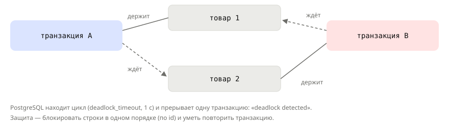

## Теория
MVCC развязывает чтение и запись, но две **записи** в одну строку одновременно невозможны. Когда транзакция меняет строку (`UPDATE`, `DELETE`), PostgreSQL ставит на неё **блокировку строки**, и вторая транзакция, которая хочет изменить ту же строку, **ждёт**, пока первая завершится (`COMMIT` или `ROLLBACK`). Обычный `SELECT` не ждёт никогда — он читает версию из своего снимка.

На Read Committed после ожидания вторая транзакция **перечитывает** строку в её новой версии и заново проверяет `WHERE`. Поэтому атомарное списание с условием безопасно:
```sql
UPDATE products SET stock = stock - 1 WHERE id = 3 AND stock >= 1;
```
Первая транзакция списала последнюю штуку; вторая дождалась, увидела `stock = 0`, условие не выполнилось — `UPDATE 0`.

**`SELECT … FOR UPDATE`** — заблокировать строки при чтении, как будто их уже меняют. Нужен, когда решение принимается в коде по прочитанным данным: прочитать остаток и цену, проверить скидку, лимит покупателя — и только потом записать. Другие транзакции, которые хотят изменить эти строки или тоже взять их `FOR UPDATE`, ждут до конца транзакции. Варианты:
- `FOR UPDATE NOWAIT` — не ждать, а сразу получить ошибку, если строка занята;
- `FOR UPDATE SKIP LOCKED` — пропустить занятые строки (так разбирают очередь задач несколькими обработчиками);
- `FOR SHARE` — запретить другим менять строку, но разрешить им тоже читать с `FOR SHARE`.

Блокировки строк держатся **до конца транзакции**, поэтому транзакции с ними делают короткими: никаких запросов к внешним сервисам и ожидания пользователя между `FOR UPDATE` и `COMMIT`.

**Взаимная блокировка (deadlock).** Транзакция A заблокировала товар 1 и ждёт товар 2; транзакция B заблокировала товар 2 и ждёт товар 1. Ждать они будут вечно, поэтому PostgreSQL через `deadlock_timeout` (по умолчанию 1 секунда) проверяет такие циклы и прерывает одну из транзакций ошибкой `deadlock detected`; другая продолжает работу. Какая именно будет прервана, заранее не известно. Защита — **один порядок блокировок**: менять и блокировать строки всегда в порядке `id` (`ORDER BY id … FOR UPDATE`). И, как с ошибкой сериализации, — уметь повторить транзакцию.

**Блокировки таблиц** берут команды изменения структуры: `ALTER TABLE`, `DROP TABLE`, `TRUNCATE`, `CREATE INDEX` (без `CONCURRENTLY`). Пока они ждут или работают, запросы к таблице встают в очередь — поэтому миграции на больших таблицах планируют отдельно (раздел «Создание и изменение таблиц», тема ALTER).

## Наглядно
**Рисунок 1.** Взаимная блокировка двух транзакций.



**Таблица 1.** Кто кого ждёт.

| Первая транзакция | Вторая транзакция | Ждёт? |
|---|---|---|
| `UPDATE` строки | `SELECT` той же строки | нет — читает свой снимок |
| `UPDATE` строки | `UPDATE` той же строки | да, до конца первой |
| `SELECT … FOR UPDATE` | `UPDATE` / `FOR UPDATE` той же строки | да |
| `SELECT … FOR UPDATE` | `SELECT` той же строки | нет |
| `ALTER TABLE` | любой запрос к таблице | да |

**Таблица 2.** Списание с `FOR UPDATE`: две сессии покупают ноутбук 2 (остаток 2) по одной штуке.

| Шаг | Сессия A | Сессия B |
|---|---|---|
| 1 | `BEGIN;` `SELECT stock … WHERE id = 2 FOR UPDATE;` → 2 | |
| 2 | | `BEGIN;` `SELECT stock … WHERE id = 2 FOR UPDATE;` — **ждёт** |
| 3 | `UPDATE products SET stock = 1 WHERE id = 2;` `COMMIT;` | |
| 4 | | получает строку: → **1**; списывает до 0, `COMMIT;` |

## На практике
Задача: списать товары из корзины так, чтобы параллельные покупки не продали лишнего. Параллельные сессии в тренажёре не воспроизвести — проверяем команды по одной.

### Шаг 1. Списание нескольких позиций с условием
В корзине — по 3 штуки ноутбуков 1 и 2. Списываем только то, чего хватает:
```sql
UPDATE products
SET stock = stock - 3
WHERE id IN (1, 2) AND stock >= 3
RETURNING id, stock;
```
Результат:
```
 id | stock
----+-------
  1 |     2
(1 row)

UPDATE 1
```
Ноутбука 2 всего 2 штуки — его строка не подошла под условие. Приложение сравнивает число изменённых строк с числом позиций и, если не сошлось, откатывает транзакцию заказа. Без `AND stock >= 3` команда упала бы на `CHECK (stock >= 0)` целиком.

### Шаг 2. Блокировка при чтении
Решение принимается в коде — читаем с блокировкой, в порядке `id`:
```sql
BEGIN;
SELECT id, stock, price
FROM products
WHERE id IN (2, 1)
ORDER BY id
FOR UPDATE;
COMMIT;
```
Результат:
```
BEGIN
 id | stock |  price
----+-------+----------
  1 |     2 | 64990.00
  2 |     2 | 89990.00
(2 rows)

COMMIT
```
Остаток ноутбука 1 — 2: шаг 1 уже списал три. До `COMMIT` эти две строки не изменит ни одна другая транзакция. `ORDER BY id` задаёт одинаковый порядок блокировок во всех транзакциях — защита от взаимной блокировки.

## Частые ошибки
- **«Прочитать, проверить, записать» без блокировки.** Параллельная транзакция успевает между чтением и записью; нужен атомарный `UPDATE` с условием или `FOR UPDATE`.
- **Разный порядок блокировок.** Одна транзакция меняет товары 1 и 2, другая — 2 и 1: deadlock. Сортируйте по `id`.
- **Долгая транзакция с блокировками.** Запрос к платёжному сервису между `FOR UPDATE` и `COMMIT` держит строки секундами.
- **Ожидание, что `FOR UPDATE` запретит чтение.** Обычный `SELECT` его не ждёт; ждут только изменения и другие блокирующие чтения.
- **Нет повтора при deadlock.** Одна из транзакций будет прервана — код должен уметь повторить её.

## Итог
**Блокировки строк**
- `UPDATE`/`DELETE` блокируют строку до конца транзакции; вторая запись ждёт, чтение — нет.
- Атомарный `UPDATE … WHERE условие` — перепроверка по новой версии после ожидания.
- `SELECT … FOR UPDATE` — блокировка при чтении; `NOWAIT`, `SKIP LOCKED`.

**Deadlock**
- Цикл ожиданий; PostgreSQL прерывает одну транзакцию.
- Защита — один порядок блокировок и повтор транзакции.

## Вопросы на собеседовании
<details><summary>Блокирует ли `UPDATE` чтение строки в PostgreSQL?</summary>

Нет. Благодаря MVCC обычный `SELECT` читает версию строки из своего снимка и не ждёт. Ждут только другие изменения этой строки и блокирующие чтения (`FOR UPDATE`, `FOR SHARE`) — до конца транзакции, которая держит блокировку.
</details>

<details><summary>Что такое deadlock и как его избежать?</summary>

Две (или больше) транзакции ждут друг друга по кругу: каждая держит строку, нужную другой. PostgreSQL обнаруживает цикл и прерывает одну транзакцию ошибкой `deadlock detected`. Избегают одинаковым порядком блокировок (сортировка по ключу), короткими транзакциями и повтором прерванной транзакции в коде.
</details>

<details><summary>Зачем нужен `SKIP LOCKED`?</summary>

Для очередей задач в таблице: несколько обработчиков берут задачи `SELECT … FOR UPDATE SKIP LOCKED LIMIT 10` — каждый получает свободные строки, пропуская уже взятые другими, и никто никого не ждёт. Так устроены многие очереди поверх PostgreSQL.
</details>
