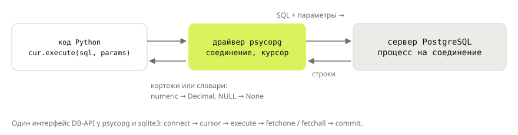

## Теория
До сих пор запросы писали руками в тренажёре. В магазине их отправляет код: страница каталога, скрипт ночной выгрузки, обработчик платежа. Для этого нужен **драйвер** — библиотека, которая умеет говорить с сервером базы по сети. Для PostgreSQL в Python стандарт — **psycopg** (версия 3, пакет `psycopg`); через него же работает Django.

Работа с базой из кода — всегда одни и те же шаги:
1. **Соединение** — `psycopg.connect(...)`: адрес сервера, имя базы, пользователь, пароль. Параметры не пишут в коде — берут из переменных окружения или настроек (`DATABASE_URL`).
2. **Курсор** — `conn.cursor()`: объект, через который выполняют запросы и забирают результат.
3. **Запрос** — `cur.execute(sql, параметры)`.
4. **Результат** — `cur.fetchone()` (одна строка или `None`, если строк нет), `cur.fetchall()` (список всех строк), `cur.fetchmany(n)` (следующие `n`); по курсору можно и просто пройти циклом `for row in cur`.
5. **Фиксация и закрытие** — `conn.commit()` и `conn.close()`; удобнее — блок `with`, который делает это сам (тема 3).

Строка результата по умолчанию — **кортеж**: `(1, 'Ноутбук Aster 14', Decimal('64990.00'))`, обращение по номеру `row[1]`. Если нужен **словарь** с именами столбцов — `row_factory=dict_row` при создании курсора или соединения: `row['name']`. Типы PostgreSQL превращаются в типы Python: `integer` → `int`, `numeric` → `Decimal` (не `float` — деньги считаются точно), `timestamptz` → `datetime` с часовым поясом, `jsonb` → `dict`, NULL → `None`.

`fetchall()` загружает все строки в память. Для выгрузки миллиона строк так нельзя — читают порциями через `fetchmany` или циклом по курсору (для настоящего потокового чтения в psycopg есть «серверный курсор» `conn.cursor(name=...)`).

Интерфейс «соединение — курсор — `execute` — `fetch`» описан стандартом Python **DB-API 2.0** (PEP 249). Его выполняют и `psycopg`, и встроенный модуль `sqlite3` — поэтому примеры ниже, которые можно запустить, сделаны на `sqlite3` с базой в памяти. Отличия — в адресе подключения и в знаке параметра (`%s` у psycopg, `?` у sqlite3, следующая тема).

## Наглядно
**Рисунок 1.** Путь запроса из кода до базы и обратно.



**Таблица 1.** Методы курсора.

| Метод | Возвращает | Когда |
|---|---|---|
| `fetchone()` | одну строку или `None` | ожидается одна строка: товар по `id` |
| `fetchall()` | список строк (возможно пустой) | строк немного: заказы покупателя |
| `fetchmany(n)` | следующие `n` строк | большие выгрузки порциями |
| `for row in cur` | строки по одной | обработка в цикле |
| `rowcount` | число строк, затронутых `UPDATE`/`DELETE` | проверить, что изменение случилось |

## На практике
Задача: скрипт выгрузки заказов за день — сначала как он выглядит с PostgreSQL, потом работающий пример на `sqlite3`.

### Шаг 1. Скрипт на psycopg
Файл `export_orders.py`:
```python
import os

import psycopg
from psycopg.rows import dict_row

DSN = os.environ["DATABASE_URL"]  # postgresql://shop:…@db:5432/shop

with psycopg.connect(DSN, row_factory=dict_row) as conn:
    rows = conn.execute(
        """
        SELECT o.id, u.email, o.status
        FROM orders o
        JOIN users u ON u.id = o.user_id
        WHERE o.created_at >= %s AND o.created_at < %s
        ORDER BY o.id
        """,
        ("2026-04-15", "2026-04-16"),
    ).fetchall()

for row in rows:
    print(row["id"], row["email"], row["status"])
```
`conn.execute` в psycopg 3 — сокращение: сам создаёт курсор и выполняет запрос. Даты переданы параметрами, а не вписаны в строку (об этом — следующая тема). Пароль — в переменной окружения, а не в коде, который лежит в git.

### Шаг 2. То же на sqlite3
Учебная таблица в памяти — запускается где угодно, без сервера:
```python
import sqlite3

conn = sqlite3.connect(":memory:")
conn.execute("CREATE TABLE orders (id INTEGER PRIMARY KEY, email TEXT, status TEXT, day TEXT)")
conn.executemany(
    "INSERT INTO orders (id, email, status, day) VALUES (?, ?, ?, ?)",
    [
        (32, "maksim.fedorov@example.com", "new", "2026-04-14"),
        (33, "boris.ivanov@example.com", "new", "2026-04-15"),
        (34, "anna.smirnova@example.com", "new", "2026-04-15"),
    ],
)

cur = conn.execute("SELECT id, email FROM orders WHERE day = ? ORDER BY id", ("2026-04-15",))
print(cur.fetchone())
print(cur.fetchall())
print(cur.fetchone())
```
Результат:
```
(33, 'boris.ivanov@example.com')
[(34, 'anna.smirnova@example.com')]
None
```
`fetchone` взял первую строку, `fetchall` — **оставшиеся**, а после них строк больше нет — `None`. Курсор читает результат по порядку и назад не возвращается.

### Шаг 3. Строки-словари
В sqlite3 аналог `dict_row` — `sqlite3.Row`: строка, к которой можно обращаться по имени столбца:
```python
conn.row_factory = sqlite3.Row
for row in conn.execute("SELECT id, email FROM orders ORDER BY id"):
    print(row["id"], row["email"])
```
Результат:
```
32 maksim.fedorov@example.com
33 boris.ivanov@example.com
34 anna.smirnova@example.com
```
По имени читать надёжнее: если в запрос добавят столбец, номера сдвинутся, а имена — нет.

## Частые ошибки
- **Пароль в коде.** Строка подключения с паролем попадает в git; параметры — из переменных окружения.
- **`fetchone()` там, где строк много.** Обработается только первая; остальные молча потеряются.
- **`fetchall()` на огромной выборке.** Всё уходит в память процесса; порции через `fetchmany` или цикл по курсору.
- **Обращение по номеру столбца.** `row[2]` ломается при изменении запроса; `dict_row` / `sqlite3.Row` и имена.
- **`float` для денег.** psycopg отдаёт `numeric` как `Decimal`; не превращайте его в `float` для расчётов.

## Итог
**Шаги**
- Соединение → курсор → `execute` → `fetch…` → фиксация и закрытие.
- Параметры подключения — из окружения.

**Результат**
- `fetchone` — строка или `None`, `fetchall` — оставшиеся строки, `fetchmany(n)` — порция.
- Строки — кортежи; `dict_row` — словари.
- Типы: `numeric` → `Decimal`, `timestamptz` → `datetime`, NULL → `None`.

**DB-API**
- Один интерфейс у `psycopg` и `sqlite3`; отличаются подключение и знак параметра.

## Вопросы на собеседовании
<details><summary>Чем соединение отличается от курсора?</summary>

Соединение — сеанс с сервером базы: сетевое подключение, авторизация, транзакция. Курсор — объект внутри соединения для выполнения запросов и чтения результата. На одном соединении может быть много курсоров; транзакция — у соединения, общая для всех его курсоров.
</details>

<details><summary>Что такое DB-API?</summary>

Стандарт PEP 249 — общий интерфейс драйверов баз данных в Python: `connect`, `cursor`, `execute`, `fetchone`/`fetchall`, `commit`/`rollback`, `rowcount`. Его реализуют psycopg, sqlite3, драйверы MySQL; поэтому код похож для разных СУБД, а ORM строятся поверх.
</details>

<details><summary>Как выгрузить из базы миллион строк, не исчерпав память?</summary>

Не `fetchall`, а порциями: `fetchmany(1000)` в цикле или итерация по курсору. В psycopg обычный курсор всё равно получает весь результат с сервера, поэтому для действительно больших выборок используют серверный курсор (`conn.cursor(name="export")`) — сервер отдаёт строки частями — или `COPY … TO STDOUT`.
</details>
