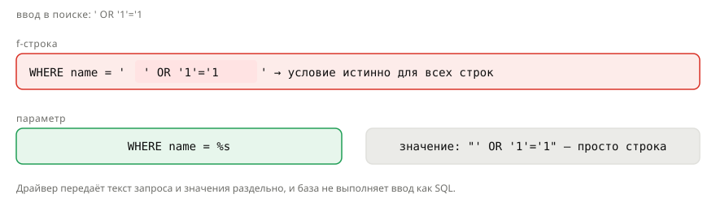

## Теория
Почти в каждом запросе из приложения есть значение от пользователя: текст поиска, номер товара, email при входе. Первое, что приходит в голову, — вставить его в строку запроса f-строкой: `cur.execute(f"SELECT id, name FROM products WHERE name = '{query}'")`. Это **SQL-инъекция** — одна из самых известных уязвимостей. Пользователь вводит не название, а кусок SQL: `' OR '1'='1`. Запрос превращается в `WHERE name = '' OR '1'='1'` — условие истинно для всех строк. Вместо `'1'='1'` можно подставить `'; DROP TABLE orders; --` или `UNION SELECT email, password_hash FROM users`. Ошибка — в том, что **данные смешиваются с кодом**: база не может отличить, где кончился запрос разработчика и начался ввод.

**Параметры** решают это полностью. В тексте запроса на месте значения — **плейсхолдер**, а значения передаются отдельно, вторым аргументом `execute`: `cur.execute("SELECT id, name FROM products WHERE name = %s", (query,))`. Драйвер передаёт значение как данные, и `' OR '1'='1` остаётся просто строкой, которую ищут в названиях. Правила:
- плейсхолдер в psycopg — `%s` для любого типа (число, строка, дата, `None`); именованные — `%(name)s` со словарём параметров. В sqlite3 — `?` и `:name`;
- плейсхолдер **без кавычек**: `WHERE name = %s`, а не `'%s'` — кавычки драйвер расставит сам;
- параметры — **кортеж или список**, даже из одного значения: `(query,)` с запятой; `(query)` — просто строка в скобках;
- `LIKE`: знаки `%` добавляют к значению в Python — `("%" + query + "%",)`, а в запросе пишут `name ILIKE %s`;
- список для `IN`: в psycopg — `WHERE id = ANY(%s)` и Python-список `([1, 4, 7],)`;
- параметром можно передать только **значение**. Имя таблицы или столбца (например, поле сортировки из адреса страницы) параметром не передать — его выбирают из **белого списка** в коде или собирают через `psycopg.sql.Identifier`.

Экранирование кавычек «вручную» (`query.replace("'", "''")`) — не защита: способов обойти его много, а с параметрами думать об этом не нужно. ORM (Django) всегда использует параметры, но при `raw()` и `extra()` ответственность снова на разработчике.

## Наглядно
**Рисунок 1.** Что получает база при f-строке и при параметре.



**Таблица 1.** Параметры в psycopg и sqlite3.

| Задача | psycopg | sqlite3 |
|---|---|---|
| одно значение | `WHERE id = %s`, `(5,)` | `WHERE id = ?`, `(5,)` |
| именованные | `WHERE id = %(id)s`, `{"id": 5}` | `WHERE id = :id`, `{"id": 5}` |
| поиск по части строки | `name ILIKE %s`, `(f"%{q}%",)` | `name LIKE ?`, `(f"%{q}%",)` |
| список | `id = ANY(%s)`, `([1, 4, 7],)` | по одному `?` на элемент |
| имя столбца | `sql.Identifier(col)` или белый список | белый список |

## На практике
Задача: поиск товара по названию из формы — уязвимая версия и безопасная. Запускаем на `sqlite3`: инъекция работает одинаково в любой базе.

### Шаг 1. Учебная таблица
Три товара в базе в памяти:
```python
import sqlite3

conn = sqlite3.connect(":memory:")
conn.execute("CREATE TABLE products (id INTEGER PRIMARY KEY, name TEXT, price REAL)")
conn.executemany(
    "INSERT INTO products (id, name, price) VALUES (?, ?, ?)",
    [(1, "Ноутбук Aster 14", 64990), (4, "Беспроводная мышь", 1499), (7, "Коврик для мыши", 490)],
)
```

### Шаг 2. f-строка
Покупатель ищет товар, а вводит `' OR '1'='1`:
```python
query = "' OR '1'='1"
sql = f"SELECT id, name FROM products WHERE name = '{query}'"
print(sql)
print(conn.execute(sql).fetchall())
```
Результат:
```
SELECT id, name FROM products WHERE name = '' OR '1'='1'
[(1, 'Ноутбук Aster 14'), (4, 'Беспроводная мышь'), (7, 'Коврик для мыши')]
```
Кавычка из ввода закрыла строку, и `OR '1'='1'` стал частью условия — запрос вернул всё. На странице входа то же самое пустило бы без пароля.

### Шаг 3. Параметр
Тот же ввод, но значением:
```python
print(conn.execute("SELECT id, name FROM products WHERE name = ?", (query,)).fetchall())
```
Результат:
```
[]
```
Товара с названием `' OR '1'='1` нет — ввод остался данными.

### Шаг 4. Поиск по части названия
`%` добавляем к значению, а не в текст запроса:
```python
query = "мыш"
rows = conn.execute(
    "SELECT id, name FROM products WHERE name LIKE ? ORDER BY id",
    ("%" + query + "%",),
).fetchall()
print(rows)
```
Результат:
```
[(4, 'Беспроводная мышь'), (7, 'Коврик для мыши')]
```
В psycopg запрос тот же, только `?` заменяется на `%s`, а `LIKE` — на `ILIKE` (без учёта регистра).

## Частые ошибки
- **f-строка, `+`, `.format()` или `%` со значением пользователя.** Любая склейка значения с текстом запроса — инъекция.
- **Кавычки вокруг плейсхолдера.** `'%s'` — значение окажется внутри лишних кавычек или запрос сломается; пишите `%s`.
- **`(query)` вместо `(query,)`.** Без запятой это строка, а не кортеж: драйвер возьмёт её посимвольно или упадёт.
- **Имя столбца параметром.** `ORDER BY %s` сортирует по константе, а не по столбцу; имена — белым списком или `sql.Identifier`.
- **«Экранирую кавычки сам».** Ненадёжно и не нужно — используйте параметры.

## Итог
**SQL-инъекция**
- Значение склеено с текстом запроса — ввод становится кодом.
- Последствия: чтение чужих данных, обход входа, удаление таблиц.

**Параметры**
- Плейсхолдер в запросе (`%s` в psycopg, `?` в sqlite3) без кавычек, значения — отдельно кортежем.
- `LIKE` — `%` в значении; список — `= ANY(%s)`.
- Имена таблиц и столбцов — только белый список или `sql.Identifier`.

## Вопросы на собеседовании
<details><summary>Что такое SQL-инъекция и как от неё защититься?</summary>

Подстановка пользовательского ввода прямо в текст SQL: ввод с кавычками и операторами меняет смысл запроса (`' OR '1'='1`, `; DROP TABLE …`). Защита — параметризованные запросы: текст запроса с плейсхолдерами и значения передаются раздельно, и база не интерпретирует значения как код. ORM делает это сам; при сыром SQL — только параметры, никаких f-строк.
</details>

<details><summary>Можно ли передать параметром имя таблицы или столбца?</summary>

Нет: параметр — это значение, а не часть синтаксиса запроса. `ORDER BY %s` подставит строковую константу, сортировка не изменится. Имена выбирают из белого списка допустимых значений в коде или безопасно экранируют средствами драйвера — в psycopg `sql.SQL("ORDER BY {}").format(sql.Identifier(col))`.
</details>

<details><summary>Защищает ли ORM от SQL-инъекций?</summary>

Да, пока вы пользуетесь его API: фильтры и значения уходят в базу параметрами. Защита пропадает, если собирать сырой SQL строкой — в `raw()`, `extra()`, `cursor.execute()` с f-строкой. Там тоже нужно передавать значения параметрами.
</details>
