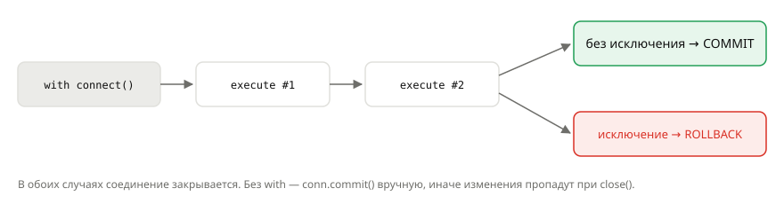

## Теория
В тренажёре каждый запрос фиксировался сразу. Драйвер ведёт себя иначе: в psycopg соединение по умолчанию **не в режиме autocommit** — первый же `execute` неявно начинает транзакцию (`BEGIN`), и все изменения висят в ней, пока код не вызовет **`conn.commit()`**. Забыли — и при закрытии соединения изменения откатятся: скрипт «отработал без ошибок», а в базе ничего не поменялось. При ошибке транзакцию нужно откатить **`conn.rollback()`**, иначе следующие запросы получат `current transaction is aborted`.

Поэтому соединение используют через **`with`**:
- `with psycopg.connect(dsn) as conn:` — при выходе из блока без исключения изменения фиксируются (`commit`), при исключении — откатываются (`rollback`), и соединение закрывается;
- `with conn.transaction():` — явная транзакция внутри соединения; вложенный блок становится `SAVEPOINT`;
- `psycopg.connect(dsn, autocommit=True)` — каждый запрос фиксируется сразу, как в `psql`; удобно для служебных скриптов, но атомарности нескольких запросов тогда нет.

Связанные изменения — заказ, позиции, списание остатков — выполняют **в одной транзакции**: исключение посередине откатит всё, и «полузаказа» не останется. В Django то же делает `transaction.atomic()`.

**Соединения дорогие.** Каждое соединение с PostgreSQL — отдельный процесс на сервере: установка TCP, проверка пароля, запуск процесса — миллисекунды, а то и десятки. Открывать соединение на каждый запрос или в цикле — частая причина медленного кода, а тысяча одновременных соединений съест память сервера (по умолчанию `max_connections = 100`). Решения:
- одно соединение на скрипт или на обработку HTTP-запроса, а не на каждую строку;
- **пул соединений** — набор заранее открытых соединений, которые код берёт и возвращает: `psycopg_pool.ConnectionPool` в приложении, PgBouncer между приложением и базой. Django держит соединение между запросами (`CONN_MAX_AGE`) и с версии 5.1 умеет пул psycopg;
- соединение, взятое из пула, возвращают **без открытой транзакции** — `with pool.connection() as conn:` делает это сам.

## Наглядно
**Рисунок 1.** Блок `with` фиксирует или откатывает транзакцию сам.



**Таблица 1.** Что происходит с изменениями.

| Код | Изменения |
|---|---|
| `execute(…)` без `commit()`, затем `close()` | откатываются |
| `execute(…)`, `commit()` | фиксируются |
| `with psycopg.connect(…) as conn:` без исключения | фиксируются при выходе |
| `with psycopg.connect(…) as conn:` с исключением | откатываются |
| `autocommit=True` | каждый запрос фиксируется сразу |

## На практике
Задача: оформить заказ из Python атомарно — запустим на `sqlite3`, где `with conn:` работает так же: фиксирует при успехе и откатывает при исключении (но, в отличие от psycopg, не закрывает соединение).

### Шаг 1. Функция оформления заказа
Две таблицы: товары с остатком и заказы. Оформление — вставка заказа и списание остатка в одном блоке `with`:
```python
import sqlite3

conn = sqlite3.connect(":memory:")
conn.execute("CREATE TABLE products (id INTEGER PRIMARY KEY, stock INTEGER NOT NULL CHECK (stock >= 0))")
conn.execute("CREATE TABLE orders (id INTEGER PRIMARY KEY, product_id INTEGER, quantity INTEGER)")
conn.execute("INSERT INTO products (id, stock) VALUES (1, 5), (2, 2)")
conn.commit()


def place_order(conn, product_id, quantity):
    with conn:
        conn.execute("INSERT INTO orders (product_id, quantity) VALUES (?, ?)", (product_id, quantity))
        conn.execute("UPDATE products SET stock = stock - ? WHERE id = ?", (quantity, product_id))
```

### Шаг 2. Удачный и неудачный заказ
Три штуки первого товара (есть пять) и три штуки второго (есть две):
```python
place_order(conn, 1, 3)
try:
    place_order(conn, 2, 3)
except sqlite3.IntegrityError as error:
    print("Заказ не оформлен:", error)

print(conn.execute("SELECT id, product_id, quantity FROM orders").fetchall())
print(conn.execute("SELECT id, stock FROM products").fetchall())
```
Результат:
```
Заказ не оформлен: CHECK constraint failed: stock >= 0
[(1, 1, 3)]
[(1, 2), (2, 2)]
```
Второй заказ успел вставиться, но списание нарушило ограничение, и `with` откатил транзакцию целиком: в `orders` только первый заказ, остаток второго товара — прежние 2. Без транзакции в таблице остался бы заказ, под который нечего отгрузить.

### Шаг 3. То же на psycopg
Файл `checkout.py`:
```python
import os

import psycopg

with psycopg.connect(os.environ["DATABASE_URL"]) as conn:
    order_id = conn.execute(
        "INSERT INTO orders (user_id) VALUES (%s) RETURNING id", (13,)
    ).fetchone()[0]
    conn.execute(
        "INSERT INTO order_items (order_id, product_id, quantity, price) VALUES (%s, %s, %s, %s)",
        (order_id, 20, 1, 1590),
    )
    updated = conn.execute(
        "UPDATE products SET stock = stock - %s WHERE id = %s AND stock >= %s", (1, 20, 1)
    ).rowcount
    if updated != 1:
        raise RuntimeError("Товар закончился")  # исключение → ROLLBACK всего блока
```
Одно соединение, одна транзакция. Нехватка товара — исключение: `with` откатит и заказ, и позицию. `RETURNING id` даёт номер заказа для позиции, а условие в `UPDATE` — атомарную проверку остатка из раздела про блокировки.

## Частые ошибки
- **Нет `commit()`.** psycopg не фиксирует сам: скрипт «прошёл», а в базе пусто. Используйте `with` или `commit()`.
- **Нет `rollback()` после ошибки.** Соединение остаётся в прерванной транзакции, следующие запросы падают.
- **Соединение в цикле.** `for … : psycopg.connect(…)` — тысячи подключений; одно соединение на весь скрипт или пул.
- **Связанные изменения в разных транзакциях.** `autocommit=True` или `commit()` после каждого запроса — и сбой посередине оставляет «полузаказ».
- **Долгая транзакция в коде.** Запрос к платёжному сервису внутри `with` держит транзакцию и блокировки; внешние вызовы — до или после.

## Итог
**Транзакции из кода**
- В psycopg первый `execute` начинает транзакцию; без `commit()` изменения пропадут.
- `with psycopg.connect(…) as conn:` — `commit` при успехе, `rollback` при исключении, закрытие.
- `conn.transaction()` — явная транзакция; `autocommit=True` — каждый запрос сам по себе.

**Соединения**
- Дорогие: процесс на сервере, ограниченное число.
- Одно на скрипт или запрос; пул — `psycopg_pool`, PgBouncer, `CONN_MAX_AGE` в Django.

## Вопросы на собеседовании
<details><summary>Почему изменения из скрипта на psycopg не сохранились?</summary>

Соединение psycopg по умолчанию открывает транзакцию на первом запросе и не фиксирует её само. Если не вызвать `commit()` (или не выйти из блока `with psycopg.connect(...)` без исключения), при закрытии соединения транзакция откатывается. Для одиночных служебных запросов можно включить `autocommit=True`.
</details>

<details><summary>Зачем нужен пул соединений?</summary>

Открыть соединение с PostgreSQL дорого: сетевое подключение, авторизация, отдельный серверный процесс. Пул держит несколько открытых соединений и выдаёт их коду на время работы, а потом забирает обратно. Это ускоряет обработку запросов и ограничивает число соединений к базе. Реализации: `psycopg_pool` в приложении, PgBouncer снаружи.
</details>

<details><summary>Как выполнить несколько запросов атомарно из Python?</summary>

В одной транзакции одного соединения: `with psycopg.connect(...) as conn:` (или `with conn.transaction():`) — все запросы внутри фиксируются вместе при успехе и откатываются при любом исключении. Проверку бизнес-условий (остаток, лимит) делают внутри этого блока и при нарушении бросают исключение. В Django — `with transaction.atomic():`.
</details>
