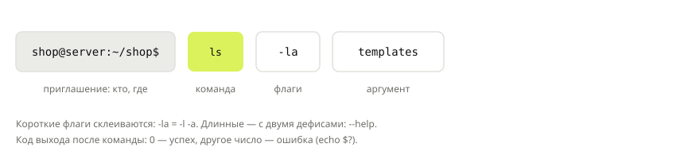

## Теория
Проводник и меню удобны, пока работаешь с документами. Разработчику терминал нужен каждый день: создать проект, поставить Django, запустить сервер, сделать коммит, зайти на сервер, где графического интерфейса нет вовсе. Команду можно повторить, записать в инструкцию или скрипт — с кликами мышью так не выйдет.

**Терминал** — окно, в котором вы вводите команды текстом. Читает и выполняет их **оболочка** (shell) — в Linux и macOS обычно `bash` или `zsh`. Слева от курсора — **приглашение**: `shop@server:~/shop$` — пользователь `shop`, компьютер `server`, текущая папка `~/shop`, а `$` значит «обычный пользователь, жду команду» (у администратора `root` — `#`). Если видите `(venv)` в начале — включено виртуальное окружение Python (тема 5).

**Команда** состоит из частей, разделённых пробелами:
```bash
ls -l -a /home/shop/shop
```
- `ls` — имя команды (программа, которую нужно запустить);
- `-l`, `-a` — **флаги** (опции): меняют поведение. Короткие флаги — одна буква с дефисом, их можно писать вместе: `-la` = `-l -a`. Длинные — два дефиса и слово: `--help`, `--all`;
- `/home/shop/shop` — **аргумент**: с чем работать (здесь — какую папку показать).

Пробел — разделитель, поэтому имя с пробелом берут в кавычки: `cat "мои заказы.txt"`. Регистр важен: `ls` и `LS` — разные команды, `Readme.md` и `README.md` — разные файлы.

**Как узнать, что умеет команда:** `команда --help` — краткая справка по флагам; `man команда` — полное руководство (выход — `q`). В тренажёре `--help` есть у всех команд и показывает короткую справку на русском; в настоящем Linux она длиннее и на английском.

**Приёмы, которые экономят время:**
- **Tab** — дополняет имя команды, файла или папки; два нажатия — показывает варианты. Набирать `cd shop/templ` и нажать Tab быстрее и без опечаток;
- **↑ / ↓** — предыдущие команды; `history` — весь список;
- **Ctrl+C** — прервать выполняющуюся команду (например, запущенный сервер);
- **Ctrl+L** или `clear` — очистить экран.

После каждой команды остаётся **код выхода**: `0` — успех, другое число — ошибка. Посмотреть его — `echo $?`. Программы и скрипты по коду выхода понимают, удалась ли предыдущая команда (`команда1 && команда2` выполнит вторую, только если первая вернула 0).

## Наглядно
**Рисунок 1.** Из чего состоит строка в терминале.



**Таблица 1.** Первые команды.

| Команда | Что делает |
|---|---|
| `pwd` | показать текущую папку |
| `ls` | список файлов и папок |
| `cd папка` | перейти в папку |
| `cat файл` | вывести содержимое файла |
| `echo текст` | вывести текст |
| `команда --help` | справка по флагам |
| `history` | список введённых команд |
| `clear` | очистить экран |

## На практике
Задача: осмотреться в папке проекта магазина и узнать, какие флаги есть у `ls`. Все команды можно повторить в тренажёре.

### Шаг 1. Где я и что здесь
`pwd` показывает текущую папку, `ls` — её содержимое:
```bash
pwd
ls
```
Результат:
```
/home/shop
shop
```
Мы в домашней папке пользователя `shop`, и в ней одна папка — проект магазина.

### Шаг 2. Справка
Какие флаги есть у `ls`:
```bash
ls --help
```
Результат:
```
ls [флаги] [путь…] — список файлов в папке.
  -l   подробно: права, владелец, размер, дата
  -a   показать скрытые (имя с точки)
  -h   размеры в K, M, G (вместе с -l)
  -R   с вложенными папками
Флаги можно писать вместе: ls -la
```

### Шаг 3. Флаги и аргумент
Подробный список папки проекта вместе со скрытыми файлами:
```bash
ls -la shop
```
Результат:
```
total 16
drwxr-xr-x 1 shop shop 4096 Nov 18 10:00 .
drwxr-xr-x 1 shop shop 4096 Nov 18 10:00 ..
-rw-r--r-- 1 shop shop   15 Nov 18 10:00 .env
-rw-r--r-- 1 shop shop    9 Nov 18 10:00 manage.py
```
В каждой строке — права (`d` в начале — папка), владелец, размер в байтах, дата изменения (у вас будет своя) и имя. `.env` раньше не был виден: имена, начинающиеся с точки, — скрытые, их показывает только `-a`.

### Шаг 4. Ошибка и код выхода
Команда с несуществующей папкой:
```bash
cd /nope
echo $?
```
Результат:
```
bash: cd: /nope: No such file or directory
1
```
Сообщения об ошибках — на английском, как в настоящем Linux: их стоит читать дословно — в них почти всегда сказано, что не так. Код выхода `1` — команда не удалась.

## Частые ошибки
- **Пробел в имени без кавычек.** `cat мои заказы.txt` — это два аргумента: `мои` и `заказы.txt`.
- **Регистр.** `cd Shop` не найдёт папку `shop`.
- **Флаг без дефиса.** `ls la` ищет файл с именем `la`.
- **Не читать сообщение об ошибке.** `No such file or directory`, `Permission denied`, `command not found` — три разные причины, и текст их называет.
- **Набирать длинные пути вручную.** Tab дополняет и заодно проверяет, что такой путь есть.

## Итог
**Терминал**
- Оболочка выполняет команды; приглашение показывает пользователя, компьютер и текущую папку.
- Команда = имя + флаги + аргументы через пробел; короткие флаги можно склеивать.

**Помощь и приёмы**
- `--help`, `man`; Tab, ↑/↓, `history`, Ctrl+C, `clear`.
- Код выхода `0` — успех; `echo $?`.

## Вопросы на собеседовании
<details><summary>Чем терминал отличается от оболочки?</summary>

Терминал — окно (программа), которое принимает ввод с клавиатуры и показывает текст. Оболочка (`bash`, `zsh`) — программа внутри него, которая разбирает введённую строку, запускает команды и выводит результат. В одном терминале можно запустить другую оболочку, а оболочку — без окна, например в скрипте.
</details>

<details><summary>Что такое код выхода?</summary>

Число, которое программа возвращает при завершении: `0` — успех, всё остальное — ошибка (значение часто говорит, какая). В оболочке его показывает `$?`; на нём построены `&&` и `||`, проверки в скриптах и CI: упавшие тесты возвращают ненулевой код, и сборка останавливается.
</details>

<details><summary>Как узнать, какие флаги есть у команды?</summary>

`команда --help` — краткая справка, `man команда` — полное руководство. Для встроенных команд оболочки (`cd`, `echo`) — `help cd`. Плюс `tldr` — сообщество собрало короткие примеры для частых случаев.
</details>
