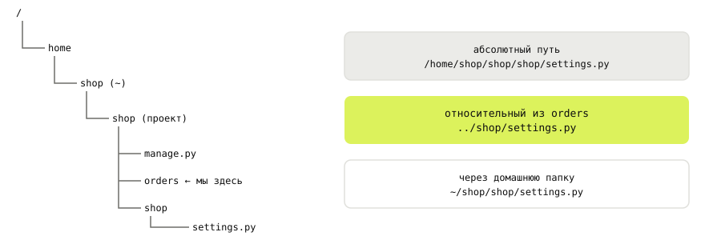

## Теория
Файлы в Linux лежат в одном **дереве папок**. Его вершина — **корень** `/`; в нём системные папки (`/etc` — настройки, `/usr` — программы, `/var` — данные и логи) и `/home` — домашние папки пользователей. Домашняя папка пользователя `shop` — `/home/shop`; у неё есть короткое имя **`~`**. Дисков `C:` и `D:` нет: всё, включая подключённые диски, — ветки одного дерева.

**Путь** — адрес файла или папки в дереве. Части разделяет `/`.
- **Абсолютный** путь начинается с `/` — от корня: `/home/shop/shop/manage.py`. Он одинаков, откуда бы вы его ни использовали.
- **Относительный** — без `/` в начале, от **текущей папки**: если вы в `/home/shop/shop`, то `manage.py` и `templates/base.html` — файлы внутри неё.

Специальные имена:
- `.` — текущая папка (`./manage.py` — тот же `manage.py`);
- `..` — папка на уровень выше (`../settings.py`, `../..` — два уровня);
- `~` — домашняя папка (`~/shop` = `/home/shop/shop`).

**Навигация:**
- `pwd` (print working directory) — где я сейчас;
- `cd путь` — перейти; `cd` без аргумента или `cd ~` — домой; `cd -` — в предыдущую папку; `cd ..` — на уровень выше;
- `ls путь` — что лежит в папке, не переходя в неё.

**Скрытые файлы** — имя начинается с точки: `.env`, `.gitignore`, `.git`, `.venv`. `ls` их не показывает, `ls -a` — показывает (вместе с `.` и `..`). Почти все настройки проекта и инструментов — скрытые файлы, поэтому `ls -la` — первая команда в незнакомой папке.

Терминал всегда «стоит» в какой-то папке, и все относительные пути считаются от неё. Самая частая ошибка новичка — запустить команду не из той папки: `No such file or directory`, хотя файл точно есть.

## Наглядно
**Рисунок 1.** Дерево папок и пути к одному файлу.



**Таблица 1.** Пути из папки `/home/shop/shop/orders`.

| Путь | Куда указывает |
|---|---|
| `.` | `/home/shop/shop/orders` |
| `..` | `/home/shop/shop` |
| `../shop/settings.py` | `/home/shop/shop/shop/settings.py` |
| `../..` | `/home/shop` |
| `~` | `/home/shop` |
| `/etc` | `/etc` — абсолютный путь, откуда угодно |

## На практике
Задача: пройти по проекту магазина, найти скрытый файл настроек и прочитать файл из соседней папки.

### Шаг 1. Видимое и скрытое
Заходим в проект и смотрим содержимое:
```bash
cd shop
ls
ls -a
```
Результат:
```
manage.py  orders  shop  templates
.  ..  .env  manage.py  orders  shop  templates
```
`.env` с секретными настройками появился только с `-a`.

### Шаг 2. Относительный путь вверх
Из папки приложения `orders` читаем настройки, которые лежат в соседней папке `shop`:
```bash
cd orders
pwd
cat ../shop/settings.py
```
Результат:
```
/home/shop/shop/orders
DEBUG = True
```
`..` поднял на уровень выше, в корень проекта, а оттуда — вниз в `shop/settings.py`. Абсолютный путь `/home/shop/shop/shop/settings.py` дал бы то же самое из любой папки.

### Шаг 3. Не та папка
Файл `.env` лежит в корне проекта, а мы — в `orders`:
```bash
cat .env
```
Результат:
```
cat: .env: No such file or directory
```
Относительный путь ищется от текущей папки. Нужно `cat ../.env` или сначала `cd ..`.

### Шаг 4. Домой и обратно
Домашняя папка и возврат туда, где были:
```bash
cd
pwd
cd -
```
Результат:
```
/home/shop
/home/shop/shop/orders
```
`cd` без аргументов вернул домой, `cd -` — обратно в предыдущую папку и заодно напечатал её путь.

## Частые ошибки
- **Команда не из той папки.** `No such file or directory` для файла, который точно есть, — проверьте `pwd`.
- **Ведущий `/` по ошибке.** `/shop/manage.py` ищет папку `shop` в корне диска, а не в текущей папке.
- **«Файла нет» — а он скрытый.** `ls` не показывает имена с точки; `ls -a`.
- **Путь Windows.** В Linux разделитель — `/`, а не `\`, и нет букв дисков.
- **`cd ..` без пробела.** `cd..` — в bash ошибка `command not found`.

## Итог
**Пути**
- Абсолютный — от корня `/`; относительный — от текущей папки.
- `.` — текущая, `..` — на уровень выше, `~` — домашняя.

**Навигация**
- `pwd`, `cd путь`, `cd` (домой), `cd -` (назад), `cd ..` (вверх).
- `ls -a` — со скрытыми файлами (имя с точки).

## Вопросы на собеседовании
<details><summary>Чем абсолютный путь отличается от относительного?</summary>

Абсолютный начинается с `/` и указывает место от корня файловой системы — одинаково из любой папки. Относительный считается от текущей рабочей папки процесса и меняет смысл, если запустить команду из другого места. В скриптах и настройках сервисов используют абсолютные пути: текущая папка там часто не та, что ожидаешь.
</details>

<details><summary>Что такое скрытые файлы в Linux?</summary>

Файлы и папки, имя которых начинается с точки (`.env`, `.git`, `.bashrc`). Это не особый атрибут, а соглашение: `ls` и файловые менеджеры их не показывают, пока не попросишь (`ls -a`). В них обычно лежат настройки программ и проекта.
</details>

<details><summary>Что означают `.` и `..`?</summary>

Ссылки, которые есть в каждой папке: `.` — сама папка, `..` — родительская. С ними строят относительные пути (`../config/settings.ini`) и запускают файлы из текущей папки (`./script.sh` — текущая папка не ищется по умолчанию среди путей к программам).
</details>
