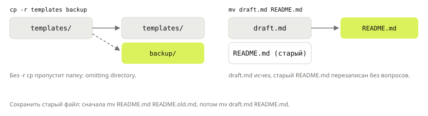

## Теория
Создать, скопировать, переименовать и удалить — пять команд, которые нужны в каждом проекте.

- **`mkdir папка`** — создать папку. Если промежуточных папок нет, `mkdir a/b/c` ответит ошибкой; **`mkdir -p a/b/c`** создаст всю цепочку (и не ругается, если папка уже есть).
- **`touch файл`** — создать пустой файл (или обновить дату изменения существующего). Расширение не обязательно — для Linux это просто часть имени: `Makefile`, `.env`, `Dockerfile` — нормальные имена.
- **`cp откуда куда`** — копировать файл. Папку — только с **`-r`** (recursive, «со всем содержимым»); без него `cp` пропускает папку с сообщением `-r not specified; omitting directory`.
- **`mv откуда куда`** — переместить или **переименовать** (переименование — это перемещение в ту же папку под новым именем). Если файл с новым именем уже есть, **`mv` молча его перезапишет**.
- **`rm файл`** — удалить файл; папку — **`rm -r`**. Корзины нет: удалённое не вернуть.
- **`cat файл`** — вывести содержимое; **`echo текст > файл`** — записать текст в файл (перезаписав его), **`>>`** — дописать в конец.

Несколько файлов можно передать одной команде: `touch a.py b.py`, `rm a.py b.py`, `mv *.csv exports/` (`*` — шаблон «любые символы», оболочка подставит все подходящие имена).

**Осторожно с `rm -rf`.** Флаги `-r` и `-f` (force — не спрашивать, не ругаться на отсутствующие файлы) удаляют всё дерево без вопросов. Опечатка с пробелом — `rm -rf ./ venv` вместо `rm -rf ./venv` — удалит текущую папку целиком. Перед `rm -r` полезно выполнить `ls` с тем же путём и убедиться, что удаляется то, что нужно.

## Наглядно
**Рисунок 1.** cp копирует, mv перемещает и переименовывает.



**Таблица 1.** Команды для файлов и папок.

| Команда | Что делает | Ловушка |
|---|---|---|
| `mkdir -p a/b/c` | создать папку с родителями | без `-p` — ошибка, если `a/b` нет |
| `touch f` | создать пустой файл | — |
| `cp f g` | копировать файл | папку — только с `-r` |
| `mv f g` | переименовать / переместить | `g` существует — перезапишется молча |
| `rm f`, `rm -r d` | удалить файл / папку | корзины нет |
| `echo x > f` / `>> f` | записать / дописать | `>` стирает старое содержимое |

## На практике
Задача: собрать структуру папок проекта, сделать резервную копию шаблонов и навести порядок.

### Шаг 1. Папки с родителями
Папка для стилей магазина — три уровня вложенности:
```bash
mkdir shop/static/css
mkdir -p shop/static/css
ls shop
```
Результат:
```
mkdir: cannot create directory ‘shop/static/css’: No such file or directory
static
```
Первая команда упала: папок `shop` и `static` ещё нет. С `-p` создалась вся цепочка.

### Шаг 2. Пустые файлы
Файлы будущего приложения — одной командой:
```bash
touch shop/__init__.py shop/views.py
ls shop
```
Результат:
```
__init__.py  static  views.py
```

### Шаг 3. Копия папки
Резервная копия шаблонов перед правкой:
```bash
cp templates backup
cp -r templates backup
ls backup
```
Результат:
```
cp: -r not specified; omitting directory 'templates'
base.html
```
Без `-r` копия не создалась. Сообщение легко пропустить — а потом обнаружить, что резервной копии нет.

### Шаг 4. Переименование поверх существующего файла
В проекте есть `README.md` и черновик `draft.md`. Переименовываем черновик:
```bash
mv draft.md README.md
cat README.md
```
Результат:
```
Черновик
```
Старый `README.md` с текстом «Магазин» исчез без предупреждения — `mv` записал черновик на его место. Нужен старый файл — сначала переименуйте его (`mv README.md README.old.md`).

### Шаг 5. Удалить папку
Резервная копия больше не нужна:
```bash
rm backup
rm -r backup
ls
```
Результат:
```
rm: cannot remove 'backup': Is a directory
README.md  shop  templates
```
`rm` без `-r` папки не удаляет — это защита от случайности. Порядок в `ls` — побайтовый: заглавные буквы раньше строчных.

## Частые ошибки
- **`cp` папки без `-r`.** Сообщение `omitting directory` — копии нет.
- **`mv` поверх существующего файла.** Старый файл пропадает без вопросов.
- **`mkdir` без `-p` для вложенных папок.** `No such file or directory`.
- **`>` вместо `>>`.** `echo X > .env` стирает всё, что было в `.env`.
- **`rm -rf` с непроверенным путём.** Корзины нет; сначала `ls` того же пути.

## Итог
**Создание**
- `mkdir -p` — папка со всеми родителями; `touch` — пустой файл.
- `echo … > файл` — записать, `>>` — дописать.

**Копирование и перемещение**
- `cp`, для папок `cp -r`.
- `mv` — перемещает и переименовывает; существующий файл перезаписывает.

**Удаление**
- `rm`, для папок `rm -r`; корзины нет, `rm -rf` — без вопросов.

## Вопросы на собеседовании
<details><summary>Как переименовать файл в Linux?</summary>

Командой `mv старое новое`: переименование — это перемещение в ту же папку под другим именем. Если файл с новым именем уже существует, `mv` перезапишет его без предупреждения; `mv -i` спросит подтверждение, `mv -n` не будет перезаписывать.
</details>

<details><summary>Чем `rm -r` отличается от `rm -rf`?</summary>

`-r` удаляет папку вместе с содержимым. `-f` (force) добавляет «без вопросов»: не спрашивает подтверждения для защищённых от записи файлов и не сообщает об отсутствующих. Вместе они удаляют всё дерево молча — поэтому путь проверяют заранее.
</details>

<details><summary>Чем `>` отличается от `>>`?</summary>

Оба перенаправляют вывод команды в файл. `>` создаёт файл или стирает его содержимое и пишет заново, `>>` дописывает в конец. Для логов и накопления данных — `>>`, для «записать результат» — `>`.
</details>
