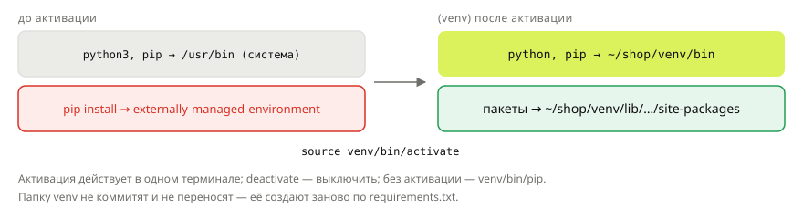

## Теория
Магазину нужен Django 5.1, старому проекту на том же компьютере — Django 4.2, а системным утилитам Ubuntu — свои версии библиотек. Если ставить пакеты в «общий» Python, проекты начнут мешать друг другу, а обновление одного сломает другой. Поэтому у каждого проекта своё **виртуальное окружение** (venv) — отдельная папка со своим Python и своими пакетами.

**Создать** — модулем `venv` из стандартной библиотеки, в корне проекта:
```bash
python3 -m venv venv
```
Последнее слово — имя папки окружения; принято `venv` или `.venv`. Внутри — `bin/` с `python` и `pip` этого окружения и `lib/…/site-packages`, куда будут ставиться пакеты.

**Активировать** — `source venv/bin/activate` (в Windows — `venv\Scripts\activate`). Команда меняет переменную `PATH` текущего терминала так, что `python` и `pip` берутся из окружения. Признак — `(venv)` в начале приглашения; проверка — `which python` показывает путь внутри проекта. **Выйти** — `deactivate`. Активация действует только в этом окне терминала: в новом окне её нужно повторить.

Без активации окружение тоже можно использовать — полным путём: `venv/bin/python manage.py runserver`, `venv/bin/pip install …`. Так делают в скриптах и на сервере.

**Почему без окружения не получится.** В Ubuntu 24.04 (и других современных Linux) `pip install` в системный Python запрещён: система защищает свои пакеты, и `pip` отвечает `error: externally-managed-environment` с советом создать окружение. Обходить это флагом `--break-system-packages` не нужно — нужен venv.

Окружение не переносят и не коммитят: внутри него пути конкретного компьютера, а весит оно десятки мегабайт. Переносят **список пакетов** (`requirements.txt`, следующая тема), а окружение на новом месте создают заново. Папку окружения добавляют в `.gitignore` (раздел «Git»).

## Наглядно
**Рисунок 1.** Активация подменяет python и pip на версии из окружения.



**Таблица 1.** Команды окружения.

| Команда | Что делает |
|---|---|
| `python3 -m venv venv` | создать окружение в папке `venv` |
| `source venv/bin/activate` | включить в этом терминале — появляется `(venv)` |
| `which python` | показать, какой Python будет запущен |
| `deactivate` | выключить |
| `venv/bin/python …` | использовать без активации |

## На практике
Задача: изолировать зависимости проекта магазина и поставить в окружение первую библиотеку.

### Шаг 1. Без окружения
Пробуем поставить пакет в системный Python:
```bash
pip install django
```
Результат:
```
error: externally-managed-environment
…
    If you wish to install a non-Debian-packaged Python package,
    create a virtual environment using python3 -m venv path/to/venv.
    Then use path/to/venv/bin/python and path/to/venv/bin/pip. Make
    sure you have python3-full installed.
…
```
Сообщение длинное (здесь — сокращено), но решение в нём названо прямо — `python3 -m venv`.

### Шаг 2. Создать и посмотреть
В корне проекта `~/shop`:
```bash
python3 -m venv venv
ls venv/bin
```
Результат:
```
activate  pip  pip3  python  python3  python3.12
```
В `bin` — собственные `python` и `pip` окружения и скрипт `activate`.

### Шаг 3. Активировать
До активации команды `python` нет, после — она ведёт в окружение:
```bash
which python
source venv/bin/activate
which python
```
Результат:
```
/home/shop/shop/venv/bin/python
```
Первый `which python` ничего не вывел — в системе есть только `python3`. После активации приглашение начинается с `(venv)` — `(venv) shop@server:~/shop$`, — а `python` ведёт в папку проекта.

### Шаг 4. Пакет в окружение
Теперь `pip` ставит пакеты в `venv`, а не в систему:
```bash
pip install requests
pip list
```
Результат:
```
Collecting requests
  Downloading requests-2.32.3-py3-none-any.whl (64 kB)
…
Successfully installed certifi-2024.8.30 charset-normalizer-3.4.0 idna-3.10 requests-2.32.3 urllib3-2.2.3
Package            Version
------------------ ---------
certifi            2024.8.30
charset-normalizer 3.4.0
idna               3.10
pip                24.0
requests           2.32.3
urllib3            2.2.3
```
Вместе с `requests` поставились его **зависимости** — пакеты, без которых он не работает. В тренажёре пакеты берутся из учебного списка: Django, requests, pytest и ещё несколько.

## Частые ошибки
- **`pip install` без активации.** `externally-managed-environment` — или, в системах без защиты, пакет уходит в системный Python.
- **Забыли активировать в новом окне.** Активация действует в одном терминале; `(venv)` в приглашении — проверка.
- **Окружение в git.** Сотни файлов с путями вашего компьютера; в репозиторий кладут `requirements.txt`, окружение — в `.gitignore`.
- **Перенос папки venv.** После `mv` или копирования на другой компьютер окружение ломается — его создают заново.
- **`--break-system-packages`.** Обход защиты, который может сломать системные утилиты.

## Итог
**Зачем**
- У каждого проекта свои пакеты и версии, система не затрагивается.

**Команды**
- `python3 -m venv venv` — создать; `source venv/bin/activate` — включить; `deactivate` — выключить.
- `(venv)` в приглашении и `which python` — проверка.
- Без активации — `venv/bin/python`, `venv/bin/pip`.

**Правила**
- Окружение не коммитят и не переносят — переносят список пакетов.

## Вопросы на собеседовании
<details><summary>Зачем нужно виртуальное окружение?</summary>

Чтобы у каждого проекта был свой набор пакетов нужных версий, не мешающий другим проектам и системному Python. Окружение — папка со своим интерпретатором (ссылкой на системный) и своими `site-packages`; активация подставляет его `python` и `pip` в `PATH`.
</details>

<details><summary>Что делает `source venv/bin/activate`?</summary>

Выполняет скрипт в текущей оболочке: добавляет `venv/bin` в начало `PATH` (поэтому `python` и `pip` находятся там), задаёт `VIRTUAL_ENV` и меняет приглашение. Скрипт запускают через `source`, а не как программу, потому что иначе изменения переменных пропали бы вместе с дочерним процессом.
</details>

<details><summary>Почему окружение не кладут в git?</summary>

Оно зависит от компьютера (абсолютные пути, версия Python, бинарные файлы под систему) и весит много. Воспроизводят его из списка зависимостей: `requirements.txt` (или `pyproject.toml` с lock-файлом) — `python3 -m venv venv && venv/bin/pip install -r requirements.txt`.
</details>
