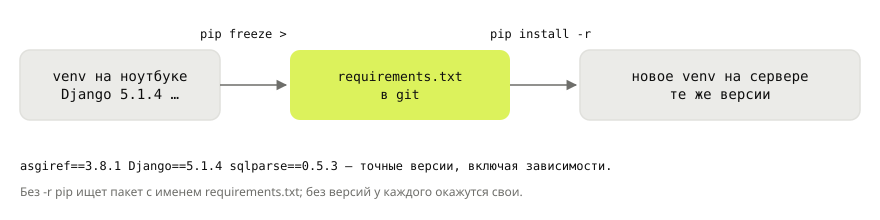

## Теория
**pip** — менеджер пакетов Python: скачивает библиотеки из каталога PyPI и ставит их в активное окружение вместе с их **зависимостями** (Django тянет за собой `asgiref` и `sqlparse`).

Основные команды:
- `pip install django` — последнюю доступную версию;
- `pip install django==5.1.4` — **конкретную** версию;
- `pip install "django>=5.1,<5.2"` — версию в диапазоне (кавычки — потому что `<` и `>` для оболочки значат перенаправление);
- `pip list` — что установлено; `pip uninstall -y django` — удалить;
- `pip freeze` — установленные пакеты в формате `имя==версия`, по одному на строку.

**`requirements.txt`** — список зависимостей проекта, который кладут в git. Записать — `pip freeze > requirements.txt`; поставить всё по списку на другом компьютере или сервере — `pip install -r requirements.txt` (флаг `-r` — «читать из файла»; без него pip ищет пакет с именем `requirements.txt`).

**Зачем фиксировать версии.** `pip install django` сегодня и через полгода поставит разные версии, и проект, который работал у вас, может не запуститься у коллеги или на сервере. `freeze` записывает точные версии всего окружения, включая зависимости, — окружение воспроизводится один в один. Обновляют версии осознанно: поменяли номер в файле, поставили, прогнали тесты, закоммитили.

У `freeze` есть минус: в список попадает всё окружение, в том числе случайно поставленные пакеты. Поэтому перед записью смотрят на `pip list`, а лишнее удаляют. В крупных проектах прямые зависимости и точные версии разделяют инструментами вроде `pip-tools`, `poetry` или `uv` — идея та же.

Порядок для нового проекта, который повторяется в каждом курсе дальше:
```bash
python3 -m venv venv
source venv/bin/activate
pip install django
pip freeze > requirements.txt
```

## Наглядно
**Рисунок 1.** requirements.txt переносит состав окружения на другой компьютер.



**Таблица 1.** Команды pip.

| Команда | Что делает |
|---|---|
| `pip install пакет` | последняя версия + зависимости |
| `pip install пакет==1.2.3` | конкретная версия |
| `pip list` | установленные пакеты |
| `pip freeze > requirements.txt` | записать точные версии в файл |
| `pip install -r requirements.txt` | поставить всё из файла |
| `pip uninstall -y пакет` | удалить |

## На практике
Задача: поставить Django нужной версии, записать зависимости и восстановить окружение по файлу.

### Шаг 1. Конкретная версия
Окружение активно, ставим Django 5.1.4:
```bash
pip install django==5.1.4
```
Результат:
```
Collecting django==5.1.4
  Downloading Django-5.1.4-py3-none-any.whl (8.3 MB)
Collecting asgiref (from Django)
  Downloading asgiref-3.8.1-py3-none-any.whl (23 kB)
Collecting sqlparse (from Django)
  Downloading sqlparse-0.5.3-py3-none-any.whl (44 kB)
Installing collected packages: sqlparse, asgiref, django
Successfully installed asgiref-3.8.1 Django-5.1.4 sqlparse-0.5.3
```
Поставились три пакета: Django и две его зависимости.

### Шаг 2. Записать зависимости
`freeze` выводит версии, `>` записывает их в файл:
```bash
pip freeze > requirements.txt
cat requirements.txt
```
Результат:
```
asgiref==3.8.1
Django==5.1.4
sqlparse==0.5.3
```

### Шаг 3. Без -r
Коллега склонировал проект и хочет поставить зависимости:
```bash
pip install requirements.txt
```
Результат:
```
ERROR: Could not find a version that satisfies the requirement requirements.txt (from versions: none)
ERROR: No matching distribution found for requirements.txt
```
pip искал в каталоге пакет с именем `requirements.txt`. Чтобы читать список из файла, нужен `-r`:
```bash
pip install -r requirements.txt
```
Результат:
```
Requirement already satisfied: asgiref in ./venv/lib/python3.12/site-packages (3.8.1)
Requirement already satisfied: django in ./venv/lib/python3.12/site-packages (5.1.4)
Requirement already satisfied: sqlparse in ./venv/lib/python3.12/site-packages (0.5.3)
```
У нас всё уже стоит; в новом окружении эта команда поставила бы ровно эти версии.

## Частые ошибки
- **`pip install requirements.txt` без `-r`.** pip ищет пакет с таким именем.
- **Версии не зафиксированы.** `django` без версии в файле — у каждого своя.
- **`freeze` в неактивированном окружении.** Список системных пакетов вместо пакетов проекта (или пустой).
- **Мусор в `requirements.txt`.** `freeze` записывает всё, что стоит в окружении; перед записью проверьте `pip list`.
- **`>` и `>>`.** `pip freeze >> requirements.txt` допишет второй список к старому — пакеты задвоятся.

## Итог
**pip**
- `install` (с `==версией`), `list`, `uninstall -y`, `freeze`.
- Зависимости пакета ставятся вместе с ним.

**requirements.txt**
- `pip freeze > requirements.txt` — записать точные версии; файл — в git.
- `pip install -r requirements.txt` — воспроизвести окружение.
- Версии фиксируют, обновляют осознанно.

## Вопросы на собеседовании
<details><summary>Зачем фиксировать версии зависимостей?</summary>

Чтобы окружение воспроизводилось одинаково у всех разработчиков, в CI и на сервере. Без фиксации `pip install` ставит последние версии, и новая версия библиотеки может сломать проект без единого изменения в коде. Обновления делают явно и проверяют тестами.
</details>

<details><summary>Что делает `pip freeze`?</summary>

Выводит все пакеты текущего окружения в формате `имя==версия` — прямые зависимости и их зависимости. Результат перенаправляют в `requirements.txt`. Минус — нет разделения на «что нужно проекту» и «что притянулось»; это решают `pip-tools` (`requirements.in` → `requirements.txt`), poetry или uv с lock-файлами.
</details>

<details><summary>Как развернуть проект на новом компьютере?</summary>

Склонировать репозиторий, создать окружение и поставить зависимости: `python3 -m venv venv`, `source venv/bin/activate`, `pip install -r requirements.txt`. Затем настройки окружения (`.env`), миграции и запуск — это будет в курсах Django и Docker.
</details>
