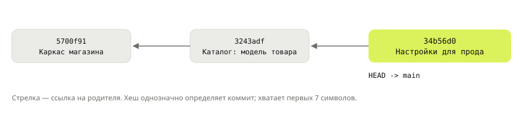

## Теория
Без контроля версий проект живёт так: `shop.zip`, `shop_v2.zip`, `shop_final.zip`, `shop_final_2_точно.zip`. Неясно, что изменилось между версиями, кто и зачем это сделал, как вернуть вчерашний вариант одного файла и как двоим работать над проектом одновременно, не затирая правки друг друга.

**Git** решает это: он хранит **историю** проекта как цепочку снимков — **коммитов**. Коммит — состояние всех файлов проекта в момент сохранения плюс автор, дата и **сообщение**, что и зачем изменено. У каждого коммита есть уникальный идентификатор — хеш вроде `486f34c…` (обычно хватает первых семи символов). По истории можно посмотреть любую прошлую версию, сравнить версии и вернуться к нужной.

Основные понятия:
- **репозиторий** — папка проекта, история которой хранится в скрытой подпапке `.git`. Удалите `.git` — останутся файлы, но пропадёт история;
- **коммит** — сохранённый снимок с сообщением;
- **ветка** — независимая линия разработки: новая страница делается в своей ветке и попадает в основную, когда готова (тема 5).

**Git и GitHub — разные вещи.** Git — программа на вашем компьютере, работает без интернета. **GitHub** (как GitLab, Bitbucket) — сервис, где хранят копию репозитория в сети: для резервной копии, совместной работы, ревью кода и деплоя (тема 7).

**Настройка.** Каждый коммит подписывается именем и почтой автора. Git берёт их из настроек — без них коммит не создастся. Настраивают один раз на компьютере:
```bash
git config --global user.name "Анна Смирнова"
git config --global user.email anna@shop.example
```
`--global` — для всех репозиториев пользователя (файл `~/.gitconfig`); без него — только для текущего. Почту указывают ту же, что в аккаунте GitHub, — тогда коммиты привяжутся к вашему профилю. Посмотреть настройки — `git config --list`.

В тренажёре Git уже настроен на «Shop Developer», кроме задач, где настройка — часть условия.

## Наглядно
**Рисунок 1.** История проекта — цепочка коммитов.



**Таблица 1.** Папки с версиями и Git.

| Вопрос | Архивы `shop_v2.zip` | Git |
|---|---|---|
| Что изменилось между версиями? | сравнивать вручную | `git diff`, `git log` |
| Кто и зачем изменил? | неизвестно | автор и сообщение коммита |
| Вернуть один файл как было вчера? | искать архив | команда по хешу коммита |
| Двое правят проект одновременно? | затирают друг друга | ветки и слияние |
| Копия в сети | вручную | GitHub |

## На практике
Задача: на новом компьютере сделать первый коммит проекта магазина — и узнать, что без настройки Git он не создастся.

### Шаг 1. Коммит без настройки
Файлы уже добавлены к коммиту (это — в следующей теме), а имя и почта Git не заданы:
```bash
git commit -m 'Каркас магазина'
```
Результат:
```
Author identity unknown

*** Please tell me who you are.

Run

  git config --global user.email "you@example.com"
  git config --global user.name "Your Name"

to set your account's default identity.
Omit --global to set the identity only in this repository.

fatal: unable to auto-detect email address (got 'shop@server.(none)')
```
Git прямо пишет, какие команды выполнить.

### Шаг 2. Настроить и повторить
Команды:
```bash
git config --global user.name 'Анна Смирнова'
git config --global user.email anna@shop.example
git commit -m 'Каркас магазина'
```
Результат:
```
[main (root-commit) 486f34c] Каркас магазина
 2 files changed, 2 insertions(+)
 create mode 100644 manage.py
 create mode 100644 shop/settings.py
```
`main` — ветка, `root-commit` — первый коммит в истории, `486f34c` — начало его хеша.

### Шаг 3. Проверить
Команды:
```bash
git config --list
git log
```
Результат:
```
user.name=Анна Смирнова
user.email=anna@shop.example
commit 486f34c764f169688b3052495e7cbb8ab9a8e6ab (HEAD -> main)
Author: Анна Смирнова <anna@shop.example>
Date:   Wed Nov 18 10:43:20 2026 +0300

    Каркас магазина
```
Автор коммита — из настроек. Дата у вас будет своя.

## Частые ошибки
- **Путать Git и GitHub.** Коммиты делаются локально без интернета; GitHub — только копия в сети.
- **Не та почта.** Коммиты с почтой, которой нет в аккаунте GitHub, не привяжутся к профилю.
- **Сообщение «правки», «fix», «123».** Через месяц не понять, что изменено; сообщение отвечает на вопрос «что и зачем».
- **Удалить `.git`.** Это и есть история; без неё папка — просто файлы.
- **Хранить версии архивами «на всякий случай».** История уже в Git — архивы только путают.

## Итог
**Git**
- Хранит историю проекта цепочкой коммитов: снимок файлов + автор, дата, сообщение, хеш.
- Репозиторий — папка с подпапкой `.git`.
- GitHub — сервис для копии репозитория в сети и совместной работы.

**Настройка**
- `git config --global user.name`, `user.email` — один раз на компьютере.
- `git config --list` — проверить.

## Вопросы на собеседовании
<details><summary>Чем Git отличается от GitHub?</summary>

Git — распределённая система контроля версий: программа, которая ведёт историю репозитория локально, без сервера. GitHub — хостинг Git-репозиториев с веб-интерфейсом, pull request'ами, ревью, задачами и CI. С Git можно работать без GitHub (или с GitLab, Bitbucket, своим сервером).
</details>

<details><summary>Что такое коммит?</summary>

Снимок состояния всех отслеживаемых файлов проекта с метаданными: автор, дата, сообщение и ссылка на родительский коммит (у коммита слияния — на два). Идентифицируется хешем SHA-1 от содержимого и метаданных, поэтому изменить коммит, не поменяв его хеш, невозможно.
</details>

<details><summary>Почему Git называют распределённым?</summary>

У каждого разработчика полная копия репозитория со всей историей: коммиты, ветки, просмотр истории и сравнение работают локально. Центральный сервер (GitHub) — договорённость команды, а не требование: репозитории обмениваются коммитами через `push` и `pull`.
</details>
