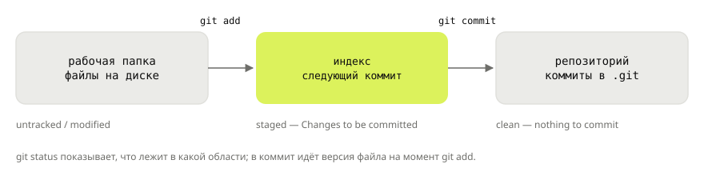

## Теория
**`git init`** в папке проекта создаёт пустой репозиторий — скрытую папку `.git`. Файлы проекта при этом никуда не деваются, но Git их пока не отслеживает.

Коммит делается в два шага, и это главное, что нужно понять в Git. Между папкой с файлами и историей есть промежуточная зона — **индекс** (staging area, «подготовленное»):
1. **`git add файл`** — положить текущую версию файла в индекс: «этот файл войдёт в следующий коммит в таком виде». `git add .` — все изменения в текущей папке и ниже, `git add -A` — во всём репозитории;
2. **`git commit -m "сообщение"`** — сохранить в историю то, что лежит в индексе.

Зачем два шага: в коммит должно попасть одно логическое изменение. Вы поправили модель товара и заодно записали заметки в `notes.txt` — `git add catalog/models.py` и коммит только с моделью, а заметки в историю не попадут.

**Состояния файлов** — их показывает **`git status`**, главная команда Git (выполняйте её перед каждым `add` и `commit`):
- **untracked** (`Untracked files`) — новый файл, Git его ещё не знает;
- **staged** (`Changes to be committed`) — изменение в индексе, войдёт в коммит;
- **modified** (`Changes not staged for commit`) — файл изменён после последнего коммита или `add`, но изменение не в индексе;
- если файл не изменён после коммита, `git status` о нём молчит: `nothing to commit, working tree clean`.

Важная деталь: `git add` кладёт в индекс версию файла **на момент команды**. Изменили файл после `add` — новые правки снова `modified`, и без повторного `add` в коммит уйдёт старая версия.

`git commit` без `-m` открыл бы редактор для сообщения; в тренажёре редактора нет — пишите `-m`. Коммит с пустым индексом не создаётся: `nothing added to commit`.

## Наглядно
**Рисунок 1.** Три области Git: рабочая папка, индекс, репозиторий.



**Таблица 1.** Что пишет `git status`.

| Раздел вывода | Состояние | Что сделать |
|---|---|---|
| `Untracked files` | новый, не отслеживается | `git add`, если нужен в истории |
| `Changes not staged for commit` | изменён, не в индексе | `git add`, чтобы войти в коммит |
| `Changes to be committed` | в индексе | `git commit` |
| `nothing to commit, working tree clean` | всё закоммичено | — |

## На практике
Задача: создать репозиторий для проекта магазина и закоммитить код, не захватив личные заметки.

### Шаг 1. Создать репозиторий
В папке проекта три вещи: `manage.py`, папка `shop` с настройками и `notes.txt` с черновыми заметками:
```bash
git init
git status
```
Результат:
```
Initialized empty Git repository in /home/shop/shop/.git/
On branch main

No commits yet

Untracked files:
  (use "git add <file>..." to include in what will be committed)
	manage.py
	notes.txt
	shop/

nothing added to commit but untracked files present (use "git add" to track)
```
Все файлы — `Untracked`: Git видит их, но не отслеживает.

### Шаг 2. Коммит без add
Команды:
```bash
git commit -m 'Каркас магазина'
```
Результат:
```
On branch main

No commits yet

Untracked files:
  (use "git add <file>..." to include in what will be committed)
	manage.py
	notes.txt
	shop/

nothing added to commit but untracked files present (use "git add" to track)
```
Индекс пуст — коммитить нечего. Git не добавляет файлы сам.

### Шаг 3. Подготовить нужное
Код — в индекс, заметки — нет:
```bash
git add manage.py shop
git status
```
Результат:
```
On branch main

No commits yet

Changes to be committed:
  (use "git rm --cached <file>..." to unstage)
	new file:   manage.py
	new file:   shop/settings.py

Untracked files:
  (use "git add <file>..." to include in what will be committed)
	notes.txt
```
`git add shop` добавил папку целиком — со всеми файлами внутри.

### Шаг 4. Коммит
Команды:
```bash
git commit -m 'Каркас магазина'
git status
```
Результат:
```
[main (root-commit) 486f34c] Каркас магазина
 2 files changed, 2 insertions(+)
 create mode 100644 manage.py
 create mode 100644 shop/settings.py
On branch main

Untracked files:
  (use "git add <file>..." to include in what will be committed)
	notes.txt

nothing added to commit but untracked files present (use "git add" to track)
```
В истории — два файла, `notes.txt` остался вне истории. Чтобы Git перестал о нём напоминать, его добавляют в `.gitignore` (тема 4).

## Частые ошибки
- **`commit` без `add`.** `nothing added to commit` — коммитить нечего.
- **Правка после `add`.** В коммит уйдёт версия на момент `add`; изменения после — снова `add`.
- **`git add .` не глядя.** В коммит попадут заметки, `.env`, окружение. Сначала `git status`.
- **Один коммит на всё за неделю.** Коммит — одно логическое изменение; так проще понять историю и откатить ошибку.
- **`git init` не в той папке.** Например, в домашней — Git начнёт отслеживать все ваши файлы. Проверьте `pwd`.

## Итог
**Репозиторий**
- `git init` — создать (папка `.git`).

**Коммит в два шага**
- `git add` — в индекс; `git commit -m` — в историю.
- В коммит идёт версия файла на момент `add`.

**Состояния**
- untracked, modified, staged; `git status` — перед каждым `add` и `commit`.

## Вопросы на собеседовании
<details><summary>Что такое индекс (staging area) в Git?</summary>

Промежуточная область между рабочей папкой и репозиторием: здесь собирается следующий коммит. `git add` копирует текущую версию файла в индекс, `git commit` сохраняет индекс в историю. Это позволяет закоммитить только часть изменений — нужные файлы (или даже части файлов: `git add -p`).
</details>

<details><summary>Какие состояния бывают у файла в Git?</summary>

Untracked — не отслеживается; tracked unmodified — совпадает с последним коммитом; modified — изменён, но не в индексе; staged — изменение в индексе и войдёт в коммит. `git status` показывает все, кроме неизменённых.
</details>

<details><summary>Чем `git add .` отличается от `git add -A`?</summary>

`git add .` добавляет изменения (новые, изменённые и удалённые файлы) в текущей папке и её подпапках, `git add -A` — во всём репозитории, откуда бы ни запустили. Из корня проекта результат одинаковый.
</details>
