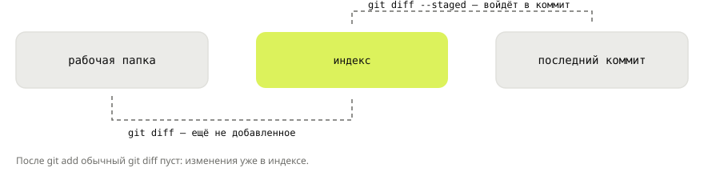

## Теория
Перед каждым коммитом полезно посмотреть, **что** именно в него уйдёт, а потом — найти в истории, когда и зачем что-то поменялось. Для этого две команды.

**`git log`** — история коммитов, новые сверху: хеш, автор, дата, сообщение. Варианты:
- `git log --oneline` — по строке на коммит: короткий хеш и сообщение;
- `git log -n 3` — только последние три;
- `git log --oneline --graph --all` — все ветки с линиями графа (пригодится в теме про ветки);
- выход из длинного вывода — `q` (в настоящем терминале длинный вывод листается, в тренажёре — нет).

Рядом с хешем в скобках — **указатели**: `HEAD -> main` значит «вы сейчас на ветке `main`, и это её последний коммит»; позже там появятся другие ветки и `origin/main`.

**`git diff`** — построчная разница. Важно, **что с чем** сравнивается:
- `git diff` — рабочая папка против индекса: изменения, которые вы **ещё не добавили** `git add`;
- `git diff --staged` — индекс против последнего коммита: то, что **войдёт в следующий коммит**.

Отсюда частое недоразумение: сделали `git add`, запустили `git diff` — пусто. Изменения никуда не делись, они в индексе, и показывает их `git diff --staged`.

Как читать diff: заголовок `diff --git a/… b/…` — какой файл; строки с `-` — удалены (было), с `+` — добавлены (стало); изменённая строка выглядит как пара «минус старая, плюс новая». `@@ -1,2 +1,2 @@` — с какой строки и сколько строк показано в старой и новой версии. В настоящем терминале строки ещё и окрашены: красные — удалённые, зелёные — добавленные.

## Наглядно
**Рисунок 1.** Что сравнивает каждая команда.



**Таблица 1.** Просмотр истории и изменений.

| Команда | Показывает |
|---|---|
| `git log` | все коммиты: хеш, автор, дата, сообщение |
| `git log --oneline` | коммиты по строке |
| `git log -n 1` | последний коммит |
| `git diff` | изменения, ещё не добавленные в индекс |
| `git diff --staged` | изменения в индексе — будущий коммит |

## На практике
Задача: перед выкладкой магазина изменить настройки, проверить правки и закоммитить их.

### Шаг 1. История
В репозитории уже два коммита:
```bash
git log --oneline
```
Результат:
```
3243adf (HEAD -> main) Каталог: модель товара
5700f91 Каркас магазина
```

### Шаг 2. Что изменено
В `shop/settings.py` выключили режим отладки и указали домен. Смотрим разницу:
```bash
git status
git diff
```
Результат:
```
On branch main

Changes not staged for commit:
  (use "git add <file>..." to update what will be committed)
  (use "git restore <file>..." to discard changes in working directory)
	modified:   shop/settings.py

no changes added to commit (use "git add" and/or "git commit -a")
diff --git a/shop/settings.py b/shop/settings.py
index 1317e0a..6b573a5 100644
--- a/shop/settings.py
+++ b/shop/settings.py
@@ -1,2 +1,2 @@
-DEBUG = True
-ALLOWED_HOSTS = []
+DEBUG = False
+ALLOWED_HOSTS = ['shop.example']
```
Обе строки заменены: «минус» — как было в коммите, «плюс» — как сейчас.

### Шаг 3. После add
Добавляем в индекс и снова смотрим:
```bash
git add shop/settings.py
git diff
git diff --staged
```
Результат:
```
diff --git a/shop/settings.py b/shop/settings.py
index 1317e0a..6b573a5 100644
--- a/shop/settings.py
+++ b/shop/settings.py
@@ -1,2 +1,2 @@
-DEBUG = True
-ALLOWED_HOSTS = []
+DEBUG = False
+ALLOWED_HOSTS = ['shop.example']
```
Первый `git diff` ничего не вывел: неподготовленных изменений больше нет. Тот же diff показал `--staged` — это и войдёт в коммит.

### Шаг 4. Коммит и история
Команды:
```bash
git commit -m 'Настройки для продакшена'
git log -n 1
```
Результат:
```
[main 34b56d0] Настройки для продакшена
 1 file changed, 2 insertions(+), 2 deletions(-)
commit 34b56d09488cf4984925400fd944e76ec69e1e2d (HEAD -> main)
Author: Shop Developer <dev@shop.example>
Date:   Wed Nov 18 10:43:34 2026 +0300

    Настройки для продакшена
```
`2 insertions(+), 2 deletions(-)` — две строки заменены. Указатель `HEAD -> main` переехал на новый коммит.

## Частые ошибки
- **«diff пустой — изменения пропали».** Они в индексе: `git diff --staged`.
- **Коммит без просмотра.** В историю уходят отладочные `print`, пароли, случайные правки; `git diff --staged` перед коммитом это ловит.
- **Читать diff наоборот.** `-` — было, `+` — стало.
- **Застрять в просмотре `git log`.** Выход — `q`.
- **Искать коммит по дате на глаз.** `git log --oneline` и понятные сообщения находят нужное быстрее; есть и `git log --grep=текст`.

## Итог
**История**
- `git log`, `--oneline`, `-n N`, `--graph --all`.
- `HEAD -> main` — текущая ветка и её последний коммит.

**Изменения**
- `git diff` — не добавленные в индекс; `git diff --staged` — то, что войдёт в коммит.
- `-` — было, `+` — стало.

## Вопросы на собеседовании
<details><summary>Чем `git diff` отличается от `git diff --staged`?</summary>

`git diff` сравнивает рабочую папку с индексом — показывает изменения, ещё не добавленные `git add`. `git diff --staged` (синоним `--cached`) сравнивает индекс с последним коммитом — показывает, что войдёт в следующий коммит. `git diff HEAD` — всё сразу: рабочая папка против коммита.
</details>

<details><summary>Что такое `HEAD`?</summary>

Указатель на то, где вы сейчас: обычно на текущую ветку, а через неё — на её последний коммит. При коммите ветка (и вместе с ней `HEAD`) сдвигается на новый коммит, при переключении ветки — `HEAD` указывает на другую ветку. `HEAD~1` — коммит перед текущим.
</details>

<details><summary>Как найти коммит, в котором изменили определённую строку?</summary>

`git log -S'текст'` — коммиты, где количество вхождений текста изменилось (строку добавили или удалили); `git blame файл` — для каждой строки последний коммит, который её менял; `git log --grep=слово` — поиск по сообщениям коммитов.
</details>
