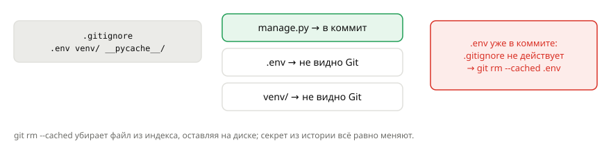

## Теория
Не всё в папке проекта должно попасть в историю:
- **секреты** — `.env` с паролем от базы и `SECRET_KEY`. Попав в git (а тем более на GitHub), секрет считается раскрытым: его меняют, удаление файла из следующего коммита не помогает — он остаётся в истории;
- **окружение** — `venv/`: сотни файлов, привязанных к вашему компьютеру; воспроизводится по `requirements.txt`;
- **генерируемое** — `__pycache__/` и `*.pyc` (байт-код Python), `db.sqlite3` (локальная база), `staticfiles/`, логи;
- **личное** — настройки редактора (`.idea/`, `.vscode/`), файлы системы (`.DS_Store`).

**`.gitignore`** — текстовый файл в корне репозитория со списком шаблонов: что Git не должен замечать. Такие файлы не появляются в `git status` как `Untracked` и не добавляются `git add .`. Сам `.gitignore` коммитят — он общий для всех разработчиков проекта.

Шаблоны, по строке на каждый:
- `.env` — файл с таким именем в любой папке;
- `venv/` — папка (слеш в конце значит «только папка»);
- `*.pyc` — по маске: `*` — любые символы;
- `/db.sqlite3` — слеш в начале: только в корне репозитория;
- `!example.env` — исключение из правила выше: этот файл всё-таки отслеживать;
- `#` — комментарий.

**Главная ловушка: `.gitignore` не действует на уже отслеживаемые файлы.** Если `.env` уже закоммичен, добавление его в `.gitignore` ничего не изменит: Git продолжит отслеживать изменения. Нужно убрать файл из индекса, оставив его на диске, — **`git rm --cached .env`** (для папки — `git rm -r --cached venv`), — и закоммитить это вместе с `.gitignore`. Обычный `git rm` удалил бы файл и с диска. Если в файле был секрет, его в любом случае нужно сменить: старая версия навсегда в истории.

Поэтому `.gitignore` создают **до первого коммита**. Готовые шаблоны для Python есть у GitHub (github/gitignore, файл `Python.gitignore`).

## Наглядно
**Рисунок 1.** .gitignore скрывает неотслеживаемые файлы, но не уже отслеживаемые.



**Таблица 1.** `.gitignore` для Django-проекта.

| Строка | Что не попадёт в git |
|---|---|
| `.env` | секреты и настройки окружения |
| `venv/`, `.venv/` | виртуальное окружение |
| `__pycache__/`, `*.pyc` | байт-код Python |
| `db.sqlite3` | локальная база разработки |
| `staticfiles/`, `media/` | собранная статика, загруженные файлы |
| `.idea/`, `.vscode/` | настройки редактора |

## На практике
Задача: в проект добавились `.env`, окружение и кэш Python — не дать им попасть в git; потом убрать из истории `.env`, который закоммитили раньше.

### Шаг 1. Лишнее в статусе
В репозитории появились файлы, которые коммитить нельзя:
```bash
git status
```
Результат:
```
On branch main

Untracked files:
  (use "git add <file>..." to include in what will be committed)
	.env
	__pycache__/
	venv/

nothing added to commit but untracked files present (use "git add" to track)
```
`git add .` сейчас добавил бы всё это.

### Шаг 2. Создать .gitignore
Записываем шаблоны по строке:
```bash
echo .env > .gitignore
echo venv/ >> .gitignore
echo __pycache__/ >> .gitignore
git status
```
Результат:
```
On branch main

Untracked files:
  (use "git add <file>..." to include in what will be committed)
	.gitignore

nothing added to commit but untracked files present (use "git add" to track)
```
Лишние файлы исчезли из статуса, остался сам `.gitignore` — его коммитят.

### Шаг 3. Уже закоммиченный .env
В другом проекте `.env` попал в первый коммит. Добавляем его в `.gitignore` — и Git продолжает его отслеживать. Убираем из индекса, но не с диска:
```bash
echo .env > .gitignore
git rm --cached .env
git status
```
Результат:
```
rm '.env'
On branch main

Changes to be committed:
  (use "git restore --staged <file>..." to unstage)
	deleted:    .env

Untracked files:
  (use "git add <file>..." to include in what will be committed)
	.gitignore
```
Для Git это «удаление» файла из следующего коммита. Коммитим вместе с `.gitignore`:
```bash
git add .gitignore
git commit -m 'Не храним .env в репозитории'
ls -a
```
Результат:
```
[main a9d5869] Не храним .env в репозитории
 2 files changed, 1 insertion(+), 1 deletion(-)
 delete mode 100644 .env
 create mode 100644 .gitignore
.  ..  .env  .git  .gitignore  manage.py
```
`.env` на диске остался, но больше не отслеживается. В прошлых коммитах он по-прежнему есть — ключ из него нужно сменить.

## Частые ошибки
- **`.gitignore` после первого коммита.** Уже отслеживаемые файлы он не трогает; нужен `git rm --cached`.
- **`git rm` вместо `git rm --cached`.** Файл удалится и с диска.
- **«Убрал `.env` — секрет в безопасности».** Он остаётся в истории и на GitHub; секрет меняют.
- **`venv` без слеша при папке с другим именем.** Шаблон должен совпадать с именем: `.venv/` и `venv/` — разные папки.
- **`.gitignore` не закоммичен.** У коллег свои правила, и кто-то закоммитит лишнее.

## Итог
**Что игнорировать**
- Секреты (`.env`), окружение (`venv/`), байт-код (`__pycache__/`), локальную базу, настройки редактора.

**.gitignore**
- Шаблоны по строке: имя, `папка/`, `*.pyc`, `/в_корне`, `!исключение`, `#` комментарий.
- Создаётся до первого коммита и коммитится.

**Уже отслеживаемые**
- `git rm --cached файл` (папка — `-r`) + коммит; секрет в истории — сменить.

## Вопросы на собеседовании
<details><summary>Почему файл из `.gitignore` всё равно показывается в изменениях?</summary>

`.gitignore` действует только на неотслеживаемые файлы. Если файл уже был закоммичен, Git отслеживает его дальше. Нужно убрать его из индекса — `git rm --cached файл` — и закоммитить вместе с правилом в `.gitignore`.
</details>

<details><summary>Что делать, если `.env` с секретами попал на GitHub?</summary>

Считать секреты скомпрометированными и сменить их (пароли, ключи API, `SECRET_KEY`). Затем убрать файл из отслеживания (`git rm --cached`, `.gitignore`). Удалить его из старых коммитов можно переписыванием истории (`git filter-repo`), но копии могли уже разойтись — поэтому главное — смена секретов.
</details>

<details><summary>Что обычно кладут в `.gitignore` Python-проекта?</summary>

Окружение (`venv/`, `.venv/`), байт-код (`__pycache__/`, `*.pyc`), файлы окружения с секретами (`.env`), локальные базы (`db.sqlite3`), собранные и загруженные файлы (`staticfiles/`, `media/`), отчёты тестов и покрытия (`.pytest_cache/`, `.coverage`), настройки IDE.
</details>
