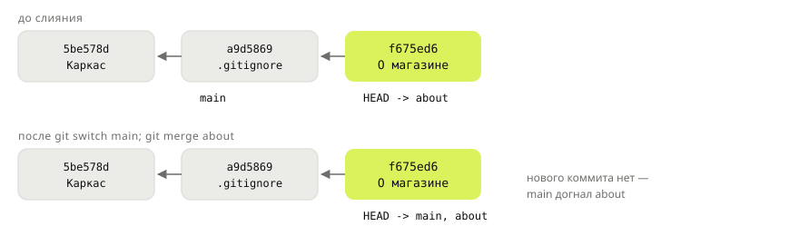

## Теория
Основная ветка `main` должна всегда работать: из неё выкладывают сайт. Новую страницу «О магазине» делают несколько дней, с промежуточными коммитами, и всё это время `main` не должен ломаться. Для этого работу ведут в отдельной **ветке**.

**Ветка** в Git — просто **указатель на коммит** с именем. При новом коммите указатель текущей ветки переезжает на него. Создать ветку — значит создать ещё один указатель; это мгновенно и ничего не копирует. **`HEAD`** показывает, на какой ветке вы сейчас: новые коммиты двигают именно её.

Команды:
- `git branch` — список веток, текущая отмечена `*`;
- `git switch -c about` — создать ветку `about` от текущего коммита и перейти на неё;
- `git switch main` — перейти на существующую ветку. Файлы в папке меняются под выбранную ветку: в `main` новой страницы ещё нет;
- `git merge about` — **влить** ветку `about` в **текущую** ветку. Сначала переходят туда, **куда** вливают (`main`), потом `merge` того, **что** вливают;
- `git branch -d about` — удалить ветку после слияния. Не слитую ветку `-d` не удалит (`not fully merged`) — защита от потери коммитов; `-D` удаляет принудительно.

**Виды слияния:**
- **fast-forward** — если в `main` с момента создания ветки ничего не появилось, Git просто передвигает указатель `main` вперёд на последний коммит ветки (`Fast-forward` в выводе). Нового коммита не создаётся;
- **коммит слияния** — если обе ветки ушли вперёд, Git создаёт коммит с двумя родителями, объединяющий изменения (`Merge made by the 'ort' strategy`). Если обе ветки поменяли одни и те же строки — конфликт (следующая тема).

Имена веток — короткие и по смыслу: `about`, `cart-limit`, `feature/promo`. Слеш — часть имени, удобная для группировки (`feature/…`, `fix/…`).

В старых материалах для переключения веток используют `git checkout ветка` и `git checkout -b ветка`. Это работает и сейчас, но у `checkout` много других значений (в том числе отменить изменения в файле), поэтому для веток в Git 2.23 появилась отдельная команда `switch`.

## Наглядно
**Рисунок 1.** Ветка — указатель; fast-forward сдвигает main вперёд.



**Таблица 1.** Команды веток.

| Команда | Что делает |
|---|---|
| `git branch` | список веток, `*` — текущая |
| `git switch -c имя` | создать ветку и перейти на неё |
| `git switch имя` | перейти на ветку |
| `git merge имя` | влить ветку в текущую |
| `git branch -d имя` | удалить слитую ветку |
| `git log --oneline --graph --all` | все ветки на графе |

## На практике
Задача: сделать страницу «О магазине» в отдельной ветке и влить её в `main`.

### Шаг 1. Новая ветка
Команды:
```bash
git switch -c about
git branch
```
Результат:
```
Switched to a new branch 'about'
* about
  main
```

### Шаг 2. Коммит в ветке
Страница и коммит:
```bash
mkdir -p templates
echo '<h1>О магазине</h1>' > templates/about.html
git add templates
git commit -m 'Страница «О магазине»'
git log --oneline --graph --all
```
Результат:
```
[about f675ed6] Страница «О магазине»
 1 file changed, 1 insertion(+)
 create mode 100644 templates/about.html
* f675ed6 (HEAD -> about) Страница «О магазине»
* a9d5869 (main) Не храним .env в репозитории
* 5be578d Каркас магазина
```
`about` ушла на коммит вперёд, `main` осталась на месте.

### Шаг 3. В main страницы нет
Команды:
```bash
git switch main
ls templates
```
Результат:
```
Switched to branch 'main'
ls: cannot access 'templates': No such file or directory
```
Файлы в папке — те, что в текущей ветке.

### Шаг 4. Слияние
Мы в `main` — вливаем `about`:
```bash
git merge about
git log --oneline --graph --all
```
Результат:
```
Updating a9d5869..f675ed6
Fast-forward
 1 file changed, 1 insertion(+)
 create mode 100644 templates/about.html
* f675ed6 (HEAD -> main, about) Страница «О магазине»
* a9d5869 Не храним .env в репозитории
* 5be578d Каркас магазина
```
В `main` новых коммитов не было — Git просто передвинул `main` на коммит ветки (fast-forward). Обе ветки теперь указывают на один коммит.

### Шаг 5. Удалить ветку
Ветка слита и больше не нужна:
```bash
git branch -d about
git branch
```
Результат:
```
Deleted branch about (was f675ed6).
* main
```
Коммит остался в `main` — удалился только указатель.

## Частые ошибки
- **`merge` не с той стороны.** Находясь в `about`, `git merge main` вливает `main` в ветку, а не наоборот. Сначала `git switch` туда, куда вливаете.
- **Работа прямо в `main`.** Незаконченная фича ломает основную ветку.
- **Переключение с незакоммиченными правками.** Git либо откажется, либо перенесёт правки в другую ветку — сначала коммит.
- **`-D` вместо `-d`.** Принудительное удаление не слитой ветки теряет её коммиты.
- **Долгоживущие ветки.** Чем дольше ветка живёт отдельно, тем больше конфликтов при слиянии.

## Итог
**Ветка**
- Указатель на коммит с именем; `HEAD` — где вы сейчас.
- `git switch -c` — создать и перейти; `git switch` — перейти.

**Слияние**
- Перейти в принимающую ветку → `git merge ветка`.
- Fast-forward — указатель просто сдвигается; иначе — коммит слияния.
- `git branch -d` — удалить слитую ветку.

## Вопросы на собеседовании
<details><summary>Что такое ветка в Git?</summary>

Подвижный указатель на коммит. При коммите указатель текущей ветки переходит на новый коммит. Создание ветки ничего не копирует — это файл с хешем коммита, поэтому ветки в Git дешёвые и их создают на каждую задачу.
</details>

<details><summary>Что такое fast-forward?</summary>

Слияние, при котором в принимающей ветке не было новых коммитов с момента ответвления: Git просто передвигает её указатель на последний коммит вливаемой ветки, без коммита слияния. Если обе ветки ушли вперёд, создаётся коммит слияния с двумя родителями (или — с `--no-ff` — даже когда fast-forward возможен).
</details>

<details><summary>Чем `git switch` отличается от `git checkout`?</summary>

`checkout` — старая универсальная команда: переключает ветки и восстанавливает файлы. В Git 2.23 её разделили на `switch` (ветки) и `restore` (файлы), чтобы случайно не затереть изменения. `checkout` по-прежнему работает.
</details>
