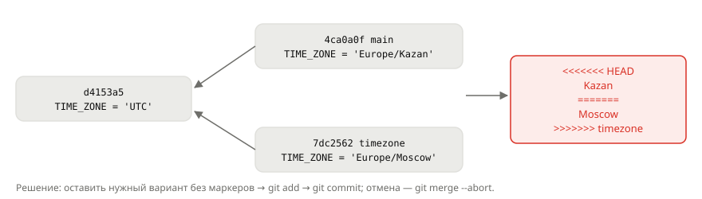

## Теория
Пока две ветки меняют разные файлы или разные места одного файла, Git сливает их сам. **Конфликт** — когда обе ветки после расхождения изменили **одни и те же строки** по-разному: Git не знает, какой вариант правильный, и просит решить человека.

Как это выглядит: `git merge` отвечает `CONFLICT (content): Merge conflict in shop/settings.py` и `Automatic merge failed`. Слияние остановлено на середине: в файле с конфликтом Git записал **оба варианта** между маркерами:
```
<<<<<<< HEAD
TIME_ZONE = 'Europe/Kazan'
=======
TIME_ZONE = 'Europe/Moscow'
>>>>>>> timezone
```
- между `<<<<<<< HEAD` и `=======` — версия **текущей** ветки (куда вливаете);
- между `=======` и `>>>>>>> timezone` — версия **вливаемой** ветки.

**Разрешить конфликт** — три шага:
1. открыть файл и оставить правильный текст: один из вариантов, оба или новый вариант — и **удалить все маркеры**;
2. `git add файл` — пометить конфликт решённым;
3. `git commit` — завершить слияние (в тренажёре — с `-m`; в настоящем Git без `-m` откроется редактор с готовым сообщением).

`git status` во время конфликта показывает `You have unmerged paths` и файлы как `both modified`. Если разбираться сейчас некогда — `git merge --abort` вернёт всё как было до `merge`.

Конфликт — не ошибка и не поломка, а нормальная часть совместной работы. Чтобы их было меньше: небольшие ветки, частые слияния, одно изменение — один коммит.

В тренажёре редактор `nano` открывает файл прямо в терминале; в эталонах задач файл переписывают через `echo >`.

## Наглядно
**Рисунок 1.** Откуда берётся конфликт.



**Таблица 1.** Маркеры конфликта.

| Маркер | Значение |
|---|---|
| `<<<<<<< HEAD` | начало версии текущей ветки |
| `=======` | граница между версиями |
| `>>>>>>> имя-ветки` | конец версии вливаемой ветки |

## На практике
Задача: в `main` часовой пояс поменяли на Казань, а в ветке `timezone` — на Москву. Влить ветку, оставив Москву.

### Шаг 1. Ветки разошлись
Команды:
```bash
git log --oneline --graph --all
```
Результат:
```
* 4ca0a0f (HEAD -> main) Часовой пояс — Казань
| * 7dc2562 (timezone) Часовой пояс — Москва
|/
* d4153a5 Каркас магазина
```
Обе ветки изменили одну строку `TIME_ZONE` после общего коммита.

### Шаг 2. Слияние останавливается
Команды:
```bash
git merge timezone
git status
```
Результат:
```
Auto-merging shop/settings.py
CONFLICT (content): Merge conflict in shop/settings.py
Automatic merge failed; fix conflicts and then commit the result.
On branch main
You have unmerged paths.
  (fix conflicts and run "git commit")
  (use "git merge --abort" to abort the merge)

Unmerged paths:
  (use "git add <file>..." to mark resolution)
	both modified:   shop/settings.py
```

### Шаг 3. Что в файле
Команды:
```bash
cat shop/settings.py
```
Результат:
```
DEBUG = True
<<<<<<< HEAD
TIME_ZONE = 'Europe/Kazan'
=======
TIME_ZONE = 'Europe/Moscow'
>>>>>>> timezone
LANGUAGE_CODE = 'en-us'
```
Строки `DEBUG` и `LANGUAGE_CODE` совпадают — конфликт только вокруг `TIME_ZONE`.

### Шаг 4. Оставить Москву и завершить
Переписываем файл без маркеров, добавляем и коммитим:
```bash
echo "DEBUG = True" > shop/settings.py
echo "TIME_ZONE = 'Europe/Moscow'" >> shop/settings.py
echo "LANGUAGE_CODE = 'en-us'" >> shop/settings.py
git add shop/settings.py
git commit -m 'Слияние timezone: оставили Москву'
git log --oneline --graph --all
```
Результат:
```
[main b11f7cd] Слияние timezone: оставили Москву
 1 file changed, 1 insertion(+), 1 deletion(-)
* b11f7cd (HEAD -> main) Слияние timezone: оставили Москву
|\
* | 4ca0a0f Часовой пояс — Казань
| * 7dc2562 (timezone) Часовой пояс — Москва
|/
* d4153a5 Каркас магазина
```
У коммита слияния два родителя — граф сходится в одну линию.

## Частые ошибки
- **Маркеры остались в файле.** `<<<<<<<` в `settings.py` — синтаксическая ошибка Python, сайт не запустится. Перед `git add` проверьте файл целиком.
- **Удалить не тот вариант.** Не «первый» или «свой», а правильный по смыслу; иногда нужны оба изменения.
- **Забыть `git add` после правки.** Файл остаётся `both modified`, коммит не создастся.
- **Паника.** `git merge --abort` возвращает состояние до слияния.
- **Неделями не сливать ветку.** Чем дольше ветки расходятся, тем больше конфликтов.

## Итог
**Конфликт**
- Обе ветки изменили одни строки — Git не выбирает сам.
- Маркеры: `<<<<<<< HEAD` (текущая), `=======`, `>>>>>>> ветка` (вливаемая).

**Разрешение**
- Оставить правильный текст и удалить маркеры → `git add` → `git commit`.
- Отказаться — `git merge --abort`.

## Вопросы на собеседовании
<details><summary>Когда в Git возникает конфликт слияния?</summary>

Когда обе сливаемые ветки после общего предка изменили одни и те же строки одного файла по-разному (или одна изменила файл, а другая удалила). Изменения в разных файлах или в разных местах одного файла Git объединяет автоматически.
</details>

<details><summary>Как разрешить конфликт?</summary>

Открыть файлы из `git status` (`both modified`), выбрать или собрать правильный вариант, удалить маркеры `<<<<<<<`, `=======`, `>>>>>>>`, выполнить `git add` для каждого файла и завершить слияние `git commit`. Отменить слияние целиком — `git merge --abort`. В IDE есть инструменты, которые показывают обе версии рядом.
</details>

<details><summary>Как уменьшить число конфликтов в команде?</summary>

Небольшие короткоживущие ветки и частые слияния с основной веткой; одна задача — одна ветка; договорённости о форматировании (автоформатер), чтобы не было «конфликтов из-за пробелов»; разделение больших файлов на модули.
</details>
