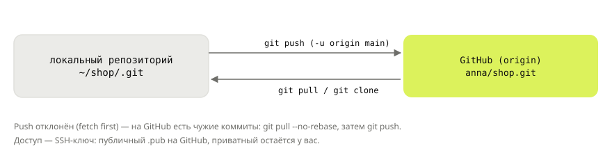

## Теория
Репозиторий на вашем компьютере — единственная копия: сломался диск — пропал проект. **Удалённый репозиторий** (remote) на GitHub — копия в сети: для резервирования, работы с другого компьютера, совместной работы и деплоя на сервер.

**Доступ по SSH.** GitHub должен знать, что вы — это вы. Удобнее всего — SSH-ключ: пара файлов, которую создаёт `ssh-keygen -t ed25519 -C "почта@github"`:
- **приватный ключ** `~/.ssh/id_ed25519` остаётся только у вас — никому не передавать и не коммитить;
- **публичный ключ** `~/.ssh/id_ed25519.pub` добавляют в GitHub (Settings → SSH and GPG keys → New SSH key).

При подключении GitHub проверяет, что у вас есть приватный ключ к добавленному публичному, — пароль вводить не нужно. Проверка — `ssh -T git@github.com` (`Hi anna! You've successfully authenticated…`). В старых инструкциях используют RSA-ключ (`-t rsa`); сейчас рекомендуют `ed25519` — он короче и надёжнее. В тренажёре `ssh-keygen` нет, «GitHub» в нём принимает любой адрес вида `git@github.com:владелец/репозиторий.git`.

**Связать и отправить.** На GitHub создают пустой репозиторий (без README), затем локально:
- `git remote add origin git@github.com:anna/shop.git` — запомнить адрес под именем `origin` (так принято называть основной удалённый репозиторий); `git remote -v` — посмотреть;
- `git push -u origin main` — отправить ветку `main`. `-u` (upstream) связывает локальную `main` с `origin/main`: дальше достаточно `git push` и `git pull` без аргументов. Без `-u` при первой отправке Git ответит `has no upstream branch`.

**Получить изменения.**
- `git clone адрес` — скачать репозиторий целиком на новый компьютер (папка с историей и уже настроенным `origin`). Делается один раз;
- `git pull` — забрать новые коммиты из `origin` в текущую ветку. Делается регулярно.

**Если на GitHub появились чужие коммиты.** Коллега отправил свой коммит, вы — свой локально. `git push` откажет (`rejected … fetch first`): сначала нужно забрать чужое. `git pull` в такой ситуации (ветки разошлись) в современном Git требует указать способ объединения: `git pull --no-rebase` — слияние, как `git merge` (создаст коммит слияния), `--rebase` — перенос ваших коммитов поверх чужих (подробно — в модуле «Git в команде»). Потом — `git push`.

Совместная работа на GitHub обычно идёт через ветки и **pull request** — запрос на слияние ветки с обсуждением и ревью; это тоже тема модуля «Git в команде».

## Наглядно
**Рисунок 1.** push и pull переносят коммиты между локальным и удалённым репозиторием.



**Таблица 1.** Команды работы с GitHub.

| Команда | Что делает |
|---|---|
| `git remote add origin адрес` | связать репозиторий с GitHub |
| `git remote -v` | показать удалённые репозитории |
| `git push -u origin main` | первая отправка ветки + связь с `origin/main` |
| `git push` | отправить новые коммиты |
| `git pull` | забрать новые коммиты |
| `git pull --no-rebase` | забрать, если ветки разошлись, — слиянием |
| `git clone адрес` | скачать репозиторий на новый компьютер |

## На практике
Задача: отправить проект магазина на GitHub, а потом забрать коммит коллеги.

### Шаг 1. Без адреса и без -u
Репозиторий на GitHub создан, локально адрес ещё не указан:
```bash
git push
git remote add origin git@github.com:anna/shop.git
git push
```
Результат:
```
fatal: No configured push destination.
Either specify the URL from the command-line or configure a remote repository using

    git remote add <name> <url>

and then push using the remote name

    git push <name>
fatal: The current branch main has no upstream branch.
To push the current branch and set the remote as upstream, use

    git push --set-upstream origin main

To have this happen automatically for branches without a tracking
upstream, see 'push.autoSetupRemote' in 'git help config'.
```
Сначала Git не знал, куда отправлять, потом — с какой веткой на GitHub связать `main`.

### Шаг 2. Первая отправка
Команды:
```bash
git push -u origin main
git status
```
Результат:
```
To github.com:anna/shop.git
 * [new branch]      main -> main
branch 'main' set up to track 'origin/main'.
On branch main
Your branch is up to date with 'origin/main'.
nothing to commit, working tree clean
```
`--set-upstream` и `-u` — одно и то же. Теперь `git status` сравнивает локальную ветку с GitHub.

### Шаг 3. Коллега опередил
Вы закоммитили README, а коллега тем временем отправил на GitHub модель корзины:
```bash
git push
```
Результат:
```
error: failed to push some refs to 'git@github.com:anna/shop.git'
hint: Updates were rejected because the remote contains work that you do not
hint: have locally. This is usually caused by another repository pushing to
hint: the same ref. If you want to integrate the remote changes, use
hint: 'git pull' before pushing again.
hint: See the 'Note about fast-forwards' in 'git push --help' for details.
To github.com:anna/shop.git
 ! [rejected]        main -> main (fetch first)
```
GitHub не даёт перезаписать чужую работу — сначала нужно её забрать.

### Шаг 4. pull при расхождении
Команды:
```bash
git pull
```
Результат:
```
From github.com:anna/shop
   c41b8bc..8ba9593  main       -> origin/main
hint: You have divergent branches and need to specify how to reconcile them.
hint: You can do so by running one of the following commands sometime before
hint: your next pull:
hint:
hint:   git config pull.rebase false  # merge
hint:   git config pull.rebase true   # rebase
hint:   git config pull.ff only       # fast-forward only
hint:
hint: You can replace "git config" with "git config --global" to set a default
hint: preference for all repositories. You can also pass --rebase, --no-rebase,
hint: or --ff-only on the command line to override the configured default per
hint: invocation.
fatal: Need to specify how to reconcile divergent branches.
```
Коммит коллеги скачан, но объединять Git не стал: ветки разошлись, а способ не выбран.

### Шаг 5. Слияние и отправка
Команды:
```bash
git pull --no-rebase
git log --oneline --graph --all
git push
```
Результат:
```
Merge made by the 'ort' strategy.
 1 file changed, 2 insertions(+)
 create mode 100644 cart/models.py
* 52afc8b (HEAD -> main) Merge remote-tracking branch 'origin/main'
|\
* | 2c41c91 README
| * 8ba9593 (origin/main) Корзина: модель
|/
* c41b8bc Каркас магазина
To github.com:anna/shop.git
   8ba9593..52afc8b  main -> main
```
Работа коллеги и ваша объединены коммитом слияния и отправлены. Чтобы не выбирать способ каждый раз, его задают настройкой: `git config --global pull.rebase false`.

## Частые ошибки
- **Приватный ключ на GitHub или в репозитории.** Публикуют только `.pub`; приватный — как пароль.
- **`git push` без `-u` в первый раз.** `has no upstream branch` — нужно `git push -u origin main`.
- **README при создании репозитория на GitHub.** Тогда на GitHub сразу есть коммит, которого нет у вас, и первая отправка отклоняется; для существующего проекта создают пустой репозиторий.
- **`git clone` вместо `git pull`.** `clone` — один раз на новом месте; обновлять — `pull`.
- **Пуш силой (`--force`), чтобы «прошло».** Затирает чужие коммиты на GitHub. Сначала `pull`.

## Итог
**Доступ**
- SSH-ключ `ed25519`: публичный (`.pub`) — на GitHub, приватный — только у вас.

**Связь и отправка**
- `git remote add origin адрес` → `git push -u origin main` → дальше `git push`.

**Получение**
- `git clone` — один раз; `git pull` — регулярно.
- Отказ `rejected (fetch first)` → `git pull --no-rebase` → `git push`.

## Вопросы на собеседовании
<details><summary>Чем `git pull` отличается от `git fetch`?</summary>

`git fetch` скачивает новые коммиты и обновляет указатели удалённых веток (`origin/main`), не трогая вашу ветку. `git pull` = `fetch` + объединение с текущей веткой (слиянием или rebase). `fetch` позволяет сначала посмотреть, что пришло, и объединить осознанно.
</details>

<details><summary>Как работает аутентификация по SSH-ключу?</summary>

Генерируется пара ключей: публичный кладут на сервер (в настройки GitHub), приватный остаётся у пользователя. При подключении сервер просит доказать владение приватным ключом (подписать случайные данные); сам приватный ключ по сети не передаётся. Публичный ключ не секретен, приватный — как пароль.
</details>

<details><summary>Почему `git push` отклоняется с `rejected (fetch first)`?</summary>

На удалённом репозитории в этой ветке есть коммиты, которых нет у вас, и push затёр бы их. Нужно забрать их (`git pull`), объединить со своими и отправить снова. `git push --force` отправит без проверки и удалит чужие коммиты — в общих ветках так не делают.
</details>
