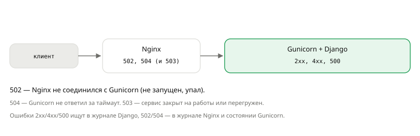

## Теория
Страница сайта объясняет ошибку человеку текстом. Клиент API — программа: мобильное приложение, сервис партнёра, — и решение «что делать дальше» она принимает **по коду ответа**. Поэтому в API код подбирают точно:

**Успех (2xx):**
- **200 OK** — прочитано или изменено, в теле — результат;
- **201 Created** — ресурс создан (`POST`), в заголовке **`Location`** — адрес нового ресурса;
- **204 No Content** — сделано, тела нет (`DELETE`, иногда `PUT`/`PATCH`).

**Ошибка клиента (4xx)** — повторять тот же запрос бессмысленно, нужно что-то исправить:
- **400 Bad Request** — запрос нельзя разобрать (битый JSON);
- **401 Unauthorized** — «кто вы?»: нет токена или он недействителен; в ответе — заголовок `WWW-Authenticate`;
- **403 Forbidden** — «вы известны, но нельзя»: чужой заказ, нет прав;
- **404 Not Found** — ресурса нет (или его существование скрывают — раздел Django «Пользователи и доступ»);
- **409 Conflict** — запрос конфликтует с состоянием ресурса: товар закончился, номер занят;
- **415 Unsupported Media Type** — тело не в том формате (`Content-Type`);
- **422 Unprocessable Entity** — JSON разобран, но данные не проходят проверку;
- **429 Too Many Requests** — превышен лимит запросов; в `Retry-After` — сколько подождать.

**Ошибка сервера (5xx)** — клиент не виноват, запрос можно повторить позже:
- **500 Internal Server Error** — исключение в коде приложения;
- **502 Bad Gateway** — прокси (Nginx) не получил ответ от приложения: Gunicorn не запущен или упал;
- **503 Service Unavailable** — сервис временно недоступен: перегрузка, работы;
- **504 Gateway Timeout** — прокси не дождался ответа приложения.

Важно, **кто** отдаёт код. 200–429 и 500 возвращает ваше приложение — их видно в журнале Django. 502 и 504 отдаёт Nginx: до Django запрос не дошёл или не вернулся вовремя — искать нужно в журнале Nginx и в состоянии Gunicorn (курс «Nginx и деплой»).

## Наглядно
**Рисунок 1.** Кто отдаёт код: приложение или прокси перед ним.



**Таблица 1.** Код — что делать клиенту.

| Код | Ситуация в магазине | Клиенту |
|---|---|---|
| 201 + `Location` | заказ создан | перейти к заказу по `Location` |
| 204 | позиция удалена из корзины | обновить корзину |
| 400 | битый JSON | исправить запрос |
| 401 | токен истёк | войти заново / обновить токен |
| 403 | чужой заказ | не повторять |
| 409 | товар закончился | показать «нет в наличии» |
| 422 | количество «два» | показать ошибку поля |
| 429 | 100 запросов в минуту | подождать `Retry-After` |
| 502 / 503 / 504 | сервер недоступен | повторить позже |

## На практике
Задача: какие коды отдаёт API заказов учебного магазина. Запросы — `curl` к учебному API, служебные заголовки убраны.

### Шаг 1. Создание заказа
Две беспроводные мыши:
```
$ curl -s -i -X POST http://localhost:8000/api/orders/ -H 'Content-Type: application/json' -d '{"product": 2, "quantity": 2}'
HTTP/1.1 201 Created
Content-Type: application/json
Location: /api/orders/125/
Content-Length: 41

{"id": 125, "user": "anna", "total": "0"}
```
Клиенту не нужно угадывать адрес нового заказа — он в `Location`.

### Шаг 2. Конфликт и неверные данные
Ноутбуков на складе три, а заказывают пять:
```
$ curl -s -i -X POST http://localhost:8000/api/orders/ -H 'Content-Type: application/json' -d '{"product": 1, "quantity": 5}'
HTTP/1.1 409 Conflict
Content-Type: application/json
Content-Length: 37

{"error": "Осталось 3 шт."}
```
Количество строкой «два»:
```
$ curl -s -i -X POST http://localhost:8000/api/orders/ -H 'Content-Type: application/json' -d '{"product": 1, "quantity": "два"}'
HTTP/1.1 422 Unprocessable Entity
Content-Type: application/json
Content-Length: 51

{"error": "Проверьте product и quantity"}
```
409 — данные верные, но состояние склада не позволяет; 422 — сами данные неверные.

### Шаг 3. 401 и 403
Заказ 124 принадлежит Анне. Без токена:
```
$ curl -s -i http://localhost:8000/api/orders/124/
HTTP/1.1 401 Unauthorized
Content-Type: application/json
WWW-Authenticate: Bearer
Content-Length: 34

{"error": "Нужен токен"}
```
С токеном Бориса:
```
$ curl -s -i http://localhost:8000/api/orders/124/ -H 'Authorization: Bearer token-boris'
HTTP/1.1 403 Forbidden
Content-Type: application/json
Content-Length: 42

{"error": "Это не ваш заказ"}
```
С токеном Анны — `200 OK` и `{"id": 124, "user": "anna", "total": "2998.00"}`. В учебном API чужой заказ — 403 для наглядности; в настоящем магазине его лучше прятать 404.

### Шаг 4. Коды в Python
Названия кодов есть в стандартной библиотеке — `http.HTTPStatus`:
```python
from http import HTTPStatus
for code in [201, 204, 401, 403, 409, 422, 429, 502, 503, 504]:
    print(code, HTTPStatus(code).phrase)
```
Результат:
```
201 Created
204 No Content
401 Unauthorized
403 Forbidden
409 Conflict
422 Unprocessable Entity
429 Too Many Requests
502 Bad Gateway
503 Service Unavailable
504 Gateway Timeout
```
В коде вместо «магических чисел» удобно писать `HTTPStatus.CONFLICT` — это то же число 409.

## Частые ошибки
- **200 с ошибкой в теле.** `{"ok": false, "error": "…"}` со статусом 200 — клиенты, прокси и мониторинг считают запрос успешным. Ошибка — кодом 4xx/5xx.
- **401 вместо 403.** 401 — «не знаю, кто вы» (войдите), 403 — «знаю, но нельзя» (повторный вход не поможет).
- **404 на «товар закончился».** Товар есть; невозможно действие в текущем состоянии — 409.
- **500 на неверные данные.** Исключение из-за `int("два")` — ошибка проверки, а не сервера: 422 (или 400).
- **Искать 502 в журнале Django.** Его отдаёт Nginx: Django запрос не получил. Смотрите, запущен ли Gunicorn, и журнал Nginx.
- **201 без `Location`.** Клиенту приходится угадывать адрес нового ресурса.

## Итог
**Успех**
- 200 — с телом, 201 + `Location` — создано, 204 — без тела.

**Клиент**
- 400 разбор, 401 кто вы, 403 нельзя, 404 нет, 409 конфликт состояния, 415 формат, 422 данные, 429 лимит.

**Сервер**
- 500 — код приложения; 502/504 — Nginx не получил ответ от приложения; 503 — временно недоступен.

## Вопросы на собеседовании
<details><summary>Чем 401 отличается от 403?</summary>

401 Unauthorized — клиент не аутентифицирован: нет учётных данных или они недействительны; ответ содержит `WWW-Authenticate`, повтор с правильным токеном поможет. 403 Forbidden — клиент известен, но прав на действие нет; повторный вход не поможет.
</details>

<details><summary>Когда 400, а когда 422?</summary>

400 — запрос синтаксически неверен: невалидный JSON, обязательный параметр не разобрать. 422 — запрос корректен по форме, но данные не проходят бизнес-проверку: отрицательное количество, неизвестный товар. FastAPI возвращает 422 на ошибки валидации, DRF — 400; главное — единообразие в одном API.
</details>

<details><summary>Чем 502 отличается от 504?</summary>

Оба отдаёт шлюз (Nginx). 502 Bad Gateway — получен недопустимый ответ или соединение не установилось (приложение не запущено, упало, сокет не тот). 504 Gateway Timeout — приложение не ответило за таймаут прокси (долгий запрос к базе или внешнему API).
</details>

## Глубже
Заголовки запроса и ответа (`Accept`, `Content-Type`, `ETag`) — следующая тема. Единый формат ошибок API — раздел «Проектирование API».
